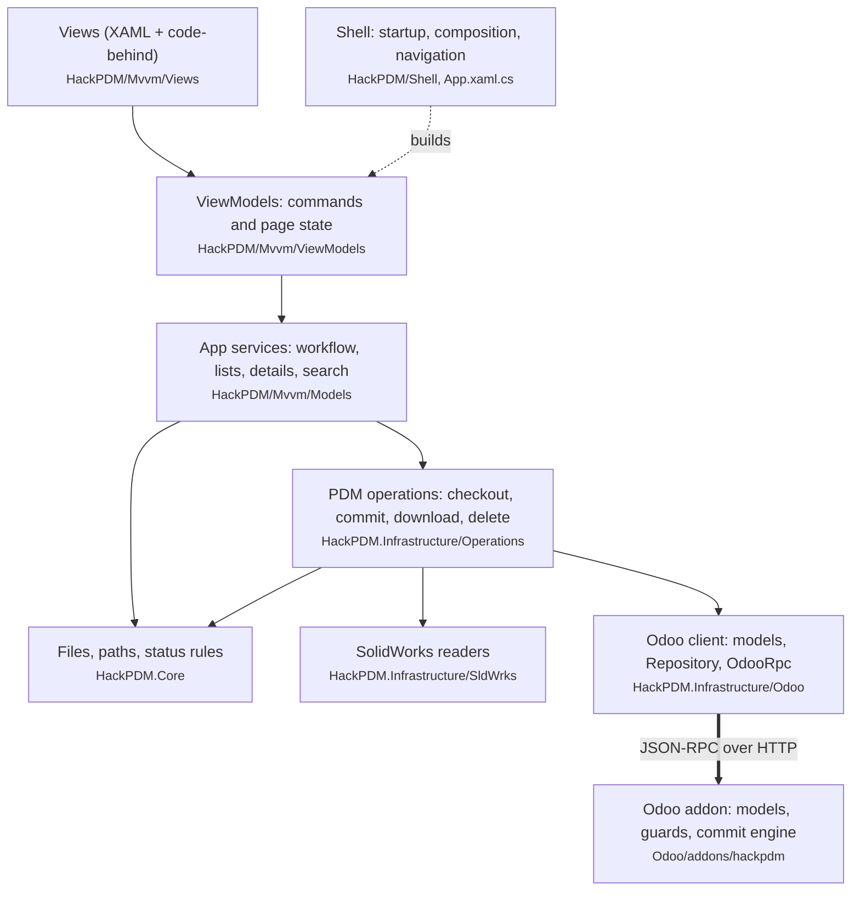

# HackPDM function map

What each part of HackPDM is responsible for, and the functions that do the work. Read this first; then follow an action call by call in [CALL_TREES.md](CALL_TREES.md) / [CALL_GRAPHS.md](CALL_GRAPHS.md), or see which classes talk to which in [CLASS_GRAPH.md](CLASS_GRAPH.md).

## Contents

- [The layers](#the-layers)
- [Life of the three main actions](#life-of-the-three-main-actions): [commit](#commit-check-in), [get latest](#get-latest), [check out](#check-out)
- Client sections
  1. [Startup and shell](#1-startup-and-shell)
  2. [Login, profiles and credentials](#2-login-profiles-and-credentials)
  3. [File manager page](#3-file-manager-page)
  4. [PDM workflow service](#4-pdm-workflow-service)
  5. [PDM operations (Infrastructure)](#5-pdm-operations-infrastructure)
  6. [Odoo client](#6-odoo-client)
  7. [Files, paths and status (Core)](#7-files-paths-and-status-core)
  8. [SolidWorks files](#8-solidworks-files)
  9. [Search, settings and tools](#9-search-settings-and-tools)
  10. [Support libraries](#10-support-libraries)
- Server
  11. [Odoo addon](#11-odoo-addon)
- [Where to change things](#where-to-change-things)

## The layers

| Project | Responsibility |
|---|---|
| `HackPDM` | The desktop app: views, view models, app services, startup. Runs on Windows (WinUI) and Linux/macOS (Uno + Skia). |
| `HackPDM.Infrastructure` | Everything that talks to the outside: the Odoo JSON-RPC client and its models, the PDM operations, SolidWorks file readers, OS credential stores. |
| `HackPDM.Core` | Rules with no I/O to the server: working-folder paths, `HackFile`, checksums, file status, writing downloaded files, settings storage. |
| `HackPDM.Domain` | Interfaces for the Odoo models and settings (`IHpEntryModel`, `IOdooDefaults`, …) and small shared types. |
| `HackPDM.Shared`, `HackPDM.Abstractions` | netstandard2.0 helpers: Odoo attributes and enums, `BiMap`, `Except`, ring buffer. |
| `HackPDM.SchemaGenerator` | Roslyn source generator: turns each `[OdooModel]`/`[OdooProp]` class into the read map and `ToOdoo()` code. |
| `Odoo/addons/hackpdm` | The server: data model (folders, files, versions, dependencies, properties, commits), access guards, the commit engine, and the RPC methods the client calls. |

## Life of the three main actions

### Commit (check in)

| Step | Function | What happens |
|---|---|---|
| 1 | `HackFileManagerViewModel.CommitSelectedCommand` | The toolbar button. `CommitDirectoryCommand` does the same for a folder. |
| 2 | `PdmWorkflowService.CollectCommitFilesAsync` → `DependencyScanner.GetHackFileWithDependencies` | Gathers the selected files plus every local file a SolidWorks file references. |
| 3 | `PdmCommitOperations.FilterCommitHackFilesAsync` | Drops names the server would refuse, then sorts files into new entries, changed versions and unchanged files. |
| 4 | `HpPDMCommit.CreateCommitAsync` → `hp.pdm.commit.create` | Opens a commit owned by this computer (node). |
| 5 | `PdmCommitOperations.CommitRecordAsync`, once per file | Creates missing folders (`CreateDirectoriesAsync`), then stages the entry (`CommitStaging.StageEntryAsync`) and the version with its contents and preview (`StageVersionAsync`). For SolidWorks files it also stages the dependency links (`StageRelationshipsAsync`) and custom properties (`StagePropertiesAsync`). Staging writes `hp.record.staged` rows; nothing real is created yet. |
| 6 | `HpPDMCommit.ServerCommit` → `hp.pdm.commit.start_commit` | The server's `run_commit_job` turns every staged row into a real record in one transaction. On failure, `handle_commit_failure` marks the commit errored and drops its rows; the client calls `ServerClear` (`clear_commit`) on its own failures. |
| 7 | `CheckInUnchangedAsync` | Releases the checkout of files that were checked out but not changed. |

### Get latest

| Step | Function | What happens |
|---|---|---|
| 1 | `GetLatestSelectedCommand` / `GetLatestDirectoryCommand` | Folder commands first list the entry ids with `HpDirectory.GetDirectoryEntryIDsAsync` (`get_all_entry_ids`). |
| 2 | `PdmWorkflowService.ExpandWithDependenciesAsync` → `hp.version.get_recursive_dependency_entries` | Adds every file the selection depends on. |
| 3 | `PdmDownloadOperations.GetLatestVersionsAsync` → `related_browse` | Reads each entry's latest version (metadata only). |
| 4 | `PdmDownloadOperations.BatchBySize` + `ProcessDownloadsAsync` | Splits into batches by count and bytes, and downloads a few batches in parallel. |
| 5 | `ProcessVersionBatchAsync` → `LocalFileWriter.WriteAsync` | Reads `file_contents` (base64), skips files whose local copy already matches (`Checksums.MatchesLocalCopy`), keeps local edits (`HasLocalChangesAsync`), writes the rest read-only with the server's date. |

### Check out

| Step | Function | What happens |
|---|---|---|
| 1 | `CheckoutSelectedCommand` → `PdmWorkflowService.CheckoutLatestAsync` | Gets the latest version of the files first, so you edit the newest copy. |
| 2 | `PdmCheckoutOperations.FilterCheckoutEntries` | Keeps entries that are not deleted and not checked out by anyone. |
| 3 | `CheckOutEntryAsync` → `hp.version.checkout_entry` | The server records the user, the computer and the time on the latest version, refusing if someone else holds it. |
| 4 | (same) | Makes the local file writable. Undo is `UnCheckOutEntryAsync`, which clears the fields and makes the file read-only again. |

## 1. Startup and shell

Starts the app, wires services together, and moves between pages. Folder: `HackPDM/App.xaml.cs`, `HackPDM/Shell`.

| Function | What it does |
|---|---|
| `HackApp.OnLaunched` | Creates the main window, initialises composition, loads settings and defaults, shows the home page, applies the theme, and starts the smoke test when requested. |
| `AppComposition.Initialize` / `InitializeDefaults` | Hooks the app to the UI thread and gives the Hack and Odoo defaults their settings store. The single place where services are created. |
| `AppComposition.CreateFileManager`, `CreateProfileManager`, `CreateHackSettings`, `CreateOdooSettings`, `CreateThemeEditor` | Build each page's view model per visit. |
| `AppComposition.Settings`, `Dialogs`, `JsonDraft` | Process-wide settings, dialog service and JSON-editor draft. |
| `AppSettingsStore.Open` | Opens `AppConfig.json`, importing the packaged defaults on first run. |
| `NavigationService.NavigateTo` | Switches the home page's frame to a page type. |
| `HomeView.Navigate` | Navigates and applies that page's saved window size. |
| `ThemeService.Attach`, `SetMode`, `SetColor`, `Save` | Light/dark mode and colour overrides. |
| `HackUpdater.EnsureUpdated` | Compares the app version with the one stored in Odoo's settings and offers the installer. |
| `SmokeTestRunner.Start` | With `HACKPDM_SMOKE_TEST=1`, drives the real UI (login, tree, list) for the CI gate. |

## 2. Login, profiles and credentials

Gets a logged-in session and remembers how to get it again. Folders: `HackPDM/Mvvm/ViewModels/Settings`, `HackPDM/Mvvm/Models/Settings`, `HackPDM.Infrastructure/Odoo`, `HackPDM.Infrastructure/Credentials`.

| Function | What it does |
|---|---|
| `ProfileManagerViewModel.LoginAsync` | The Login button: checks the server (`AbleToLoginAsync`), logs in, loads reference data, then opens the file manager. |
| `ProfileManagerViewModel.AbleToLoginAsync` | Pings the host (`OdooConnection.CorrectOdooAddress`), tests the port (`CorrectOdooPort`), and reports why login can't work. |
| `OdooDefaults.InitializeAsync` | Logs in if needed (`InitializeLoginAsync` → `OdooRpc.LoginAsync`), then loads every lookup table (`OdooLookupCache.LoadAsync`). |
| `OdooLookupCache.LoadAsync` | Reads users, types, categories, properties, name filters and settings once into dictionaries (`ExtToType`, `IdToUser`, …). |
| `OdooDefaults.SaveCredentials` | Stores the user name and password in the OS keychain. |
| `CrossPlatformCredentialManager.ReadCredential` / `WriteCredential` / `DeleteCredential` | Windows Credential Manager, macOS Keychain, or Linux Secret Service, with a fallback file when none exists. |
| `ProfileStore.ReadAsync` / `WriteAsync` / `Apply` / `Current` | Load and save a login profile as JSON, optionally without the password. |
| `LoginSession.LoggedInAs` | Remembers which account is logged in, so the file manager's cached state is reset when it changes. |

## 3. File manager page

The main screen: folder tree, file list, details tabs and preview. Folders: `HackPDM/Mvvm/Views/Hack`, `HackPDM/Mvvm/ViewModels/Hack`, `HackPDM/Mvvm/Models/Hack`.

| Function | What it does |
|---|---|
| `HackFileManagerViewModel.Initialize` | Loads the Odoo metadata the page needs. |
| `HackFileManagerViewModel.LoadDirectoryTreeAsync` → `DirectoryTreeService.LoadAsync` | Builds the folder tree from `get_children_directories_by_id`, merged with local folders. Reuses the cached tree unless it is stale. |
| `HackFileManagerViewModel.LoadEntriesAsync` → `EntryListService.LoadAsync` | Lists a folder: server entries (`get_entries`) joined with local files, each given a status by `EntryStatusResolver`. |
| `HackFileManagerViewModel.ShowEntryDetailsAsync` → `EntryDetailsService.GetHistoryAsync`, `GetParentsAsync`, `GetChildrenAsync`, `GetPropertiesAsync`, `GetVersionInfoAsync`, `GetPreviewImageAsync` | Fills the detail tab that is showing and the preview. A newer selection cancels the older load. |
| `HackFileManagerViewModel.ApplyLocalChangesAsync` | Updates only the rows of files that changed on disk. |
| `HackFileManagerViewModel.SortEntries`, `GroupBy` | Sort and group the list (`EntryRowKeys`, `EntryListGrouping`). |
| `HackFileManagerViewModel.RefreshFromServer` | The refresh button. |
| `FileManagerState.RememberEntries` / `TryGetEntries` / `MarkStale` / `Reset` | Keeps the tree and the last folder's rows between visits so returning to the page is instant. |
| `LocalFileWatcher.Watch` + `LocalChangeBatcher.Add` / `TakeDue` | Watches the working folder and merges bursts of save events into one change per file. Lock and temporary files are ignored (`IsNoise`). |
| `EntryFileService.OpenEntriesAsync`, `OpenFile`, `OpenContainingFolders`, `DownloadVersionAsync`, `PlanMove` / `ExecuteMoveAsync`, `DeleteFiles` | Local file actions: open, show in folder, download a past version, move, delete local copies. |
| `HackFileManagerView` code-behind | Turns tree, list and tab events into view-model calls, and hosts the picture-in-picture preview (`PipWindow`). |

## 4. PDM workflow service

`PdmWorkflowService` (`HackPDM/Mvvm/Models/Hack`) is the bridge between the page's commands and the Infrastructure operations. Each method opens the status window, reports progress, and returns when the operation ends. View models only see `IPdmWorkflowService`.

| Function | What it does |
|---|---|
| `GetLatestAsync` | Get latest for entry ids, with their dependencies. |
| `CheckoutLatestAsync` / `CheckoutAsync` / `UnCheckoutAsync` | Check out (after getting latest) and undo a checkout. |
| `CollectCommitFilesAsync` / `CollectFolderCommitFilesAsync` | Gather the files a commit will contain. |
| `CommitAsync` | The commit sequence described [above](#commit-check-in). |
| `LogicalDeleteAsync` / `RestoreDeletedInDirectoryAsync` / `PermanentDeleteAsync` | Mark deleted, restore, or remove from the server for good. |
| `PlanVersionDownloadAsync` / `DownloadVersionsAsync` | Download past versions (with or without dependencies) to a temporary or working folder. |
| `GetDirectoryEntryIdsAsync`, `PreloadMetadata` | Helpers for folder commands. |

Progress and messages go through `IOperationReporter`, which `StatusWindowReporter` implements with the status window (`StatusDialogViewModel`: log lists, progress bar, cancel).

## 5. PDM operations (Infrastructure)

The actual work against the server and the disk, with no UI. Folder: `HackPDM.Infrastructure/Operations`.

| Class | Key functions | Responsibility |
|---|---|---|
| `PdmCheckoutOperations` | `CheckOutEntriesAsync`, `CheckOutEntryAsync`, `UnCheckOutEntriesAsync`, `UnCheckOutEntryAsync`, `FilterCheckoutEntries`, `FilterUnCheckoutEntries` | Check out and release files; toggle the local read-only flag. |
| `PdmCommitOperations` | `FilterCommitHackFilesAsync`, `FilesNotInOdooSegmentedAsync`, `CommitRecordAsync`, `CreateDirectoriesAsync`, `IsFilteredName` | Decide what a commit contains and stage each file. |
| `CommitStaging` | `NewEntry`, `FindRemoteEntryAsync`, `StageEntryAsync`, `PrepareVersion`, `StageVersionAsync`, `StageRelationshipsAsync`, `StagePropertiesAsync` | Build the staged rows for entries, versions, dependency links and SolidWorks properties. |
| `PdmDownloadOperations` | `GetLatestVersionsAsync`, `GetAllEntriesAndDependenciesListAsync`, `GetVersionListAsync`, `BatchBySize`, `ProcessDownloadsAsync`, `ProcessVersionBatchAsync`, `ContentsTimeoutMs` | Work out what to download, then download in size-limited parallel batches while keeping local edits. |
| `PdmDeleteOperations` | `SetDeletedAsync`, `PermanentDeleteEntry`, `PermanentDeleteVersions`, `PermanentDeleteVersionProperty`, `PermanentDeleteVersionRelationships` | Logical delete and restore, and permanent delete of entries with their versions, properties, links and stored files. |
| `VersionFileService` | `DownloadContentsAsync`, `DownloadFileAsync`, `DownloadAllAsync`, `GetPreviewImage`, `GetVersionFromLocal`, `MoveFile` | Single-version file transfer: contents, preview and the local copy of a past version. |

## 6. Odoo client

Talks to the server. Folder: `HackPDM.Infrastructure/Odoo`.

| Class | Key functions | Responsibility |
|---|---|---|
| `OdooTransport` | `SendJsonAsync` | One HTTP POST of a JSON-RPC request, with timeouts. Detects servers that close connections. |
| `OdooRpc` | `CallAsync`, `ExecuteAsync`, `LoginAsync`, `SearchAsync`, `ReadAsync`, `SearchReadAsync`, `CreateAsync`, `CreateManyAsync`, `WriteAsync`, `UnlinkAsync`, `Convert` | The typed Odoo verbs. Every call returns a `Result<T>` instead of throwing. |
| `Result<T>` | `Ok`, `Error`, `ValueOr`, `Unwrap`, `Map` | A value or the reason the call failed. |
| `OdooDomain` | `Where`, `IdIn`, `And`, `ToRpc` | Builds search filters (`[("name", "=", x), …]`). |
| `OdooValues` | `FromJson`, `ToRpc`, `Text`, `Int`, `RefId`, `RefIds` | Converts between JSON-RPC values and .NET, and reads fields from an `OdooRow`. |
| `Repository<T>` | `ReadAsync`, `SearchReadAsync`, `SmartReadAsync`, `RelatedAsync`, `Populate` | Reads rows and fills typed model objects through the generated assignment maps. |
| `HpBaseModelTransport<T>` | `CreateAsync`, `StageRecAsync`, `MultiStageAsync`, `WriteChangedValuesAsync`, `GetRecordsByIdsAsync`, `GetRelatedRecordByIdsAsync`, `ToOdoo`, `GetHpModel` | Base class of every model (`HpEntry`, `HpVersion`, `HpDirectory`, …): create, stage, write and read one model. |
| `HpDirectory` | `GetSubdirectoriesAsync`, `GetEntriesAsync`, `GetDirectoryEntryIDsAsync`, `LastAvailableDirectory`, `CreateNew` | Folder-specific server calls. |
| `HpPDMCommit` | `ServerCommit`, `ServerClear` | Run or discard a commit on the server. |
| `HpEntry`, `HpVersion`, `HpVersionProperty` | `CanCheckOut`, `CanUnCheckOut`, `IsText`, `IsNumber`, … | Model-specific rules. |
| `OdooDefaults` / `OdooLookupCache` | see [section 2](#2-login-profiles-and-credentials) | The session and reference data. |
| `SchemaGenerator` (separate project) | `OdooAssignments_<Model>.Map`, `ToOdoo` | Generated at build time from the `[OdooProp]` attributes, so reads and writes need no reflection. |

## 7. Files, paths and status (Core)

Rules about local files that don't need the server. Folder: `HackPDM.Core`.

| Class | Key functions | Responsibility |
|---|---|---|
| `PwaPaths` | `ToAbsolute`, `ToRelative`, `ToServerName`, `ToServerDirectory`, `LocalSegments`, `IsInside`, `FolderOf` | Converts between the three path forms: local (`C:\vault\a\b.sldprt`), server name (`root\a\b.sldprt`) and server folder (`root / a`). Keeps paths inside the working folder. |
| `HackFile` | `GetFromPath`, `GetChecksum`, `SetModifiedDate` | One file, local and/or remote, with its status data. |
| `Checksums` | `OfFile`, `Matches`, `MatchesLocalCopy` | SHA-1 in the server's form; decides whether a download is needed. |
| `LocalFileWriter` | `WriteAsync`, `LocalTargetPath` | Writes downloaded bytes safely: stays inside the working folder, lifts read-only, checks the write. |
| `EntryStatusResolver` | `ResolveRemote`, `ResolveLocal` | The status codes (`ro`, `lo`, `nv`, `cm`, `co`, `lm`, `dt`, …). |
| `FileStatusPolicy` | `ForOpen`, `ForLatestRemote`, `ForLatestLocal`, `CanUploadIcon` | Which actions a status allows. |
| `DirectoryNode` / `DirectoryTreeMerger` | `FindChild`, `SortRecursive` | The folder tree, independent of the UI control. |
| `JsonFileSettingsProvider` / `CoreSettings` | `Get`, `Set`, `Contains`, `Remove` | Settings stored in `AppConfig.json`. |
| `ShellLauncher` | | Opens files and folders with the OS. |
| `AsyncHelper` | `WaitUntil`, `AsyncRunner` | Polling waits with timeout and cancellation. |

## 8. SolidWorks files

Reads references, properties and previews from SolidWorks files. Folders: `HackPDM.Infrastructure/SldWrks`, `HackPDM.Infrastructure/Hack`.

| Class | Key functions | Responsibility |
|---|---|---|
| `SwFileReader` | `GetReferences`, `GetDependencies`, `GetProperties`, `ReadProperties`, `GetPreviewPng` | Reads the file format directly (OLE streams), so it works on every OS without SolidWorks installed. |
| `SwStreamStore`, `OlePropertySet`, `ConfigHeaderReader` | | Low-level readers of the compound file, property sets and configuration names. |
| `SwDocMgr` | `GetDependencies`, `GetProperties` | The licensed SolidWorks Document Manager (COM, Windows only), used when a licence key is configured. |
| `SolidWorksUtil.DocMgr` | | Picks the reader: Document Manager on Windows with a key, otherwise `SwFileReader`. |
| `SwReferenceResolver` | `Resolve`, `Segments`, `FileName` | Maps a reference stored in a file (often another computer's path) to the local file. |
| `SwDependencies` | `Of` | References of a file, each resolved. |
| `DependencyScanner` | `GetHackFileWithDependencies`, `GetHackFolderWithDependenciesAsync` | Walks references recursively to collect everything a commit needs (`HackResultTree`). |
| `SwDocumentTypes` | `IsSolidWorks`, `Of` | `.sldprt`, `.sldasm`, `.slddrw` by extension. |

## 9. Search, settings and tools

| Area | Key functions | Responsibility |
|---|---|---|
| Search (`SearchOdooViewModel`, `EntrySearchService`) | `SearchAsync`, `BuildDomainAsync`, `GetSearchableProperties`; commands `CheckoutAsync`, `OpenAsync`, `LocateAsync` | Find files by name, flags and property values, then act on them or locate them in the file manager. |
| Odoo / Hack settings (`OdooSettingsViewModel`, `HackSettingsViewModel`) | `SubmitAsync` | Edit the server connection and the local working-folder settings. |
| Status window (`StatusDialogViewModel`, `StatusWindowReporter`) | `AddLog`, `ResetProgress`, `Advance`, `CompleteProgress`, `ConfirmCloseAsync` | Shows the progress, log and errors of a running operation, and lets you cancel it. |
| JSON editor (`JsonEditorViewModel`, `AppConfigJsonService`) | `LoadText`, `ToJson`, `Save`, `Keep` | Edit `AppConfig.json` as a tree or text. |
| Theme editor (`ThemeEditorViewModel`, `ThemeService`) | `Save`, `Revert`, `ResetSelected`, `ResetAll` | Colour overrides for the app theme. |
| Dialogs (`DialogService`, `FilePickerService`) | `ShowMessageAsync`, `ConfirmAsync`, `ShowStatusWindow`, `PickOpenFileAsync` | Dialogs and file pickers behind interfaces, so view models stay testable. |

## 10. Support libraries

| Class | Responsibility |
|---|---|
| `BiMap<TKey, TValue>` | Two-way dictionary (key → value and value → key). |
| `ConcurrentSet<T>` | Thread-safe set. |
| `ObservableRingBuffer<T>` | Fixed-size observable list for log lines. |
| `Except` | Fluent argument guards. |
| `OperatorConverter`, Odoo enums (`HackPDM.Shared`) | Search operators and field types shared with the source generator. |

## 11. Odoo addon

The server: `Odoo/addons/hackpdm`. Every model inherits `hp.common.model`. Normal users are limited by the guards in `hp_guard` and the overrides of `create`/`write`; administrators (`is_pdm_admin`) may bypass them.

### Data model

| Model | Holds |
|---|---|
| `hp.directory` | Folders, as a tree (`parent_id`, `complete_name`). Names are unique per folder, ignoring case. |
| `hp.entry` | One file in a folder: name, type, category, `latest_version_id`, deleted flag. Checkout fields are related to the latest version. |
| `hp.version` | One saved version of a file: contents (attachment), checksum, size, preview, `node_id` (the computer that committed it), dependency links (`parent_ids`/`child_ids`), and checkout user/node/date. Committed versions can't be changed by regular users. |
| `hp.version.property` | SolidWorks custom properties per version and configuration. |
| `hp.pdm.commit` + `hp.record.staged` | A commit and its staged rows, which become real records together. |
| `hp.node` | A client computer. |
| `hp.type`, `hp.category`, `hp.property`, `hp.entry.name.filter`, `hp.user`, `hp.settings` | Reference data the client caches at login. |
| `hp.release`, `hp.release.review` | Release/review workflow. The client has the model classes (`HpRelease`, `HpReleaseReview`) but no screen that uses them yet. |

### RPC functions the client calls

| Function | Responsibility |
|---|---|
| `hp.pdm.commit.start_commit` → `run_commit_job` / `handle_commit_failure` | The commit engine: creates all staged records of a commit in one transaction, or marks it errored and removes its rows. |
| `hp.pdm.commit.clear_commit` | Discards a commit's staged rows (refused once committed). |
| `hp.record.staged.create` / `write` | Staging; a user can only stage into their own commit. |
| `hp.version.checkout_entry` / `checkout_entries` | Checks out to the caller and computer, refusing a file someone else holds or that is deleted. |
| `hp.version.create` / `write`, `hp.entry.write` | Guarded writes: only the holder of a checkout may add a version; checkout fields only change through checkout and undo. |
| `hp.version.get_recursive_dependency_entries` / `_versions` | Everything a set of files or versions depends on, recursively. |
| `hp.directory.get_children_directories_by_id` | The folder tree below a folder, in one call. |
| `hp.directory.get_entries`, `get_all_entry_ids`, `last_available_directory` | Folder listings and path lookups. |
| `hp.common.model.smart_read` / `related_browse` / `fast_read` / `create_read` | Generic reads for every model: dotted field paths, following relations, create-and-read in one call. |
| Standard ORM: `search`, `read`, `search_read`, `create`, `write`, `unlink` | Through `OdooRpc`, for every `hp.*` model, under Odoo's access rules. |

### Guards (`hp_guard.py`)

| Function | Responsibility |
|---|---|
| `is_pdm_admin` / `require_admin` | Who may bypass the user-level rules, and which maintenance jobs are admin-only. |
| `check_name` / `name_problem` | Refuse file and folder names that are unsafe as a path segment. |
| `create_case_insensitive_unique_index` | Unique names per folder ignoring case, so two clients can't both create `Part.SLDPRT` and `part.sldprt`. |

### Admin and migration (one-off)

`migrate_webdav_files_to_records`, `migrate_image_from_database`, `display_all_fnames`, `cleanup_filestore`: imports from the previous HackPDM storage (WebDAV and the old database). Administrators only.

## Where to change things

| To change… | Start in |
|---|---|
| A toolbar or context-menu action | `HackFileManagerViewModel` command → `PdmWorkflowService` |
| What a commit contains or how it is staged | `PdmCommitOperations`, `CommitStaging` |
| What may be committed, checked out or changed | The addon's `create`/`write` overrides and `hp_guard`; mirror the client checks in `PdmCheckoutOperations` / `FileStatusPolicy` |
| How a status icon is chosen | `EntryStatusResolver` |
| How downloads are batched or kept | `PdmDownloadOperations` |
| A new field on a model | The addon model, then add an `[OdooProp]` property to the C# model (the generator does the rest) |
| SolidWorks reference or property reading | `SwFileReader`, `SwReferenceResolver` |
| Path conversions | `PwaPaths` |
| Startup or service wiring | `HackApp.OnLaunched`, `AppComposition` |
