# HackPDM call graphs

The call trees of [CALL_TREES.md](CALL_TREES.md) drawn as Mermaid flowcharts: every starting action in HackPDM, and what it calls. A starting action is a UI command or event handler, app startup, the file watcher, or an RPC method on the Odoo server. Each one is a graph, read left to right, with its numbered notes under it. The graphs render on GitHub, GitLab, in VS Code's Markdown preview and in most Markdown viewers that support Mermaid.

## How to read a graph

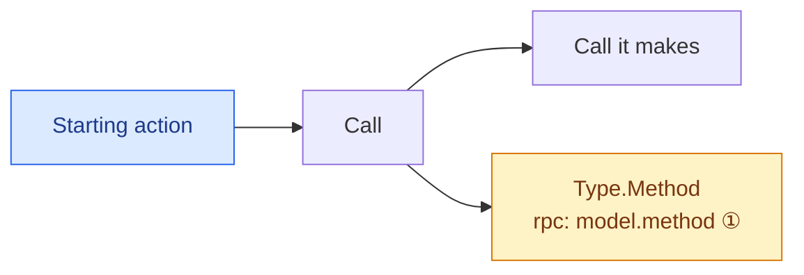

- Blue: the starting action. Amber: a call that reaches the Odoo server (`rpc:` names the server method; look it up in [Odoo server (RPC)](#odoo-server-rpc) to see what it does next).
- A graph goes at most two calls deep below its start. Branches are drawn top to bottom in call order.
- `Type.Method` is a call into another type; a bare `Method` is on the same class as its caller. A call through an interface names the type that implements it.
- ① ② … point to the note with that number below the graph: when the branch runs, or how it behaves.
- Logging, progress reporting, property reads and UI-thread marshaling are left out.

## Contents
- **[App, login, search and settings](#app-login-search-and-settings)**
  - [Startup](#startup): [Program.Main](#programmain) · [HackApp (ctor)](#hackapp-ctor) · [HackApp.OnLaunched](#hackapponlaunched) · [HackApp.Window_Closed](#hackappwindow_closed) · [SmokeTestRunner.RunAsync](#smoketestrunnerrunasync)
  - [Login & profiles](#login--profiles): [ProfileManagerViewModel.LoginAsync](#profilemanagerviewmodelloginasync) · [ProfileManagerViewModel.AbleToLoginAsync](#profilemanagerviewmodelabletologinasync) · [ProfileManagerViewModel.OpenSettings](#profilemanagerviewmodelopensettings) · [ProfileManagerViewModel.LoadProfileAsync](#profilemanagerviewmodelloadprofileasync) · [ProfileManagerViewModel.SaveProfileAsync](#profilemanagerviewmodelsaveprofileasync) · [ProfileManagerViewModel.SaveProfileWithoutPasswordAsync](#profilemanagerviewmodelsaveprofilewithoutpasswordasync) · [ProfileManagerViewModel.CreateTemplateAsync](#profilemanagerviewmodelcreatetemplateasync) · [HackUpdater.EnsureUpdated](#hackupdaterensureupdated) · [HackUpdater.UpdaterProcess](#hackupdaterupdaterprocess)
  - [Search](#search): [SearchOdooViewModel.SearchAsync](#searchodooviewmodelsearchasync) · [SearchOdooViewModel.Reset](#searchodooviewmodelreset) · [SearchOdooViewModel.AddPropertyAsync](#searchodooviewmodeladdpropertyasync) · [SearchOdooViewModel.DeleteProperties](#searchodooviewmodeldeleteproperties) · [SearchOdooViewModel.ResetProperties](#searchodooviewmodelresetproperties) · [SearchOdooViewModel.CheckoutAsync](#searchodooviewmodelcheckoutasync) · [SearchOdooViewModel.UndoCheckoutAsync](#searchodooviewmodelundocheckoutasync) · [SearchOdooViewModel.CheckoutAndOpenAsync](#searchodooviewmodelcheckoutandopenasync) · [SearchOdooViewModel.OpenAsync](#searchodooviewmodelopenasync) · [SearchOdooViewModel.LocateAsync](#searchodooviewmodellocateasync) · [SearchOdooView (ctor)](#searchodooview-ctor) · [SearchOdooView.OdooCancel_Click](#searchodooviewodoocancel_click) · [SearchOdooView.OdooSearchResults_DoubleTapped](#searchodooviewodoosearchresults_doubletapped)
  - [Settings & theme](#settings--theme): [HackSettingsViewModel.SubmitAsync](#hacksettingsviewmodelsubmitasync) · [OdooSettingsViewModel.SubmitAsync](#odoosettingsviewmodelsubmitasync) · [ThemeEditorViewModel.OnSelectedModeIndexChanged](#themeeditorviewmodelonselectedmodeindexchanged) · [ThemeEditorViewModel.ResetSelected](#themeeditorviewmodelresetselected) · [ThemeEditorViewModel.ResetAll](#themeeditorviewmodelresetall) · [ThemeEditorViewModel.Save](#themeeditorviewmodelsave) · [ThemeEditorViewModel.Revert](#themeeditorviewmodelrevert) · [ThemeEditorView.Picker_ColorChanged](#themeeditorviewpicker_colorchanged) · [ThemeEditorView.ShowDialog_Click](#themeeditorviewshowdialog_click) · [ApplicationSettingsView.SettingsSections_SelectionChanged](#applicationsettingsviewsettingssections_selectionchanged)
  - [Status window](#status-window): [StatusWindowReporter.BeginOperation](#statuswindowreporterbeginoperation) · [StatusWindowReporter.Cancel](#statuswindowreportercancel) · [StatusWindowReporter.OnCancelled](#statuswindowreporteroncancelled) · [StatusWindowReporter.ShowWindow](#statuswindowreportershowwindow) · [StatusWindowReporter.Log](#statuswindowreporterlog) · [StatusWindowReporter.SetTotal / Advance / SetProcessed / Complete](#statuswindowreportersettotal--advance--setprocessed--complete) · [StatusDialogViewModel.Cancel](#statusdialogviewmodelcancel) · [StatusDialogView.CmdCloseClick](#statusdialogviewcmdcloseclick) · [StatusDialogView.StatusSettings_Click](#statusdialogviewstatussettings_click) · [StatusDialogView.AppWindow_Closing](#statusdialogviewappwindow_closing)
  - [JSON editor & tools](#json-editor--tools): [JsonEditorViewModel.Load](#jsoneditorviewmodelload) · [JsonEditorView.OnExportJsonClick](#jsoneditorviewonexportjsonclick) · [JsonEditorView.OnAddChildClick](#jsoneditorviewonaddchildclick) · [JsonEditorView.OnDeleteNodeClick](#jsoneditorviewondeletenodeclick) · [JsonEditorView.OnViewModeChanged](#jsoneditorviewonviewmodechanged) · [JsonEditorView.OnNavigatedFrom](#jsoneditorviewonnavigatedfrom)
  - [Navigation](#navigation): [HomeView (ctor)](#homeview-ctor) · [NavigationService.NavigateTo](#navigationservicenavigateto) · [HomeView.HomeNavigator_SelectionChanged](#homeviewhomenavigator_selectionchanged) · [HomeView.Navigate](#homeviewnavigate) · [HomeView.HomeNavigator_BackRequested](#homeviewhomenavigator_backrequested) · [ProfileManagerView (ctor)](#profilemanagerview-ctor) · [ConfigurationView (ctor)](#configurationview-ctor) · [OdooSettingsView (ctor)](#odoosettingsview-ctor) · [HackSettingsView (ctor)](#hacksettingsview-ctor) · [ApplicationSettingsView (ctor)](#applicationsettingsview-ctor) · [ThemeEditorView (ctor)](#themeeditorview-ctor) · [JsonEditorView (ctor)](#jsoneditorview-ctor) · [HackFileManagerView.Search_Click](#hackfilemanagerviewsearch_click) · [PipWindow (ctor)](#pipwindow-ctor) · [PipWindow.OnExitPipClicked](#pipwindowonexitpipclicked)
- **[File manager](#file-manager)**
  - [Commands — commit/checkout/get latest](#commands--commitcheckoutget-latest): [CommitSelectedCommand](#commitselectedcommand) · [CommitDirectoryCommand](#commitdirectorycommand) · [GetLatestSelectedCommand](#getlatestselectedcommand) · [GetLatestDirectoryCommand](#getlatestdirectorycommand) · [GetLatestDirectoryTopCommand](#getlatestdirectorytopcommand) · [CheckoutSelectedCommand](#checkoutselectedcommand) · [CheckoutDirectoryCommand](#checkoutdirectorycommand) · [UndoCheckoutSelectedCommand](#undocheckoutselectedcommand) · [UndoCheckoutDirectoryCommand](#undocheckoutdirectorycommand)
  - [Commands — history versions](#commands--history-versions): [DownloadHistoryCommand](#downloadhistorycommand) · [DownloadHistoryToTempCommand](#downloadhistorytotempcommand) · [DownloadHistoryOverwriteCommand](#downloadhistoryoverwritecommand) · [OpenHistoryFromTempCommand](#openhistoryfromtempcommand) · [OpenHistoryOverwriteCommand](#openhistoryoverwritecommand) · [MoveHistoryToTempCommand](#movehistorytotempcommand) · [MoveHistoryToWorkingCommand](#movehistorytoworkingcommand) · [DownloadHistoryWithDependenciesCommand](#downloadhistorywithdependenciescommand)
  - [Commands — delete/restore](#commands--deleterestore): [LogicalDeleteSelectedCommand](#logicaldeleteselectedcommand) · [LogicalDeleteDirectoryCommand](#logicaldeletedirectorycommand) · [RestoreDirectoryCommand](#restoredirectorycommand) · [RestoreDirectoryRecursiveCommand](#restoredirectoryrecursivecommand) · [PermanentDeleteSelectedCommand](#permanentdeleteselectedcommand) · [LocalDeleteSelectedCommand](#localdeleteselectedcommand) · [LocalDeleteDirectoryCommand](#localdeletedirectorycommand)
  - [Commands — navigation & view](#commands--navigation--view): [GroupByCommand](#groupbycommand) · [OpenSelectedCommand](#openselectedcommand) · [OpenSelectedLatestRemoteCommand](#openselectedlatestremotecommand) · [OpenSelectedLatestLocalCommand](#openselectedlatestlocalcommand) · [OpenSelectedFoldersCommand](#openselectedfolderscommand) · [OpenDirectoryCommand](#opendirectorycommand) · [UploadIconCommand](#uploadiconcommand)
  - [View event handlers](#view-event-handlers): [OdooDirectoryTree_SelectionChanged](#odoodirectorytree_selectionchanged) · [OdooDirectoryTree_RightTapped](#odoodirectorytree_righttapped) · [OdooDirectoryBreadcrumb_ItemClicked](#odoodirectorybreadcrumb_itemclicked) · [TreeViewItem_Loaded](#treeviewitem_loaded) · [TreeViewItem_Unloaded](#treeviewitem_unloaded) · [OdooEntryList_SelectionChanged](#odooentrylist_selectionchanged) · [VersionTabs_SelectionChanged](#versiontabs_selectionchanged) · [OdooEntryList_Sorting](#odooentrylist_sorting) · [OdooHistory_SelectionChanged](#odoohistory_selectionchanged) · [OdooParents_DoubleTapped](#odooparents_doubletapped) · [OdooChildren_DoubleTapped](#odoochildren_doubletapped) · [Refresh_Click](#refresh_click) · [Search_Click](#search_click) · [ManageTypes_Click](#managetypes_click) · [Anchor_Checked](#anchor_checked) · [OnTogglePipClicked](#ontogglepipclicked) · [OnPipWindowClosed](#onpipwindowclosed) · [OnViewModelPropertyChanged](#onviewmodelpropertychanged) · [OnRefreshRequested](#onrefreshrequested) · [OnTreeLoadedAsync](#ontreeloadedasync) · [OnFolderChanged](#onfolderchanged) · [OnRowReplaced](#onrowreplaced) · [OnGroupingChanged](#ongroupingchanged)
  - [File watcher](#file-watcher): [FileSystemWatcher.Created](#filesystemwatchercreated) · [FileSystemWatcher.Changed](#filesystemwatcherchanged) · [FileSystemWatcher.Deleted](#filesystemwatcherdeleted) · [FileSystemWatcher.Renamed](#filesystemwatcherrenamed) · [FileSystemWatcher.Error](#filesystemwatchererror) · [LocalFileWatcher.Flush](#localfilewatcherflush) · [FileManagerState.LocalFilesChanged](#filemanagerstatelocalfileschanged) · [HackFileManagerViewModel.OnLocalFilesChanged](#hackfilemanagerviewmodelonlocalfileschanged) · [HackFileManagerViewModel.ApplyLocalChangesAsync](#hackfilemanagerviewmodelapplylocalchangesasync) · [HackFileManagerViewModel.OnLocalChangesLost](#hackfilemanagerviewmodelonlocalchangeslost)
  - [Load and selection](#load-and-selection): [HackFileManagerView (ctor)](#hackfilemanagerview-ctor) · [HackFileManagerViewModel (ctor)](#hackfilemanagerviewmodel-ctor) · [OnNavigatedTo](#onnavigatedto) · [LoadHackMan](#loadhackman) · [HackFileManagerViewModel.LoadDirectoryTreeAsync](#hackfilemanagerviewmodelloaddirectorytreeasync) · [LoadAndRestoreAsync](#loadandrestoreasync) · [EntryListService.LoadAsync](#entrylistserviceloadasync) · [HackFileManagerViewModel.ShowEntryDetailsAsync](#hackfilemanagerviewmodelshowentrydetailsasync) · [HackFileManagerViewModel.PreviewVersionAsync](#hackfilemanagerviewmodelpreviewversionasync) · [OnShowInactiveChanged](#onshowinactivechanged) · [OnIsGroupingEnabledChanged](#onisgroupingenabledchanged) · [OdooDirectoryTree.Expanding](#odoodirectorytreeexpanding) · [OdooDirectoryTree.Collapsed](#odoodirectorytreecollapsed) · [OdooDirectoryTree.LostFocus](#odoodirectorytreelostfocus) · [OdooParents.SelectionChanged](#odooparentsselectionchanged) · [OdooChildren.SelectionChanged](#odoochildrenselectionchanged) · [OdooHistory.DoubleTapped](#odoohistorydoubletapped) · [EntryOpen.DoubleTapped](#entryopendoubletapped) · [EntryDelete.DoubleTapped](#entrydeletedoubletapped) · [TreeDownload.DoubleTapped](#treedownloaddoubletapped) · [TreeUndelete.DoubleTapped](#treeundeletedoubletapped) · [HistoryDownload.DoubleTapped](#historydownloaddoubletapped) · [HistoryMove.DoubleTapped](#historymovedoubletapped) · [OnNavigatedFrom](#onnavigatedfrom)
- **[Odoo server (RPC)](#odoo-server-rpc)**
  - [Commit](#commit): [hp.pdm.commit.start_commit](#hppdmcommitstart_commit) · [hp.pdm.commit.clear_commit](#hppdmcommitclear_commit) · [hp.pdm.commit.run_commit_job](#hppdmcommitrun_commit_job) · [hp.pdm.commit.handle_commit_failure](#hppdmcommithandle_commit_failure) · [hp.pdm.commit.write](#hppdmcommitwrite)
  - [Checkout](#checkout): [hp.version.checkout_entry](#hpversioncheckout_entry) · [hp.version.checkout_entries](#hpversioncheckout_entries)
  - [Entries & versions (create/write guards)](#entries--versions-createwrite-guards): [hp.entry.write](#hpentrywrite) · [hp.version.create](#hpversioncreate) · [hp.version.write](#hpversionwrite) · [hp.version.property.create](#hpversionpropertycreate) · [hp.version.property.write](#hpversionpropertywrite) · [hp.record.staged.create](#hprecordstagedcreate) · [hp.record.staged.write](#hprecordstagedwrite)
  - [Folders](#folders): [hp.directory.get_dir_id_for_filepath](#hpdirectoryget_dir_id_for_filepath) · [hp.directory.get_dir_id_for_parentpath](#hpdirectoryget_dir_id_for_parentpath) · [hp.directory.get_dir_ids_for_filepaths](#hpdirectoryget_dir_ids_for_filepaths) · [hp.directory.get_directories](#hpdirectoryget_directories) · [hp.directory.get_children_directories](#hpdirectoryget_children_directories) · [hp.directory.get_children_directories_by_id](#hpdirectoryget_children_directories_by_id) · [hp.directory.get_entries](#hpdirectoryget_entries) · [hp.directory.get_all_entry_ids](#hpdirectoryget_all_entry_ids) · [hp.directory.last_available_directory](#hpdirectorylast_available_directory) · [hp.directory.create_new_details](#hpdirectorycreate_new_details) · [hp.directory.create_new_directories](#hpdirectorycreate_new_directories)
  - [Dependencies](#dependencies): [hp.version.get_recursive_dependency](#hpversionget_recursive_dependency) · [hp.version.get_recursive_dependency_versions](#hpversionget_recursive_dependency_versions) · [hp.version.get_recursive_dependency_entries](#hpversionget_recursive_dependency_entries) · [hp.version.get_entries_from_children](#hpversionget_entries_from_children) · [hp.node.update_node_latest_versions](#hpnodeupdate_node_latest_versions)
  - [Reading helpers](#reading-helpers): [hp.common.model.smart_read](#hpcommonmodelsmart_read) · [hp.common.model.fast_read](#hpcommonmodelfast_read) · [hp.common.model.related_browse](#hpcommonmodelrelated_browse) · [hp.common.model.related_search_browse](#hpcommonmodelrelated_search_browse) · [hp.common.model.create_read](#hpcommonmodelcreate_read) · [hp.entry.checksum_nonmatches](#hpentrychecksum_nonmatches) · [hp.entry.checksum_list_nonmatches](#hpentrychecksum_list_nonmatches) · [hp.entry.first_helper](#hpentryfirst_helper)
  - [Admin & migration](#admin--migration): [hp.version.migrate_webdav_files_to_records](#hpversionmigrate_webdav_files_to_records) · [hp.common.model.migrate_webdav_files_to_records](#hpcommonmodelmigrate_webdav_files_to_records) · [hp.version.migrate_image_from_database](#hpversionmigrate_image_from_database) · [hp.version.display_all_fnames](#hpversiondisplay_all_fnames) · [hp.version.cleanup_filestore](#hpversioncleanup_filestore) · [hp.release.review.reviewer_decision](#hpreleasereviewreviewer_decision) · [hp.entry.init](#hpentryinit) · [hp.directory.init](#hpdirectoryinit)
  - [Client → server](#client--server)

## App, login, search and settings

### Startup

#### Program.Main

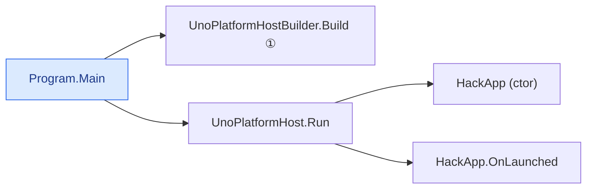

① app factory = new HackApp(); X11, framebuffer, macOS, Win32 hosts  

#### HackApp (ctor)

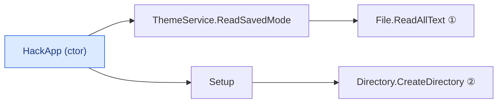

① AppConfig.json Theme.Mode; sets RequestedTheme Dark/Light  
② when the temp folder does not exist  

#### HackApp.OnLaunched

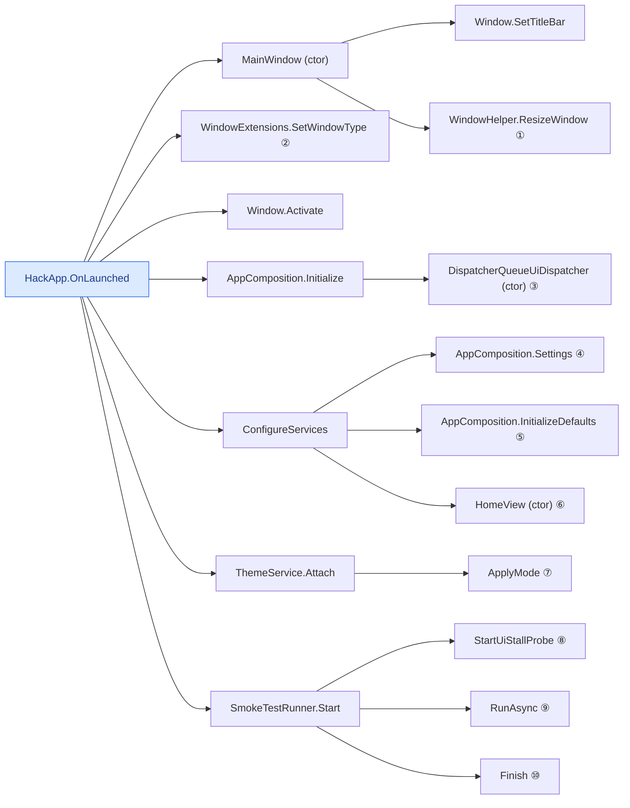

① Profile Manager size  
② Overlapped  
③ becomes UiDispatcher.Current  
④ first use: CoreSettings over AppSettingsStore.Open (settings.json, imports packaged LocalSettings once)  
⑤ registers HackDefaults.Instance / OdooDefaults.Instance on that store  
⑥ becomes the root frame's content; see Navigation  
⑦ first use of AppComposition.Theme: ThemeService (ctor) loads AppConfig.json via UIStorage.GlobalData, applies saved colors  
⑧ when HACKPDM_SMOKE_TEST=1  
⑨ posted to the UI thread  
⑩ writes smoke-report.json, Environment.Exit  

#### HackApp.Window_Closed

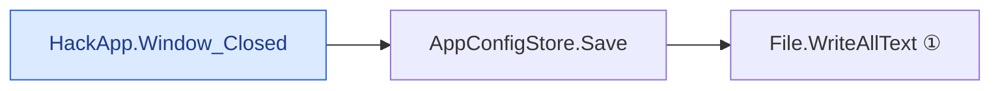

① AppConfig.json from the in-memory UIStorage.GlobalData  

#### SmokeTestRunner.RunAsync

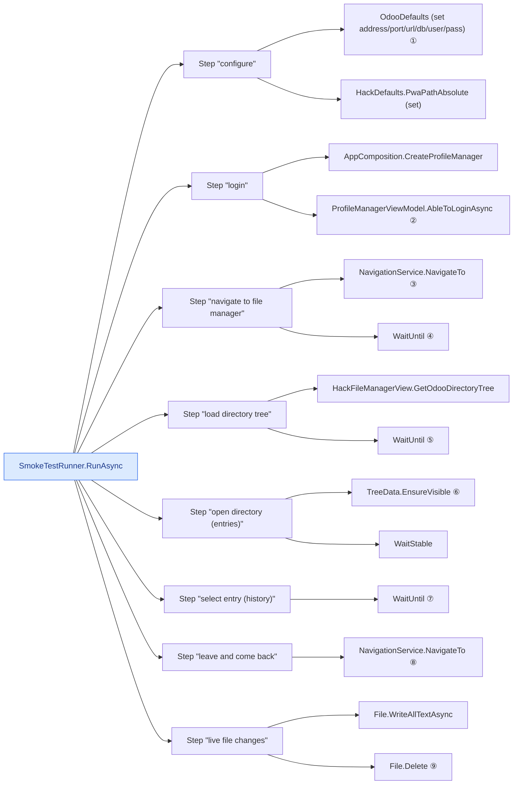

① from HACKPDM_ODOO_* env vars  
② same path as the Login button  
③ HackFileManager  
④ page loaded and window resized to its preset  
⑤ tree loaded from the server  
⑥ selection triggers the entry load  
⑦ history rows loaded  
⑧ ProfileManager, then HackFileManager; checks state was kept  
⑨ checks the watcher rebuilds one row and badges folders  

[↑ contents](#contents)

### Login & profiles

#### ProfileManagerViewModel.LoginAsync

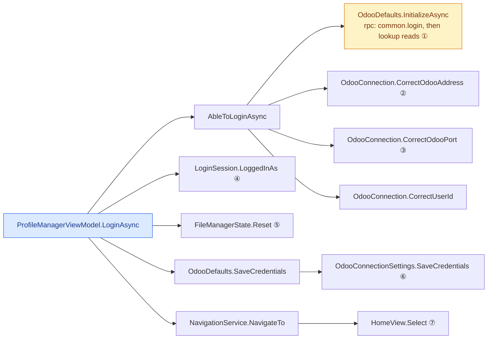

① skips common.login when a user id is already set; throws on a failed login  
② ICMP ping  
③ TCP connect  
④ this and the lines below: only after a successful login  
⑤ accountChanged callback: when server/db/user differ from the last login  
⑥ OS keychain via CrossPlatformCredentialManager.WriteCredential  
⑦ HackFileManager  

#### ProfileManagerViewModel.AbleToLoginAsync

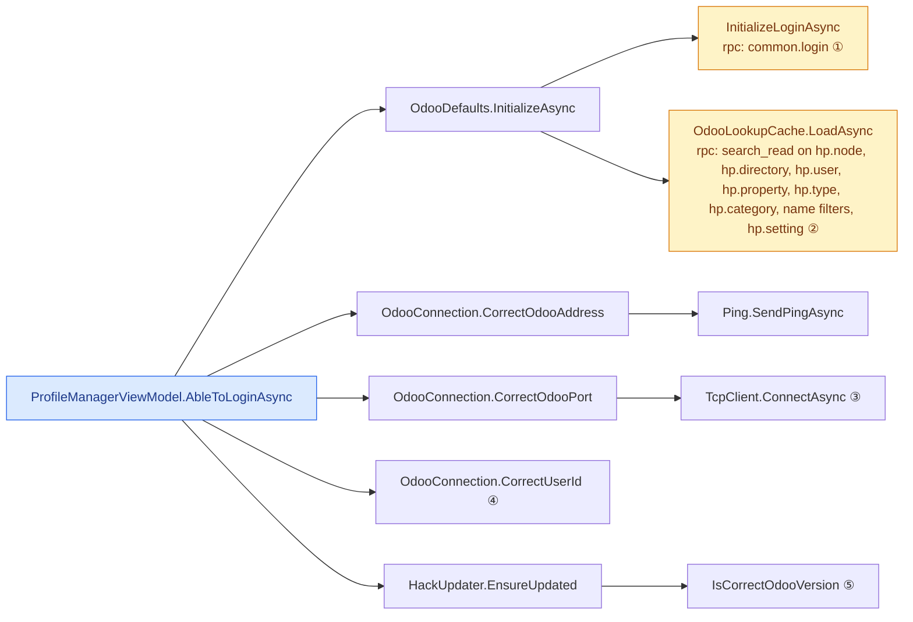

① only when OdooId is 0; a failed login throws, and AbleToLoginAsync returns false with no message  
② registers this machine as a node when missing  
③ 5 s timeout  
④ 1 = success; 0 adds "invalid odoo credentials"  
⑤ never reached: CorrectUserId always returns a status  

#### ProfileManagerViewModel.OpenSettings

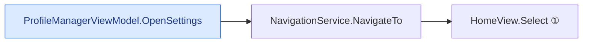

① Configuration  

#### ProfileManagerViewModel.LoadProfileAsync

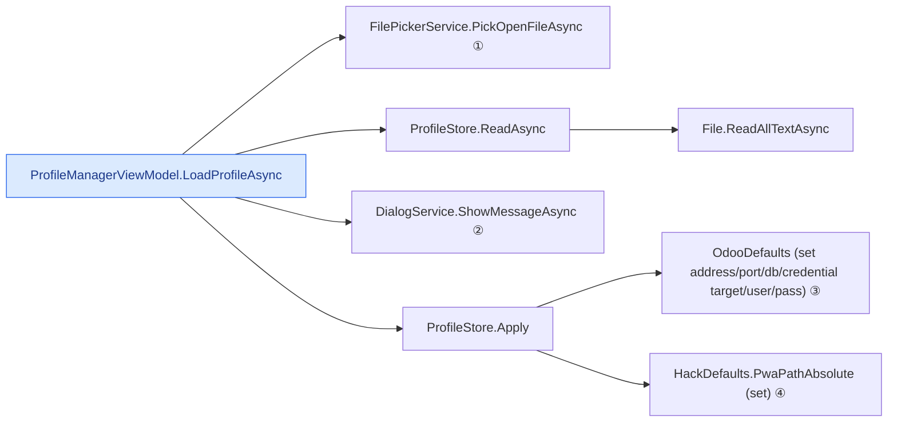

① .json  
② when the file is not a valid profile  
③ address/port/db saved to settings.json; user/pass in memory only  
④ settings.json  

#### ProfileManagerViewModel.SaveProfileAsync

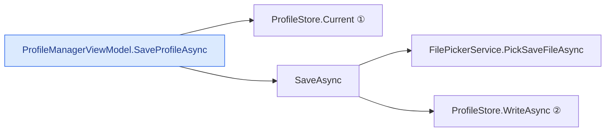

① includePassword: true  
② password written in plain text  

#### ProfileManagerViewModel.SaveProfileWithoutPasswordAsync

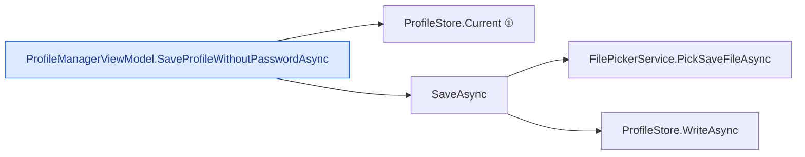

① includePassword: false  

#### ProfileManagerViewModel.CreateTemplateAsync

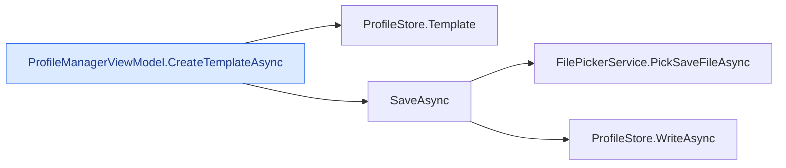

#### HackUpdater.EnsureUpdated

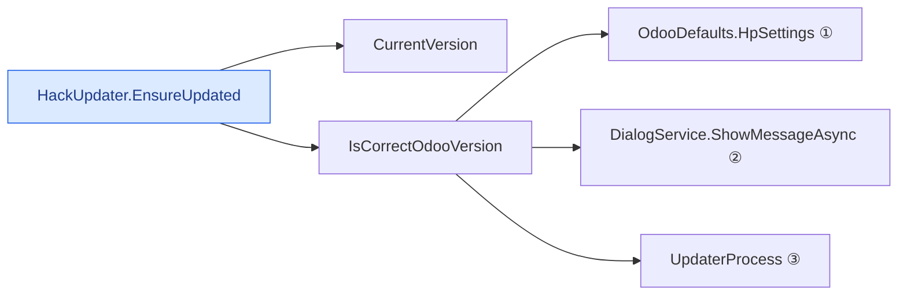

① cached hp.setting rows, no rpc  
② when versions differ and showOutdatedUpdater: Yes/No/Cancel  
③ when the user answers Yes  

#### HackUpdater.UpdaterProcess

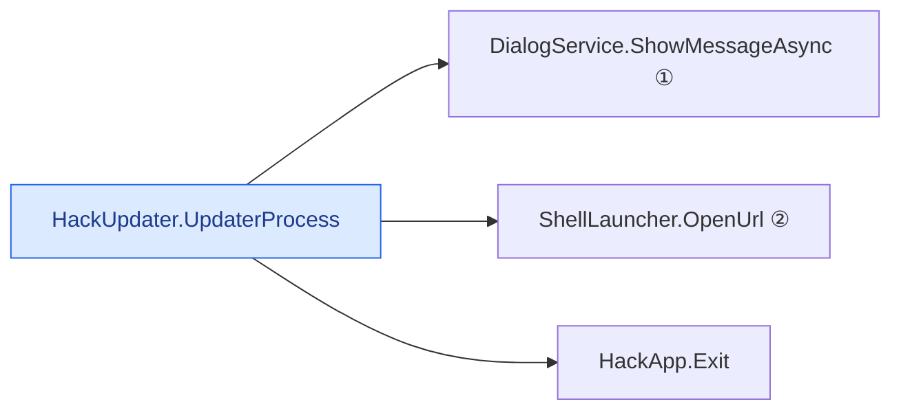

① not awaited  
② \\freedom\Engineering\hackpdm\setup.exe  

[↑ contents](#contents)

### Search

#### SearchOdooViewModel.SearchAsync

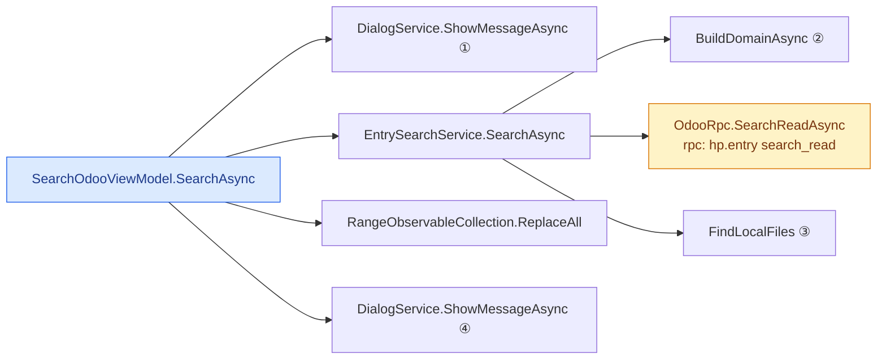

① when MaxResults is not a number  
② one hp.version.property search_read per property filter  
③ when LocalOnly or DeletedRemotely: scans the vault  
④ "No results found." or "Finished!"  

#### SearchOdooViewModel.Reset

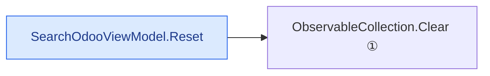

① results and property filters; form fields reset  

#### SearchOdooViewModel.AddPropertyAsync

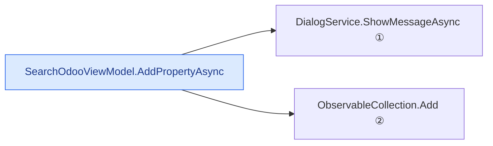

① when no property or operator is picked  
② PropertiesActive  

#### SearchOdooViewModel.DeleteProperties

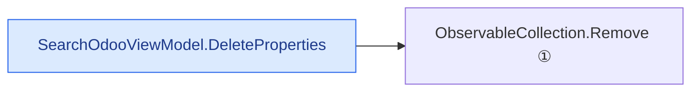

① selected PropertiesActive rows  

#### SearchOdooViewModel.ResetProperties

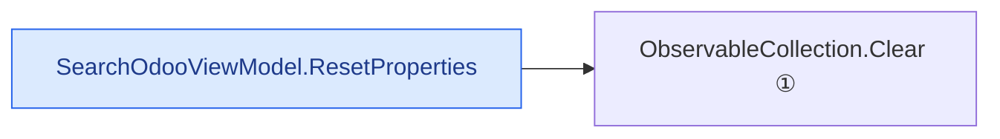

① PropertiesActive  

#### SearchOdooViewModel.CheckoutAsync

```mermaid
flowchart LR
  n0["SearchOdooViewModel.CheckoutAsync"]
  n1["SetCheckoutAsync"]
  n0 --> n1
  n2["DialogService.ShowMessageAsync ①"]
  n1 --> n2
  n3["RunOnIdsAsync ②"]
  n1 --> n3
  classDef start fill:#dbeafe,stroke:#2563eb,color:#1e3a8a
  classDef rpc fill:#fef3c7,stroke:#d97706,color:#78350f
  class n0 start
```

① when LocalOnly  
② runs PdmWorkflowService.CheckoutLatestAsync (get latest + checkout) in the status window; nothing when no remote ids  

#### SearchOdooViewModel.UndoCheckoutAsync

```mermaid
flowchart LR
  n0["SearchOdooViewModel.UndoCheckoutAsync"]
  n1["SetCheckoutAsync"]
  n0 --> n1
  n2["DialogService.ShowMessageAsync ①"]
  n1 --> n2
  n3["RunOnIdsAsync ②"]
  n1 --> n3
  classDef start fill:#dbeafe,stroke:#2563eb,color:#1e3a8a
  classDef rpc fill:#fef3c7,stroke:#d97706,color:#78350f
  class n0 start
```

① when LocalOnly  
② runs PdmWorkflowService.UnCheckoutAsync  

#### SearchOdooViewModel.CheckoutAndOpenAsync

```mermaid
flowchart LR
  n0["SearchOdooViewModel.CheckoutAndOpenAsync"]
  n1["SetCheckoutAsync"]
  n0 --> n1
  n2["RunOnIdsAsync ①"]
  n1 --> n2
  n3["OpenAsync"]
  n0 --> n3
  n4["EntryFileService.OpenLatestRemoteAsync ②"]
  n3 --> n4
  classDef start fill:#dbeafe,stroke:#2563eb,color:#1e3a8a
  classDef rpc fill:#fef3c7,stroke:#d97706,color:#78350f
  class n0 start
```

① PdmWorkflowService.CheckoutLatestAsync  
② when remote ids were checked out  

#### SearchOdooViewModel.OpenAsync

```mermaid
flowchart LR
  n0["SearchOdooViewModel.OpenAsync"]
  n1["EntryFileService.OpenLatestRemoteAsync"]
  n0 --> n1
  n2["HpEntry.GetRelatedRecordByIdsAsync<br/>rpc: hp.entry related_browse ①"]
  n1 --> n2
  n3["HpVersion.DownloadFileAsync<br/>rpc: hp.version read file_contents ②"]
  n1 --> n3
  n4["OpenFile"]
  n1 --> n4
  n5["EntryFileService.OpenFolder ③"]
  n0 --> n5
  classDef start fill:#dbeafe,stroke:#2563eb,color:#1e3a8a
  classDef rpc fill:#fef3c7,stroke:#d97706,color:#78350f
  class n0 start
  class n2,n3 rpc
```

① remote rows  
② to the system temp folder  
③ local rows  

#### SearchOdooViewModel.LocateAsync

```mermaid
flowchart LR
  n0["SearchOdooViewModel.LocateAsync"]
  n1["EntrySearchService.TreeSegmentsBelowRoot"]
  n0 --> n1
  n2["PwaPaths.LocalSegments ①"]
  n1 --> n2
  n3["AppComposition.LocateInFileManagerAsync"]
  n0 --> n3
  n4["FileManagerState.RequestLocateAsync"]
  n3 --> n4
  n5["NavigationService.NavigateTo ②"]
  n3 --> n5
  classDef start fill:#dbeafe,stroke:#2563eb,color:#1e3a8a
  classDef rpc fill:#fef3c7,stroke:#d97706,color:#78350f
  class n0 start
```

① local rows only  
② HackFileManager  

#### SearchOdooView (ctor)

```mermaid
flowchart LR
  n0["SearchOdooView (ctor)"]
  n1["AppComposition.SearchOdoo ①"]
  n0 --> n1
  n2["SearchOdooViewModel.LoadLookups"]
  n0 --> n2
  n3["EntrySearchService.GetSearchableProperties ②"]
  n2 --> n3
  classDef start fill:#dbeafe,stroke:#2563eb,color:#1e3a8a
  classDef rpc fill:#fef3c7,stroke:#d97706,color:#78350f
  class n0 start
```

① first use builds the run-wide SearchOdooViewModel  
② from cached OdooDefaults.IdToProp, no rpc  

#### SearchOdooView.OdooCancel_Click

```mermaid
flowchart LR
  n0["SearchOdooView.OdooCancel_Click"]
  n1["Frame.GoBack ①"]
  n0 --> n1
  n2["Window.Close ②"]
  n0 --> n2
  classDef start fill:#dbeafe,stroke:#2563eb,color:#1e3a8a
  classDef rpc fill:#fef3c7,stroke:#d97706,color:#78350f
  class n0 start
```

① when the frame can go back  
② otherwise: the search window  

#### SearchOdooView.OdooSearchResults_DoubleTapped

```mermaid
flowchart LR
  n0["SearchOdooView.OdooSearchResults_DoubleTapped"]
  n1["SearchOdooViewModel.LocateCommand"]
  n0 --> n1
  n2["LocateAsync"]
  n1 --> n2
  classDef start fill:#dbeafe,stroke:#2563eb,color:#1e3a8a
  classDef rpc fill:#fef3c7,stroke:#d97706,color:#78350f
  class n0 start
```

[↑ contents](#contents)

### Settings & theme

#### HackSettingsViewModel.SubmitAsync

```mermaid
flowchart LR
  n0["HackSettingsViewModel.SubmitAsync"]
  n1["Validate"]
  n0 --> n1
  n2["TryCreateDirectory ①"]
  n1 --> n2
  n3["TryCreateDirectory ②"]
  n1 --> n3
  n4["DialogService.ShowMessageAsync ③"]
  n0 --> n4
  n5["HackDefaults.PwaPathAbsolute (set)"]
  n0 --> n5
  n6["JsonFileSettingsProvider.Set ④"]
  n5 --> n6
  n7["HackDefaults.PwaPathRelative (set)"]
  n0 --> n7
  n8["StorageBox.TemporaryPath (set) ⑤"]
  n0 --> n8
  n9["DialogService.ShowMessageAsync ⑥"]
  n0 --> n9
  n10["Saved"]
  n0 --> n10
  n11["Window.Close ⑦"]
  n10 --> n11
  classDef start fill:#dbeafe,stroke:#2563eb,color:#1e3a8a
  classDef rpc fill:#fef3c7,stroke:#d97706,color:#78350f
  class n0 start
```

① PWA folder; created even when the other path fails  
② temp folder  
③ when a folder can't be created: nothing saved  
④ settings.json  
⑤ in memory only, not persisted  
⑥ "Hack settings saved"  
⑦ HackSettingsView: only when the page has its own window  

#### OdooSettingsViewModel.SubmitAsync

```mermaid
flowchart LR
  n0["OdooSettingsViewModel.SubmitAsync"]
  n1["DialogService.ShowMessageAsync ①"]
  n0 --> n1
  n2["OdooDefaults (set address/port/db/sw key/area factor)"]
  n0 --> n2
  n3["JsonFileSettingsProvider.Set ②"]
  n2 --> n3
  n4["OdooDefaults (set user/pass/url) ③"]
  n0 --> n4
  n5["DialogService.ShowMessageAsync ④"]
  n0 --> n5
  n6["Saved"]
  n0 --> n6
  n7["Window.Close ⑤"]
  n6 --> n7
  classDef start fill:#dbeafe,stroke:#2563eb,color:#1e3a8a
  classDef rpc fill:#fef3c7,stroke:#d97706,color:#78350f
  class n0 start
```

① when the area factor is not a decimal: nothing saved  
② settings.json  
③ in memory only; keychain gets user/pass on the next successful login; OdooId is not reset, so that Login skips common.login  
④ "Odoo settings saved"  
⑤ OdooSettingsView: only when the page has its own window  

#### ThemeEditorViewModel.OnSelectedModeIndexChanged

```mermaid
flowchart LR
  n0["ThemeEditorViewModel.OnSelectedModeIndexChanged"]
  n1["ThemeService.SetMode"]
  n0 --> n1
  n2["ApplyMode ①"]
  n1 --> n2
  n3["Refresh"]
  n0 --> n3
  n4["PublishSelected"]
  n0 --> n4
  classDef start fill:#dbeafe,stroke:#2563eb,color:#1e3a8a
  classDef rpc fill:#fef3c7,stroke:#d97706,color:#78350f
  class n0 start
```

① mode combo box; every attached window root  

#### ThemeEditorViewModel.ResetSelected

```mermaid
flowchart LR
  n0["ThemeEditorViewModel.ResetSelected"]
  n1["ThemeService.ResetColor"]
  n0 --> n1
  n2["Restore"]
  n1 --> n2
  n3["RefreshOwnedBackgrounds"]
  n1 --> n3
  n4["Refresh"]
  n0 --> n4
  n5["ThemeService.GetColor"]
  n4 --> n5
  n6["ThemeService.IsOverridden"]
  n4 --> n6
  n7["PublishSelected"]
  n0 --> n7
  n8["ThemeEditorView.ShowInPicker ①"]
  n7 --> n8
  classDef start fill:#dbeafe,stroke:#2563eb,color:#1e3a8a
  classDef rpc fill:#fef3c7,stroke:#d97706,color:#78350f
  class n0 start
```

① SelectedColorValueChanged  

#### ThemeEditorViewModel.ResetAll

```mermaid
flowchart LR
  n0["ThemeEditorViewModel.ResetAll"]
  n1["ThemeService.ResetAll"]
  n0 --> n1
  n2["Restore ①"]
  n1 --> n2
  n3["RefreshOwnedBackgrounds"]
  n1 --> n3
  n4["Refresh"]
  n0 --> n4
  n5["PublishSelected"]
  n0 --> n5
  classDef start fill:#dbeafe,stroke:#2563eb,color:#1e3a8a
  classDef rpc fill:#fef3c7,stroke:#d97706,color:#78350f
  class n0 start
```

① each overridden key  

#### ThemeEditorViewModel.Save

```mermaid
flowchart LR
  n0["ThemeEditorViewModel.Save"]
  n1["ThemeService.Save"]
  n0 --> n1
  n2["AppConfigStore.Save ①"]
  n1 --> n2
  classDef start fill:#dbeafe,stroke:#2563eb,color:#1e3a8a
  classDef rpc fill:#fef3c7,stroke:#d97706,color:#78350f
  class n0 start
```

① AppConfig.json; restart needed when the mode changed  

#### ThemeEditorViewModel.Revert

```mermaid
flowchart LR
  n0["ThemeEditorViewModel.Revert"]
  n1["ThemeService.Revert"]
  n0 --> n1
  n2["Restore"]
  n1 --> n2
  n3["AppConfigStore.Load"]
  n1 --> n3
  n4["ApplyOverrides"]
  n1 --> n4
  n5["ApplyMode"]
  n1 --> n5
  n6["Refresh"]
  n0 --> n6
  n7["PublishSelected"]
  n0 --> n7
  classDef start fill:#dbeafe,stroke:#2563eb,color:#1e3a8a
  classDef rpc fill:#fef3c7,stroke:#d97706,color:#78350f
  class n0 start
```

#### ThemeEditorView.Picker_ColorChanged

```mermaid
flowchart LR
  n0["ThemeEditorView.Picker_ColorChanged"]
  n1["ThemeEditorViewModel.SetSelectedColor"]
  n0 --> n1
  n2["ThemeService.SetColor ①"]
  n1 --> n2
  n3["Refresh"]
  n1 --> n3
  classDef start fill:#dbeafe,stroke:#2563eb,color:#1e3a8a
  classDef rpc fill:#fef3c7,stroke:#d97706,color:#78350f
  class n0 start
```

① ignored while the view model drives the picker; live brush recolor; no-op when a restart is pending  

#### ThemeEditorView.ShowDialog_Click

```mermaid
flowchart LR
  n0["ThemeEditorView.ShowDialog_Click"]
  n1["ContentDialog.ShowAsync ①"]
  n0 --> n1
  classDef start fill:#dbeafe,stroke:#2563eb,color:#1e3a8a
  classDef rpc fill:#fef3c7,stroke:#d97706,color:#78350f
  class n0 start
```

① preview of the dialog surface only  

#### ApplicationSettingsView.SettingsSections_SelectionChanged

```mermaid
flowchart LR
  n0["ApplicationSettingsView.SettingsSections_SelectionChanged"]
  n1["ShowSection"]
  n0 --> n1
  n2["Frame.Navigate ①"]
  n1 --> n2
  classDef start fill:#dbeafe,stroke:#2563eb,color:#1e3a8a
  classDef rpc fill:#fef3c7,stroke:#d97706,color:#78350f
  class n0 start
```

① ThemeEditorView (the only section)  

[↑ contents](#contents)

### Status window

#### StatusWindowReporter.BeginOperation

```mermaid
flowchart LR
  n0["StatusWindowReporter.BeginOperation"]
  n1["CancellationTokenSource (ctor) ①"]
  n0 --> n1
  n2["CancellationToken.Register"]
  n0 --> n2
  n3["OnCancelled ②"]
  n2 --> n3
  classDef start fill:#dbeafe,stroke:#2563eb,color:#1e3a8a
  classDef rpc fill:#fef3c7,stroke:#d97706,color:#78350f
  class n0 start
```

① only when the previous one was cancelled  
② callback; also sets StatusDialogViewModel.IsInProcess = true first  

#### StatusWindowReporter.Cancel

```mermaid
flowchart LR
  n0["StatusWindowReporter.Cancel"]
  n1["CancellationTokenSource.Cancel"]
  n0 --> n1
  n2["OnCancelled ①"]
  n1 --> n2
  classDef start fill:#dbeafe,stroke:#2563eb,color:#1e3a8a
  classDef rpc fill:#fef3c7,stroke:#d97706,color:#78350f
  class n0 start
```

① registered callback  

#### StatusWindowReporter.OnCancelled

```mermaid
flowchart LR
  n0["StatusWindowReporter.OnCancelled"]
  n1["DialogService.ShowMessageAsync ①"]
  n0 --> n1
  classDef start fill:#dbeafe,stroke:#2563eb,color:#1e3a8a
  classDef rpc fill:#fef3c7,stroke:#d97706,color:#78350f
  class n0 start
```

① "Cancelled Operation"; IsInProcess = false first  

#### StatusWindowReporter.ShowWindow

```mermaid
flowchart LR
  n0["StatusWindowReporter.ShowWindow"]
  n1["DialogService.ShowStatusWindow"]
  n0 --> n1
  n2["Window.Activate ①"]
  n1 --> n2
  n3["WindowHelper.CreateWindowAndPage#lt;StatusDialogView#gt; ②"]
  n1 --> n3
  classDef start fill:#dbeafe,stroke:#2563eb,color:#1e3a8a
  classDef rpc fill:#fef3c7,stroke:#d97706,color:#78350f
  class n0 start
```

① when already open  
② otherwise  

#### StatusWindowReporter.Log

```mermaid
flowchart LR
  n0["StatusWindowReporter.Log"]
  n1["StatusLogSession.Log"]
  n0 --> n1
  n2["WeakReferenceMessenger.Send ①"]
  n1 --> n2
  classDef start fill:#dbeafe,stroke:#2563eb,color:#1e3a8a
  classDef rpc fill:#fef3c7,stroke:#d97706,color:#78350f
  class n0 start
```

① to StatusDialogViewModel.Receive > AddLog  

#### StatusWindowReporter.SetTotal / Advance / SetProcessed / Complete

```mermaid
flowchart LR
  n0["StatusWindowReporter.SetTotal / Advance / SetProcessed / Complete"]
  n1["StatusDialogViewModel.ResetProgress / Advance / SetProcessed / CompleteProgress"]
  n0 --> n1
  n2["Update ①"]
  n1 --> n2
  classDef start fill:#dbeafe,stroke:#2563eb,color:#1e3a8a
  classDef rpc fill:#fef3c7,stroke:#d97706,color:#78350f
  class n0 start
```

① one coalesced UI refresh  

#### StatusDialogViewModel.Cancel

```mermaid
flowchart LR
  n0["StatusDialogViewModel.Cancel"]
  n1["StatusWindowReporter.Cancel"]
  n0 --> n1
  n2["CancellationTokenSource.Cancel ①"]
  n1 --> n2
  classDef start fill:#dbeafe,stroke:#2563eb,color:#1e3a8a
  classDef rpc fill:#fef3c7,stroke:#d97706,color:#78350f
  class n0 start
```

① via AppComposition's cancelOperation callback  

#### StatusDialogView.CmdCloseClick

```mermaid
flowchart LR
  n0["StatusDialogView.CmdCloseClick"]
  n1["Window.Close"]
  n0 --> n1
  n2["AppWindow_Closing ①"]
  n1 --> n2
  classDef start fill:#dbeafe,stroke:#2563eb,color:#1e3a8a
  classDef rpc fill:#fef3c7,stroke:#d97706,color:#78350f
  class n0 start
```

① Closing event  

#### StatusDialogView.StatusSettings_Click

```mermaid
flowchart LR
  n0["StatusDialogView.StatusSettings_Click"]
  n1["WindowHelper.CreateWindowPage#lt;ApplicationSettingsView#gt;"]
  n0 --> n1
  n2["CreateWindowAndPage"]
  n1 --> n2
  classDef start fill:#dbeafe,stroke:#2563eb,color:#1e3a8a
  classDef rpc fill:#fef3c7,stroke:#d97706,color:#78350f
  class n0 start
```

#### StatusDialogView.AppWindow_Closing

```mermaid
flowchart LR
  n0["StatusDialogView.AppWindow_Closing"]
  n1["StatusDialogViewModel.ConfirmCloseAsync"]
  n0 --> n1
  n2["DialogService.ShowMessageAsync ①"]
  n1 --> n2
  n3["StatusWindowReporter.Cancel ②"]
  n1 --> n3
  n4["Window.Close ③"]
  n0 --> n4
  classDef start fill:#dbeafe,stroke:#2563eb,color:#1e3a8a
  classDef rpc fill:#fef3c7,stroke:#d97706,color:#78350f
  class n0 start
```

① only while IsInProcess; the close is held; OK/Cancel  
② when the user confirms  
③ when confirmed  

[↑ contents](#contents)

### JSON editor & tools

#### JsonEditorViewModel.Load

```mermaid
flowchart LR
  n0["JsonEditorViewModel.Load"]
  n1["AppConfigJsonService.Load"]
  n0 --> n1
  n2["File.ReadAllText ①"]
  n1 --> n2
  n3["Show"]
  n0 --> n3
  n4["JsonNodeViewModel (ctor) ②"]
  n3 --> n4
  classDef start fill:#dbeafe,stroke:#2563eb,color:#1e3a8a
  classDef rpc fill:#fef3c7,stroke:#d97706,color:#78350f
  class n0 start
```

① AppConfig.json; sample JSON when missing  
② one per root key  

#### JsonEditorView.OnExportJsonClick

```mermaid
flowchart LR
  n0["JsonEditorView.OnExportJsonClick"]
  n1["JsonEditorViewModel.ToJson"]
  n0 --> n1
  n2["JsonNodeViewModel.ToJsonNode"]
  n1 --> n2
  n3["AppConfigJsonService.Format"]
  n1 --> n3
  n4["ContentDialog.ShowAsync"]
  n0 --> n4
  n5["JsonEditorViewModel.Save"]
  n0 --> n5
  n6["AppConfigJsonService.Save ①"]
  n5 --> n6
  classDef start fill:#dbeafe,stroke:#2563eb,color:#1e3a8a
  classDef rpc fill:#fef3c7,stroke:#d97706,color:#78350f
  class n0 start
```

① when Save is pressed; writes AppConfig.json; UIStorage.GlobalData not updated, so Window_Closed overwrites it on exit  

#### JsonEditorView.OnAddChildClick

```mermaid
flowchart LR
  n0["JsonEditorView.OnAddChildClick"]
  n1["JsonNodeViewModel.AddChildProperty"]
  n0 --> n1
  n2["JsonNodeViewModel (ctor) ①"]
  n1 --> n2
  classDef start fill:#dbeafe,stroke:#2563eb,color:#1e3a8a
  classDef rpc fill:#fef3c7,stroke:#d97706,color:#78350f
  class n0 start
```

① objects and arrays only  

#### JsonEditorView.OnDeleteNodeClick

```mermaid
flowchart LR
  n0["JsonEditorView.OnDeleteNodeClick"]
  n1["JsonEditorViewModel.Remove"]
  n0 --> n1
  n2["JsonNodeViewModel.DeleteSelf ①"]
  n1 --> n2
  n3["ObservableCollection.Remove ②"]
  n1 --> n3
  classDef start fill:#dbeafe,stroke:#2563eb,color:#1e3a8a
  classDef rpc fill:#fef3c7,stroke:#d97706,color:#78350f
  class n0 start
```

① child node  
② root node  

#### JsonEditorView.OnViewModeChanged

```mermaid
flowchart LR
  n0["JsonEditorView.OnViewModeChanged"]
  n1["SyncTreeToCodeView"]
  n0 --> n1
  n2["JsonEditorViewModel.ToJson ①"]
  n1 --> n2
  n3["ApplyJsonSyntaxHighlighting"]
  n1 --> n3
  n4["SyncCodeViewToTree"]
  n0 --> n4
  n5["RichEditBox.Document.GetText ②"]
  n4 --> n5
  n6["JsonEditorViewModel.LoadText ③"]
  n4 --> n6
  classDef start fill:#dbeafe,stroke:#2563eb,color:#1e3a8a
  classDef rpc fill:#fef3c7,stroke:#d97706,color:#78350f
  class n0 start
```

① Code tab  
② Tree tab  
③ parse error: InfoBar shown and Code tab reselected  

#### JsonEditorView.OnNavigatedFrom

```mermaid
flowchart LR
  n0["JsonEditorView.OnNavigatedFrom"]
  n1["RichEditBox.Document.GetText ①"]
  n0 --> n1
  n2["JsonEditorViewModel.Keep"]
  n0 --> n2
  n3["ToJson ②"]
  n2 --> n3
  classDef start fill:#dbeafe,stroke:#2563eb,color:#1e3a8a
  classDef rpc fill:#fef3c7,stroke:#d97706,color:#78350f
  class n0 start
```

① when the code view is shown  
② kept in AppComposition.JsonDraft for the next visit  

[↑ contents](#contents)

### Navigation

#### HomeView (ctor)

```mermaid
flowchart LR
  n0["HomeView (ctor)"]
  n1["NavigationService.Attach"]
  n0 --> n1
  n2["HomeNavigator.SelectedItem = ProfileManager"]
  n0 --> n2
  n3["HomeNavigator_SelectionChanged"]
  n2 --> n3
  classDef start fill:#dbeafe,stroke:#2563eb,color:#1e3a8a
  classDef rpc fill:#fef3c7,stroke:#d97706,color:#78350f
  class n0 start
```

#### NavigationService.NavigateTo

```mermaid
flowchart LR
  n0["NavigationService.NavigateTo"]
  n1["HomeView.Select"]
  n0 --> n1
  n2["HomeNavigator_SelectionChanged ①"]
  n1 --> n2
  classDef start fill:#dbeafe,stroke:#2563eb,color:#1e3a8a
  classDef rpc fill:#fef3c7,stroke:#d97706,color:#78350f
  class n0 start
```

① via SelectedItem; Settings selects the settings item  

#### HomeView.HomeNavigator_SelectionChanged

```mermaid
flowchart LR
  n0["HomeView.HomeNavigator_SelectionChanged"]
  n1["Show"]
  n0 --> n1
  n2["ShowConfiguration ①"]
  n1 --> n2
  n3["Navigate ②"]
  n1 --> n3
  classDef start fill:#dbeafe,stroke:#2563eb,color:#1e3a8a
  classDef rpc fill:#fef3c7,stroke:#d97706,color:#78350f
  class n0 start
```

① Configuration: navigates to ConfigurationView  
② NotLoggedInView when HackFileManager is picked while logged out; else the page from the Pages table  

#### HomeView.Navigate

```mermaid
flowchart LR
  n0["HomeView.Navigate"]
  n1["Frame.Navigate ①"]
  n0 --> n1
  n2["WindowHelper.SetWindowConfig"]
  n0 --> n2
  n3["WindowConfig.Preset"]
  n2 --> n3
  n4["WindowExtensions.SetWindowType"]
  n2 --> n4
  n5["AppWindow.Move / Resize"]
  n2 --> n5
  n6["X11WindowSize.TryResize"]
  n2 --> n6
  classDef start fill:#dbeafe,stroke:#2563eb,color:#1e3a8a
  classDef rpc fill:#fef3c7,stroke:#d97706,color:#78350f
  class n0 start
```

① creates the page; the page builds its view model  

#### HomeView.HomeNavigator_BackRequested

```mermaid
flowchart LR
  n0["HomeView.HomeNavigator_BackRequested"]
  n1["Frame.GoBack ①"]
  n0 --> n1
  classDef start fill:#dbeafe,stroke:#2563eb,color:#1e3a8a
  classDef rpc fill:#fef3c7,stroke:#d97706,color:#78350f
  class n0 start
```

① when the frame can go back  

#### ProfileManagerView (ctor)

```mermaid
flowchart LR
  n0["ProfileManagerView (ctor)"]
  n1["AppComposition.CreateProfileManager"]
  n0 --> n1
  n2["ProfileManagerViewModel (ctor) ①"]
  n1 --> n2
  classDef start fill:#dbeafe,stroke:#2563eb,color:#1e3a8a
  classDef rpc fill:#fef3c7,stroke:#d97706,color:#78350f
  class n0 start
```

① OStatus seeded from LoginSession.LastErrors; no server call  

#### ConfigurationView (ctor)

```mermaid
flowchart LR
  n0["ConfigurationView (ctor)"]
  n1["Frame.Navigate"]
  n0 --> n1
  n2["OdooSettingsView (ctor)"]
  n1 --> n2
  n3["Frame.Navigate"]
  n0 --> n3
  n4["HackSettingsView (ctor)"]
  n3 --> n4
  classDef start fill:#dbeafe,stroke:#2563eb,color:#1e3a8a
  classDef rpc fill:#fef3c7,stroke:#d97706,color:#78350f
  class n0 start
```

#### OdooSettingsView (ctor)

```mermaid
flowchart LR
  n0["OdooSettingsView (ctor)"]
  n1["AppComposition.CreateOdooSettings"]
  n0 --> n1
  n2["OdooSettingsViewModel (ctor) ①"]
  n1 --> n2
  classDef start fill:#dbeafe,stroke:#2563eb,color:#1e3a8a
  classDef rpc fill:#fef3c7,stroke:#d97706,color:#78350f
  class n0 start
```

① reads OdooDefaults; user/pass from the OS keychain on first read  

#### HackSettingsView (ctor)

```mermaid
flowchart LR
  n0["HackSettingsView (ctor)"]
  n1["AppComposition.CreateHackSettings"]
  n0 --> n1
  n2["HackSettingsViewModel (ctor) ①"]
  n1 --> n2
  classDef start fill:#dbeafe,stroke:#2563eb,color:#1e3a8a
  classDef rpc fill:#fef3c7,stroke:#d97706,color:#78350f
  class n0 start
```

① current PWA and temp folders, or defaults  

#### ApplicationSettingsView (ctor)

```mermaid
flowchart LR
  n0["ApplicationSettingsView (ctor)"]
  n1["ShowSection"]
  n0 --> n1
  n2["Frame.Navigate ①"]
  n1 --> n2
  classDef start fill:#dbeafe,stroke:#2563eb,color:#1e3a8a
  classDef rpc fill:#fef3c7,stroke:#d97706,color:#78350f
  class n0 start
```

① on Loaded; ThemeEditorView  

#### ThemeEditorView (ctor)

```mermaid
flowchart LR
  n0["ThemeEditorView (ctor)"]
  n1["AppComposition.CreateThemeEditor"]
  n0 --> n1
  n2["ThemeEditorViewModel (ctor) ①"]
  n1 --> n2
  n3["ShowInPicker"]
  n0 --> n3
  n4["FillSamples"]
  n0 --> n4
  classDef start fill:#dbeafe,stroke:#2563eb,color:#1e3a8a
  classDef rpc fill:#fef3c7,stroke:#d97706,color:#78350f
  class n0 start
```

① fills Colors from ThemeColorCatalog, then Refresh  

#### JsonEditorView (ctor)

```mermaid
flowchart LR
  n0["JsonEditorView (ctor)"]
  n1["JsonEditorViewModel (ctor)"]
  n0 --> n1
  n2["LoadText ①"]
  n1 --> n2
  classDef start fill:#dbeafe,stroke:#2563eb,color:#1e3a8a
  classDef rpc fill:#fef3c7,stroke:#d97706,color:#78350f
  class n0 start
```

① when AppComposition.JsonDraft kept text from the last visit  

#### HackFileManagerView.Search_Click

```mermaid
flowchart LR
  n0["HackFileManagerView.Search_Click"]
  n1["WindowHelper.CreateWindowAndPage#lt;SearchOdooView#gt;"]
  n0 --> n1
  n2["SearchOdooView (ctor) ①"]
  n1 --> n2
  n3["ThemeService.Attach"]
  n1 --> n3
  n4["SetWindowConfig"]
  n1 --> n4
  n5["SearchOdooView.StoreWindowInstance"]
  n0 --> n5
  classDef start fill:#dbeafe,stroke:#2563eb,color:#1e3a8a
  classDef rpc fill:#fef3c7,stroke:#d97706,color:#78350f
  class n0 start
```

① opens the search window  

#### PipWindow (ctor)

```mermaid
flowchart LR
  n0["PipWindow (ctor)"]
  n1["ConfigureCompactOverlay"]
  n0 --> n1
  n2["AppWindow.SetPresenter ①"]
  n1 --> n2
  classDef start fill:#dbeafe,stroke:#2563eb,color:#1e3a8a
  classDef rpc fill:#fef3c7,stroke:#d97706,color:#78350f
  class n0 start
```

① CompactOverlay  

#### PipWindow.OnExitPipClicked

```mermaid
flowchart LR
  n0["PipWindow.OnExitPipClicked"]
  n1["ReturnRequested"]
  n0 --> n1
  n2["HackFileManagerView.ReturnPreviewToPage ①"]
  n1 --> n2
  classDef start fill:#dbeafe,stroke:#2563eb,color:#1e3a8a
  classDef rpc fill:#fef3c7,stroke:#d97706,color:#78350f
  class n0 start
```

① the only subscriber  

[↑ contents](#contents)

## File manager

Pass-through plumbing is folded into the call it forwards to: OperationViewModel.RunOperationAsync / RunOnIdsAsync, RunOnDirectoryAsync, WithHistoryVersionAsync, AsyncHelper.AsyncRunner, UiDispatcher.Post, and one-line private forwards (PdmWorkflowService.CheckoutAsync/ChangeCheckoutAsync, CommitFilesAsync, DownloadLatestAsync). `HackFileManagerView.OnX  # via Event` = raising that view-model event.

### Commands — commit/checkout/get latest

#### CommitSelectedCommand

```mermaid
flowchart LR
  n0["CommitSelectedCommand"]
  n1["PdmWorkflowService.CollectCommitFilesAsync"]
  n0 --> n1
  n2["DependencyScanner.GetHackFileWithDependencies ①"]
  n1 --> n2
  n3["HackFile.GetFromPath ②"]
  n1 --> n3
  n4["PdmWorkflowService.CommitAsync"]
  n0 --> n4
  n5["PdmCommitOperations.FilterCommitHackFilesAsync ③"]
  n4 --> n5
  n6["CheckInUnchangedAsync ④"]
  n4 --> n6
  n7["HpPDMCommit.CreateCommitAsync<br/>rpc: hp.pdm.commit.create"]
  n4 --> n7
  n8["PdmCommitOperations.CommitRecordAsync ⑤"]
  n4 --> n8
  n9["HpPDMCommit.ServerCommit<br/>rpc: hp.pdm.commit.start_commit"]
  n4 --> n9
  n10["CheckInUnchangedAsync ⑥"]
  n4 --> n10
  classDef start fill:#dbeafe,stroke:#2563eb,color:#1e3a8a
  classDef rpc fill:#fef3c7,stroke:#d97706,color:#78350f
  class n0 start
  class n7,n9 rpc
```

① SolidWorks rows: the file plus everything it references  
② other rows whose file exists  
③ when any files were collected  
④ nothing new or changed, only checked-out unchanged files: checks them in, no commit  
⑤ per new or changed file; stops at the first failure  
⑥ after the server commit succeeded  

#### CommitDirectoryCommand

```mermaid
flowchart LR
  n0["CommitDirectoryCommand"]
  n1["PdmWorkflowService.CollectFolderCommitFilesAsync"]
  n0 --> n1
  n2["DependencyScanner.GetHackFolderWithDependenciesAsync ①"]
  n1 --> n2
  n3["PdmWorkflowService.CommitAsync"]
  n0 --> n3
  n4["PdmCommitOperations.FilterCommitHackFilesAsync ②"]
  n3 --> n4
  n5["CheckInUnchangedAsync ③"]
  n3 --> n5
  n6["HpPDMCommit.CreateCommitAsync<br/>rpc: hp.pdm.commit.create"]
  n3 --> n6
  n7["PdmCommitOperations.CommitRecordAsync ④"]
  n3 --> n7
  n8["HpPDMCommit.ServerCommit<br/>rpc: hp.pdm.commit.start_commit"]
  n3 --> n8
  n9["CheckInUnchangedAsync ⑤"]
  n3 --> n9
  classDef start fill:#dbeafe,stroke:#2563eb,color:#1e3a8a
  classDef rpc fill:#fef3c7,stroke:#d97706,color:#78350f
  class n0 start
  class n6,n8 rpc
```

① not for a remote-only folder  
② when any files were collected  
③ nothing new or changed, only checked-out unchanged files  
④ per new or changed file; stops at the first failure  
⑤ after the server commit succeeded  

#### GetLatestSelectedCommand

```mermaid
flowchart LR
  n0["GetLatestSelectedCommand"]
  n1["PdmWorkflowService.GetLatestAsync"]
  n0 --> n1
  n2["ExpandWithDependenciesAsync ①"]
  n1 --> n2
  n3["PdmDownloadOperations.GetLatestVersionsAsync<br/>rpc: hp.entry.related_browse"]
  n1 --> n3
  n4["PdmDownloadOperations.ProcessDownloadsAsync"]
  n1 --> n4
  classDef start fill:#dbeafe,stroke:#2563eb,color:#1e3a8a
  classDef rpc fill:#fef3c7,stroke:#d97706,color:#78350f
  class n0 start
  class n3 rpc
```

① only when a selected row has a server id  

#### GetLatestDirectoryCommand

```mermaid
flowchart LR
  n0["GetLatestDirectoryCommand"]
  n1["Dialogs.ShowMessageAsync ①"]
  n0 --> n1
  n2["PdmWorkflowService.GetDirectoryEntryIdsAsync"]
  n0 --> n2
  n3["HpDirectory.GetDirectoryEntryIDsAsync<br/>rpc: hp.directory.get_all_entry_ids ②"]
  n2 --> n3
  n4["PdmWorkflowService.GetLatestAsync"]
  n0 --> n4
  n5["ExpandWithDependenciesAsync"]
  n4 --> n5
  n6["PdmDownloadOperations.GetLatestVersionsAsync<br/>rpc: hp.entry.related_browse"]
  n4 --> n6
  n7["PdmDownloadOperations.ProcessDownloadsAsync"]
  n4 --> n7
  classDef start fill:#dbeafe,stroke:#2563eb,color:#1e3a8a
  classDef rpc fill:#fef3c7,stroke:#d97706,color:#78350f
  class n0 start
  class n3,n6 rpc
```

① no directory selected  
② with subfolders; deleted too while ShowInactive  

#### GetLatestDirectoryTopCommand

```mermaid
flowchart LR
  n0["GetLatestDirectoryTopCommand"]
  n1["Dialogs.ShowMessageAsync ①"]
  n0 --> n1
  n2["PdmWorkflowService.GetDirectoryEntryIdsAsync"]
  n0 --> n2
  n3["HpDirectory.GetDirectoryEntryIDsAsync<br/>rpc: hp.directory.get_all_entry_ids ②"]
  n2 --> n3
  n4["PdmWorkflowService.GetLatestAsync"]
  n0 --> n4
  n5["ExpandWithDependenciesAsync"]
  n4 --> n5
  n6["PdmDownloadOperations.GetLatestVersionsAsync<br/>rpc: hp.entry.related_browse"]
  n4 --> n6
  n7["PdmDownloadOperations.ProcessDownloadsAsync"]
  n4 --> n7
  classDef start fill:#dbeafe,stroke:#2563eb,color:#1e3a8a
  classDef rpc fill:#fef3c7,stroke:#d97706,color:#78350f
  class n0 start
  class n3,n6 rpc
```

① no directory selected  
② this folder only; deleted too while ShowInactive  

#### CheckoutSelectedCommand

```mermaid
flowchart LR
  n0["CheckoutSelectedCommand"]
  n1["PdmWorkflowService.CheckoutLatestAsync"]
  n0 --> n1
  n2["GetLatestAsync ①"]
  n1 --> n2
  n3["ExpandWithDependenciesAsync ②"]
  n1 --> n3
  n4["HpEntry.GetRecordsByIdsAsync<br/>rpc: hp.entry.read"]
  n1 --> n4
  n5["PdmCheckoutOperations.CheckOutEntriesAsync<br/>rpc: hp.version.checkout_entry"]
  n1 --> n5
  classDef start fill:#dbeafe,stroke:#2563eb,color:#1e3a8a
  classDef rpc fill:#fef3c7,stroke:#d97706,color:#78350f
  class n0 start
  class n4,n5 rpc
```

① rows nobody has checked out  
② CheckoutAsync, after the download finished  

#### CheckoutDirectoryCommand

```mermaid
flowchart LR
  n0["CheckoutDirectoryCommand"]
  n1["Dialogs.ShowMessageAsync ①"]
  n0 --> n1
  n2["PdmWorkflowService.GetDirectoryEntryIdsAsync"]
  n0 --> n2
  n3["HpDirectory.GetDirectoryEntryIDsAsync<br/>rpc: hp.directory.get_all_entry_ids ②"]
  n2 --> n3
  n4["PdmWorkflowService.CheckoutLatestAsync"]
  n0 --> n4
  n5["GetLatestAsync"]
  n4 --> n5
  n6["ExpandWithDependenciesAsync ③"]
  n4 --> n6
  n7["HpEntry.GetRecordsByIdsAsync<br/>rpc: hp.entry.read"]
  n4 --> n7
  n8["PdmCheckoutOperations.CheckOutEntriesAsync<br/>rpc: hp.version.checkout_entry"]
  n4 --> n8
  classDef start fill:#dbeafe,stroke:#2563eb,color:#1e3a8a
  classDef rpc fill:#fef3c7,stroke:#d97706,color:#78350f
  class n0 start
  class n3,n7,n8 rpc
```

① no directory selected  
② with subfolders  
③ CheckoutAsync, after the download finished  

#### UndoCheckoutSelectedCommand

```mermaid
flowchart LR
  n0["UndoCheckoutSelectedCommand"]
  n1["PdmWorkflowService.UnCheckoutAsync"]
  n0 --> n1
  n2["ExpandWithDependenciesAsync ①"]
  n1 --> n2
  n3["HpEntry.GetRecordsByIdsAsync<br/>rpc: hp.entry.search_read ②"]
  n1 --> n3
  n4["HpEntry.GetRecordsByIdsAsync<br/>rpc: hp.entry.search_read ③"]
  n1 --> n4
  n5["PdmCheckoutOperations.UnCheckOutEntriesAsync<br/>rpc: hp.entry.write"]
  n1 --> n5
  classDef start fill:#dbeafe,stroke:#2563eb,color:#1e3a8a
  classDef rpc fill:#fef3c7,stroke:#d97706,color:#78350f
  class n0 start
  class n3,n4,n5 rpc
```

① checked-out rows only  
② the entries checked out to this user  
③ selected entries held by others: logged, left alone  

#### UndoCheckoutDirectoryCommand

```mermaid
flowchart LR
  n0["UndoCheckoutDirectoryCommand"]
  n1["Dialogs.ShowMessageAsync ①"]
  n0 --> n1
  n2["PdmWorkflowService.GetDirectoryEntryIdsAsync"]
  n0 --> n2
  n3["HpDirectory.GetDirectoryEntryIDsAsync<br/>rpc: hp.directory.get_all_entry_ids ②"]
  n2 --> n3
  n4["PdmWorkflowService.UnCheckoutAsync"]
  n0 --> n4
  n5["ExpandWithDependenciesAsync"]
  n4 --> n5
  n6["HpEntry.GetRecordsByIdsAsync<br/>rpc: hp.entry.search_read ③"]
  n4 --> n6
  n7["HpEntry.GetRecordsByIdsAsync<br/>rpc: hp.entry.search_read ④"]
  n4 --> n7
  n8["PdmCheckoutOperations.UnCheckOutEntriesAsync<br/>rpc: hp.entry.write"]
  n4 --> n8
  classDef start fill:#dbeafe,stroke:#2563eb,color:#1e3a8a
  classDef rpc fill:#fef3c7,stroke:#d97706,color:#78350f
  class n0 start
  class n3,n6,n7,n8 rpc
```

① no directory selected  
② with subfolders  
③ the entries checked out to this user  
④ selected entries held by others: logged, left alone  

[↑ contents](#contents)

### Commands — history versions

#### DownloadHistoryCommand

```mermaid
flowchart LR
  n0["DownloadHistoryCommand"]
  n1["EntryFileService.GetVersionAsync"]
  n0 --> n1
  n2["HpVersion.GetRecordByIdAsync<br/>rpc: hp.version.read"]
  n1 --> n2
  n3["EntryFileService.HasConflictingLocalCopy"]
  n0 --> n3
  n4["Checksums.Matches ①"]
  n3 --> n4
  n5["EntryFileService.DownloadVersionAsync"]
  n0 --> n5
  n6["VersionFileService.DownloadFileAsync<br/>rpc: hp.version.read ②"]
  n5 --> n6
  n7["Dialogs.ShowMessageAsync ③"]
  n0 --> n7
  n8["EntryFileService.DownloadVersionAsync"]
  n0 --> n8
  n9["VersionFileService.DownloadFileAsync<br/>rpc: hp.version.read ④"]
  n8 --> n9
  classDef start fill:#dbeafe,stroke:#2563eb,color:#1e3a8a
  classDef rpc fill:#fef3c7,stroke:#d97706,color:#78350f
  class n0 start
  class n2,n6,n9 rpc
```

① when a history row is selected  
② no conflicting local copy: into the working folder  
③ a different local version exists: Retry = temp, Ignore = overwrite, Abort  
④ after Retry or Ignore  

#### DownloadHistoryToTempCommand

```mermaid
flowchart LR
  n0["DownloadHistoryToTempCommand"]
  n1["EntryFileService.GetVersionAsync"]
  n0 --> n1
  n2["HpVersion.GetRecordByIdAsync<br/>rpc: hp.version.read"]
  n1 --> n2
  n3["EntryFileService.DownloadVersionAsync"]
  n0 --> n3
  n4["VersionFileService.DownloadFileAsync<br/>rpc: hp.version.read ①"]
  n3 --> n4
  classDef start fill:#dbeafe,stroke:#2563eb,color:#1e3a8a
  classDef rpc fill:#fef3c7,stroke:#d97706,color:#78350f
  class n0 start
  class n2,n4 rpc
```

① into the temp folder  

#### DownloadHistoryOverwriteCommand

```mermaid
flowchart LR
  n0["DownloadHistoryOverwriteCommand"]
  n1["EntryFileService.GetVersionAsync"]
  n0 --> n1
  n2["HpVersion.GetRecordByIdAsync<br/>rpc: hp.version.read"]
  n1 --> n2
  n3["EntryFileService.DownloadVersionAsync"]
  n0 --> n3
  n4["VersionFileService.DownloadFileAsync<br/>rpc: hp.version.read ①"]
  n3 --> n4
  classDef start fill:#dbeafe,stroke:#2563eb,color:#1e3a8a
  classDef rpc fill:#fef3c7,stroke:#d97706,color:#78350f
  class n0 start
  class n2,n4 rpc
```

① into the working folder, overwriting  

#### OpenHistoryFromTempCommand

```mermaid
flowchart LR
  n0["OpenHistoryFromTempCommand"]
  n1["EntryFileService.GetVersionAsync"]
  n0 --> n1
  n2["HpVersion.GetRecordByIdAsync<br/>rpc: hp.version.read"]
  n1 --> n2
  n3["OpenHistoryAsync"]
  n0 --> n3
  n4["EntryFileService.DownloadVersionAsync ①"]
  n3 --> n4
  n5["EntryFileService.OpenFile"]
  n3 --> n5
  classDef start fill:#dbeafe,stroke:#2563eb,color:#1e3a8a
  classDef rpc fill:#fef3c7,stroke:#d97706,color:#78350f
  class n0 start
  class n2 rpc
```

① into the temp folder  

#### OpenHistoryOverwriteCommand

```mermaid
flowchart LR
  n0["OpenHistoryOverwriteCommand"]
  n1["EntryFileService.GetVersionAsync"]
  n0 --> n1
  n2["HpVersion.GetRecordByIdAsync<br/>rpc: hp.version.read"]
  n1 --> n2
  n3["OpenHistoryAsync"]
  n0 --> n3
  n4["EntryFileService.DownloadVersionAsync ①"]
  n3 --> n4
  n5["EntryFileService.OpenFile"]
  n3 --> n5
  classDef start fill:#dbeafe,stroke:#2563eb,color:#1e3a8a
  classDef rpc fill:#fef3c7,stroke:#d97706,color:#78350f
  class n0 start
  class n2 rpc
```

① into the working folder, overwriting  

#### MoveHistoryToTempCommand

```mermaid
flowchart LR
  n0["MoveHistoryToTempCommand"]
  n1["EntryFileService.GetVersionAsync"]
  n0 --> n1
  n2["HpVersion.GetRecordByIdAsync<br/>rpc: hp.version.read"]
  n1 --> n2
  n3["MoveHistoryAsync"]
  n0 --> n3
  n4["EntryFileService.PlanMove"]
  n3 --> n4
  n5["Dialogs.ConfirmAsync"]
  n3 --> n5
  n6["EntryFileService.ExecuteMoveAsync ①"]
  n3 --> n6
  n7["Refresh ②"]
  n3 --> n7
  classDef start fill:#dbeafe,stroke:#2563eb,color:#1e3a8a
  classDef rpc fill:#fef3c7,stroke:#d97706,color:#78350f
  class n0 start
  class n2 rpc
```

① after ConfirmAsync: moves the file, or downloads it when missing  
② always, confirmed or not  

#### MoveHistoryToWorkingCommand

```mermaid
flowchart LR
  n0["MoveHistoryToWorkingCommand"]
  n1["EntryFileService.GetVersionAsync"]
  n0 --> n1
  n2["HpVersion.GetRecordByIdAsync<br/>rpc: hp.version.read"]
  n1 --> n2
  n3["MoveHistoryAsync"]
  n0 --> n3
  n4["EntryFileService.PlanMove"]
  n3 --> n4
  n5["Dialogs.ConfirmAsync"]
  n3 --> n5
  n6["EntryFileService.ExecuteMoveAsync ①"]
  n3 --> n6
  n7["Refresh ②"]
  n3 --> n7
  classDef start fill:#dbeafe,stroke:#2563eb,color:#1e3a8a
  classDef rpc fill:#fef3c7,stroke:#d97706,color:#78350f
  class n0 start
  class n2 rpc
```

① after ConfirmAsync: moves the file, or downloads it when missing  
② always, confirmed or not  

#### DownloadHistoryWithDependenciesCommand

```mermaid
flowchart LR
  n0["DownloadHistoryWithDependenciesCommand"]
  n1["PdmWorkflowService.PlanVersionDownloadAsync"]
  n0 --> n1
  n2["HpVersion.GetRecordsByIdsAsync<br/>rpc: hp.version.read ①"]
  n1 --> n2
  n3["HpEntry.GetRecordByIdAsync<br/>rpc: hp.entry.read"]
  n1 --> n3
  n4["PdmDownloadOperations.GetVersionListAsync<br/>rpc: hp.version.get_recursive_dependency_versions"]
  n1 --> n4
  n5["Dialogs.ShowMessageAsync ②"]
  n0 --> n5
  n6["PdmWorkflowService.DownloadVersionsAsync"]
  n0 --> n6
  n7["HpVersion.GetRecordsByIdsAsync<br/>rpc: hp.version.read ③"]
  n6 --> n7
  n8["VersionFileService.DownloadAllAsync"]
  n6 --> n8
  n9["Dialogs.ShowMessageAsync ④"]
  n0 --> n9
  classDef start fill:#dbeafe,stroke:#2563eb,color:#1e3a8a
  classDef rpc fill:#fef3c7,stroke:#d97706,color:#78350f
  class n0 start
  class n2,n3,n4,n7 rpc
```

① when a history row is selected  
② Yes/No/Cancel: lists the version ids to download  
③ after Yes  
④ some versions failed to download  

[↑ contents](#contents)

### Commands — delete/restore

#### LogicalDeleteSelectedCommand

```mermaid
flowchart LR
  n0["LogicalDeleteSelectedCommand"]
  n1["PdmWorkflowService.LogicalDeleteAsync"]
  n0 --> n1
  n2["HpEntry.GetRecordsByIdsAsync<br/>rpc: hp.entry.read ①"]
  n1 --> n2
  n3["PdmDeleteOperations.SetDeletedAsync<br/>rpc: hp.entry.write"]
  n1 --> n3
  n4["Refresh"]
  n0 --> n4
  n5["FileManagerState.MarkStale"]
  n4 --> n5
  n6["HackFileManagerView.OnRefreshRequested ②"]
  n4 --> n6
  classDef start fill:#dbeafe,stroke:#2563eb,color:#1e3a8a
  classDef rpc fill:#fef3c7,stroke:#d97706,color:#78350f
  class n0 start
  class n2,n3 rpc
```

① only when a selected row has a server id  
② via RefreshRequested; reloads tree and rows  

#### LogicalDeleteDirectoryCommand

```mermaid
flowchart LR
  n0["LogicalDeleteDirectoryCommand"]
  n1["Dialogs.ShowMessageAsync ①"]
  n0 --> n1
  n2["PdmWorkflowService.GetDirectoryEntryIdsAsync"]
  n0 --> n2
  n3["HpDirectory.GetDirectoryEntryIDsAsync<br/>rpc: hp.directory.get_all_entry_ids ②"]
  n2 --> n3
  n4["PdmWorkflowService.LogicalDeleteAsync"]
  n0 --> n4
  n5["HpEntry.GetRecordsByIdsAsync<br/>rpc: hp.entry.read"]
  n4 --> n5
  n6["PdmDeleteOperations.SetDeletedAsync<br/>rpc: hp.entry.write"]
  n4 --> n6
  n7["Refresh"]
  n0 --> n7
  n8["FileManagerState.MarkStale ③"]
  n7 --> n8
  n9["HackFileManagerView.OnRefreshRequested ④"]
  n7 --> n9
  classDef start fill:#dbeafe,stroke:#2563eb,color:#1e3a8a
  classDef rpc fill:#fef3c7,stroke:#d97706,color:#78350f
  class n0 start
  class n3,n5,n6 rpc
```

① no directory selected  
② with subfolders  
③ runs even when no directory was selected  
④ via RefreshRequested  

#### RestoreDirectoryCommand

```mermaid
flowchart LR
  n0["RestoreDirectoryCommand"]
  n1["PdmWorkflowService.RestoreDeletedInDirectoryAsync"]
  n0 --> n1
  n2["HpEntry.GetRecordsByIdsAsync<br/>rpc: hp.entry.search_read ①"]
  n1 --> n2
  n3["PdmDeleteOperations.SetDeletedAsync<br/>rpc: hp.entry.write"]
  n1 --> n3
  n4["Refresh"]
  n0 --> n4
  n5["FileManagerState.MarkStale"]
  n4 --> n5
  n6["HackFileManagerView.OnRefreshRequested ②"]
  n4 --> n6
  classDef start fill:#dbeafe,stroke:#2563eb,color:#1e3a8a
  classDef rpc fill:#fef3c7,stroke:#d97706,color:#78350f
  class n0 start
  class n2,n3 rpc
```

① deleted entries directly in the folder  
② via RefreshRequested  

#### RestoreDirectoryRecursiveCommand

```mermaid
flowchart LR
  n0["RestoreDirectoryRecursiveCommand"]
  n1["Dialogs.ShowMessageAsync ①"]
  n0 --> n1
  classDef start fill:#dbeafe,stroke:#2563eb,color:#1e3a8a
  classDef rpc fill:#fef3c7,stroke:#d97706,color:#78350f
  class n0 start
```

① "Not Implemented Yet"  

#### PermanentDeleteSelectedCommand

```mermaid
flowchart LR
  n0["PermanentDeleteSelectedCommand"]
  n1["Dialogs.ShowMessageAsync ①"]
  n0 --> n1
  n2["Dialogs.ConfirmAsync ②"]
  n0 --> n2
  n3["PdmWorkflowService.PermanentDeleteAsync"]
  n0 --> n3
  n4["PdmDeleteOperations.PermanentDeleteEntry<br/>rpc: unlink on hp.version.property, ir.attachment, hp.version, hp.entry ③"]
  n3 --> n4
  n5["Dialogs.ShowMessageAsync ④"]
  n0 --> n5
  n6["Refresh"]
  n0 --> n6
  n7["FileManagerState.MarkStale ⑤"]
  n6 --> n7
  n8["HackFileManagerView.OnRefreshRequested ⑥"]
  n6 --> n8
  classDef start fill:#dbeafe,stroke:#2563eb,color:#1e3a8a
  classDef rpc fill:#fef3c7,stroke:#d97706,color:#78350f
  class n0 start
  class n4 rpc
```

① Release builds: "only available in debug builds"; DEBUG: when no row has a server id  
② DEBUG builds only  
③ after ConfirmAsync  
④ "Was unable to delete entries" or "Completed!"  
⑤ when the delete succeeded  
⑥ via RefreshRequested  

#### LocalDeleteSelectedCommand

```mermaid
flowchart LR
  n0["LocalDeleteSelectedCommand"]
  n1["EntryFileService.FindLocalFiles"]
  n0 --> n1
  n2["Dialogs.ConfirmAsync ①"]
  n0 --> n2
  n3["EntryFileService.DeleteFiles"]
  n0 --> n3
  n4["FileInfo.Delete ②"]
  n3 --> n4
  n5["Refresh"]
  n0 --> n5
  n6["FileManagerState.MarkStale ③"]
  n5 --> n6
  n7["HackFileManagerView.OnRefreshRequested ④"]
  n5 --> n7
  classDef start fill:#dbeafe,stroke:#2563eb,color:#1e3a8a
  classDef rpc fill:#fef3c7,stroke:#d97706,color:#78350f
  class n0 start
```

① when any selected row has a local file  
② after ConfirmAsync  
③ confirmed or not  
④ via RefreshRequested; rows only  

#### LocalDeleteDirectoryCommand

```mermaid
flowchart LR
  n0["LocalDeleteDirectoryCommand"]
  n1["EntryFileService.CountFiles"]
  n0 --> n1
  n2["Dialogs.ConfirmAsync ①"]
  n0 --> n2
  n3["EntryFileService.DeleteDirectory"]
  n0 --> n3
  n4["Directory.Delete ②"]
  n3 --> n4
  classDef start fill:#dbeafe,stroke:#2563eb,color:#1e3a8a
  classDef rpc fill:#fef3c7,stroke:#d97706,color:#78350f
  class n0 start
```

① when the local folder exists  
② after ConfirmAsync; server not touched; recursive  

[↑ contents](#contents)

### Commands — navigation & view

#### GroupByCommand

```mermaid
flowchart LR
  n0["GroupByCommand"]
  n1["EntryRowKeys.TryGetGroupKey"]
  n0 --> n1
  n2["FileManagerState.GroupField ①"]
  n0 --> n2
  n3["HackFileManagerView.OnGroupingChanged"]
  n0 --> n3
  n4["EntryListGrouping.Apply ②"]
  n3 --> n4
  classDef start fill:#dbeafe,stroke:#2563eb,color:#1e3a8a
  classDef rpc fill:#fef3c7,stroke:#d97706,color:#78350f
  class n0 start
```

① set; remembered for later visits  
② via GroupingChanged  

#### OpenSelectedCommand

```mermaid
flowchart LR
  n0["OpenSelectedCommand"]
  n1["EntryFileService.OpenEntriesAsync"]
  n0 --> n1
  n2["FileStatusPolicy.ForOpen ①"]
  n1 --> n2
  n3["OpenFile ②"]
  n1 --> n3
  n4["OpenLatestRemoteAsync ③"]
  n1 --> n4
  n5["Dialogs.ShowMessageAsync ④"]
  n0 --> n5
  classDef start fill:#dbeafe,stroke:#2563eb,color:#1e3a8a
  classDef rpc fill:#fef3c7,stroke:#d97706,color:#78350f
  class n0 start
```

① picks local copy, latest remote, or nothing per row  
② local copy  
③ remote only: downloads the latest to temp and opens it  
④ some rows could not be opened  

#### OpenSelectedLatestRemoteCommand

```mermaid
flowchart LR
  n0["OpenSelectedLatestRemoteCommand"]
  n1["EntryFileService.OpenEntriesAsync"]
  n0 --> n1
  n2["FileStatusPolicy.ForLatestRemote"]
  n1 --> n2
  n3["OpenLatestRemoteAsync ①"]
  n1 --> n3
  n4["Dialogs.ShowMessageAsync ②"]
  n0 --> n4
  classDef start fill:#dbeafe,stroke:#2563eb,color:#1e3a8a
  classDef rpc fill:#fef3c7,stroke:#d97706,color:#78350f
  class n0 start
```

① rows with a server id  
② local-only rows: "can't open local only file remotely"  

#### OpenSelectedLatestLocalCommand

```mermaid
flowchart LR
  n0["OpenSelectedLatestLocalCommand"]
  n1["EntryFileService.OpenEntriesAsync"]
  n0 --> n1
  n2["FileStatusPolicy.ForLatestLocal"]
  n1 --> n2
  n3["OpenFile ①"]
  n1 --> n3
  n4["Dialogs.ShowMessageAsync ②"]
  n0 --> n4
  classDef start fill:#dbeafe,stroke:#2563eb,color:#1e3a8a
  classDef rpc fill:#fef3c7,stroke:#d97706,color:#78350f
  class n0 start
```

① rows with a local copy  
② remote-only rows: "can't open remote only file locally"  

#### OpenSelectedFoldersCommand

```mermaid
flowchart LR
  n0["OpenSelectedFoldersCommand"]
  n1["EntryFileService.OpenContainingFolders"]
  n0 --> n1
  n2["ShellLauncher.OpenFolder ①"]
  n1 --> n2
  classDef start fill:#dbeafe,stroke:#2563eb,color:#1e3a8a
  classDef rpc fill:#fef3c7,stroke:#d97706,color:#78350f
  class n0 start
```

① once per folder holding an existing file  

#### OpenDirectoryCommand

```mermaid
flowchart LR
  n0["OpenDirectoryCommand"]
  n1["EntryFileService.OpenFolder"]
  n0 --> n1
  n2["ShellLauncher.OpenFolder ①"]
  n1 --> n2
  classDef start fill:#dbeafe,stroke:#2563eb,color:#1e3a8a
  classDef rpc fill:#fef3c7,stroke:#d97706,color:#78350f
  class n0 start
```

① when the local folder exists  

#### UploadIconCommand

```mermaid
flowchart LR
  n0["UploadIconCommand"]
  n1["FileStatusPolicy.CanUploadIcon"]
  n0 --> n1
  n2["Dialogs.ShowMessageAsync ①"]
  n0 --> n2
  classDef start fill:#dbeafe,stroke:#2563eb,color:#1e3a8a
  classDef rpc fill:#fef3c7,stroke:#d97706,color:#78350f
  class n0 start
```

① exactly one eligible row: "not implemented yet"  

[↑ contents](#contents)

### View event handlers

#### OdooDirectoryTree_SelectionChanged

```mermaid
flowchart LR
  n0["OdooDirectoryTree_SelectionChanged"]
  n1["SelectDirectory"]
  n0 --> n1
  n2["HackFileManagerViewModel.SelectedDirectory ①"]
  n1 --> n2
  n3["TreeViewNode.UpdateBreadCrumbCollection"]
  n1 --> n3
  n4["TreeData.EnsureVisible"]
  n0 --> n4
  n5["LoadSelectedEntriesAsync"]
  n0 --> n5
  n6["LoadAndRestoreAsync ②"]
  n5 --> n6
  classDef start fill:#dbeafe,stroke:#2563eb,color:#1e3a8a
  classDef rpc fill:#fef3c7,stroke:#d97706,color:#78350f
  class n0 start
```

① skipped when the node is the one already loading; set: FileManagerState.SelectedDirectory and SelectedPath  
② cancels an older load; runs HackFileManagerViewModel.LoadEntriesAsync  

#### OdooDirectoryTree_RightTapped

```mermaid
flowchart LR
  n0["OdooDirectoryTree_RightTapped"]
  n1["OdooDirectoryTree.SelectedNode ①"]
  n0 --> n1
  n2["SelectDirectory"]
  n0 --> n2
  n3["HackFileManagerViewModel.SelectedDirectory ②"]
  n2 --> n3
  n4["TreeViewNode.UpdateBreadCrumbCollection"]
  n2 --> n4
  classDef start fill:#dbeafe,stroke:#2563eb,color:#1e3a8a
  classDef rpc fill:#fef3c7,stroke:#d97706,color:#78350f
  class n0 start
```

① set: raises OdooDirectoryTree_SelectionChanged  
② set  

#### OdooDirectoryBreadcrumb_ItemClicked

```mermaid
flowchart LR
  n0["OdooDirectoryBreadcrumb_ItemClicked"]
  n1["OdooDirectoryTree.SelectedNode ①"]
  n0 --> n1
  n2["TreeData.EnsureVisible"]
  n0 --> n2
  n3["SelectDirectory"]
  n0 --> n3
  n4["HackFileManagerViewModel.SelectedDirectory ②"]
  n3 --> n4
  n5["TreeViewNode.UpdateBreadCrumbCollection"]
  n3 --> n5
  classDef start fill:#dbeafe,stroke:#2563eb,color:#1e3a8a
  classDef rpc fill:#fef3c7,stroke:#d97706,color:#78350f
  class n0 start
```

① set: raises OdooDirectoryTree_SelectionChanged  
② set  

#### TreeViewItem_Loaded

```mermaid
flowchart LR
  n0["TreeViewItem_Loaded"]
  n1["RemoveBadges ①"]
  n0 --> n1
  classDef start fill:#dbeafe,stroke:#2563eb,color:#1e3a8a
  classDef rpc fill:#fef3c7,stroke:#d97706,color:#78350f
  class n0 start
```

① a recycled container drops another folder's change badge  

#### TreeViewItem_Unloaded

```mermaid
flowchart LR
  n0["TreeViewItem_Unloaded"]
  n1["ItemToContainerMap.Remove"]
  n0 --> n1
  classDef start fill:#dbeafe,stroke:#2563eb,color:#1e3a8a
  classDef rpc fill:#fef3c7,stroke:#d97706,color:#78350f
  class n0 start
```

#### OdooEntryList_SelectionChanged

```mermaid
flowchart LR
  n0["OdooEntryList_SelectionChanged"]
  n1["HackFileManagerViewModel.SelectedEntries"]
  n0 --> n1
  n2["FileManagerState.SelectedEntryNames ①"]
  n1 --> n2
  n3["HackFileManagerViewModel.ShowEntryDetailsAsync"]
  n0 --> n3
  n4["ClearDetails ②"]
  n3 --> n4
  n5["LoadDetailTabAsync"]
  n3 --> n5
  n6["EntryDetailsService.GetPreviewImageAsync<br/>rpc: hp.version.read"]
  n3 --> n6
  n7["EntryDetailsService.GetLocalPreviewImageAsync ③"]
  n3 --> n7
  classDef start fill:#dbeafe,stroke:#2563eb,color:#1e3a8a
  classDef rpc fill:#fef3c7,stroke:#d97706,color:#78350f
  class n0 start
  class n6 rpc
```

① set; once the list is loaded  
② exactly one row selected  
③ no server preview and a local file exists  

#### VersionTabs_SelectionChanged

```mermaid
flowchart LR
  n0["VersionTabs_SelectionChanged"]
  n1["HackFileManagerViewModel.SelectedDetailTab ①"]
  n0 --> n1
  n2["HackFileManagerViewModel.ShowEntryDetailsAsync"]
  n0 --> n2
  n3["ClearDetails ②"]
  n2 --> n3
  n4["LoadDetailTabAsync"]
  n2 --> n4
  n5["EntryDetailsService.GetPreviewImageAsync<br/>rpc: hp.version.read"]
  n2 --> n5
  n6["EntryDetailsService.GetLocalPreviewImageAsync ③"]
  n2 --> n6
  classDef start fill:#dbeafe,stroke:#2563eb,color:#1e3a8a
  classDef rpc fill:#fef3c7,stroke:#d97706,color:#78350f
  class n0 start
  class n5 rpc
```

① set: FileManagerState.SelectedDetailTab  
② when a row is selected  
③ no server preview and a local file exists  

#### OdooEntryList_Sorting

```mermaid
flowchart LR
  n0["OdooEntryList_Sorting"]
  n1["HackFileManagerViewModel.SortEntries"]
  n0 --> n1
  n2["EntryRowKeys.TryGetSortKey"]
  n1 --> n2
  n3["Entries.Sort"]
  n1 --> n3
  n4["FileManagerState.Sort ①"]
  n1 --> n4
  n5["HackFileManagerView.OnGroupingChanged ②"]
  n1 --> n5
  classDef start fill:#dbeafe,stroke:#2563eb,color:#1e3a8a
  classDef rpc fill:#fef3c7,stroke:#d97706,color:#78350f
  class n0 start
```

① set; remembered for later visits  
② via GroupingChanged  

#### OdooHistory_SelectionChanged

```mermaid
flowchart LR
  n0["OdooHistory_SelectionChanged"]
  n1["HackFileManagerViewModel.SelectedHistory ①"]
  n0 --> n1
  n2["PreviewVersion"]
  n0 --> n2
  n3["HackFileManagerViewModel.PreviewVersionAsync"]
  n2 --> n3
  classDef start fill:#dbeafe,stroke:#2563eb,color:#1e3a8a
  classDef rpc fill:#fef3c7,stroke:#d97706,color:#78350f
  class n0 start
```

① set; the target of the history commands  

#### OdooParents_DoubleTapped

```mermaid
flowchart LR
  n0["OdooParents_DoubleTapped"]
  n1["FindSearchSelectionAsync"]
  n0 --> n1
  n2["OnLocateRequestedAsync ①"]
  n1 --> n2
  classDef start fill:#dbeafe,stroke:#2563eb,color:#1e3a8a
  classDef rpc fill:#fef3c7,stroke:#d97706,color:#78350f
  class n0 start
```

① exactly one parent row selected  

#### OdooChildren_DoubleTapped

```mermaid
flowchart LR
  n0["OdooChildren_DoubleTapped"]
  n1["FindSearchSelectionAsync"]
  n0 --> n1
  n2["OnLocateRequestedAsync ①"]
  n1 --> n2
  classDef start fill:#dbeafe,stroke:#2563eb,color:#1e3a8a
  classDef rpc fill:#fef3c7,stroke:#d97706,color:#78350f
  class n0 start
```

① exactly one child row selected  

#### Refresh_Click

```mermaid
flowchart LR
  n0["Refresh_Click"]
  n1["HackFileManagerViewModel.RefreshFromServer"]
  n0 --> n1
  n2["FileManagerState.MarkStale ①"]
  n1 --> n2
  n3["HackFileManagerView.OnRefreshRequested ②"]
  n1 --> n3
  classDef start fill:#dbeafe,stroke:#2563eb,color:#1e3a8a
  classDef rpc fill:#fef3c7,stroke:#d97706,color:#78350f
  class n0 start
```

① All  
② via RefreshRequested (Tree); the rebuilt tree reselects the folder and relists it  

#### Search_Click

```mermaid
flowchart LR
  n0["Search_Click"]
  n1["WindowHelper.CreateWindowAndPage#lt;SearchOdooView#gt;"]
  n0 --> n1
  n2["SearchOdooView.StoreWindowInstance"]
  n0 --> n2
  classDef start fill:#dbeafe,stroke:#2563eb,color:#1e3a8a
  classDef rpc fill:#fef3c7,stroke:#d97706,color:#78350f
  class n0 start
```

#### ManageTypes_Click

```mermaid
flowchart LR
  n0["ManageTypes_Click"]
  n1["WindowHelper.CreateWindowPage#lt;OdooFileTypeManagerView#gt;"]
  n0 --> n1
  classDef start fill:#dbeafe,stroke:#2563eb,color:#1e3a8a
  classDef rpc fill:#fef3c7,stroke:#d97706,color:#78350f
  class n0 start
```

#### Anchor_Checked

```mermaid
flowchart LR
  n0["Anchor_Checked"]
  n1["OverlappedPresenter.IsAlwaysOnTop ①"]
  n0 --> n1
  classDef start fill:#dbeafe,stroke:#2563eb,color:#1e3a8a
  classDef rpc fill:#fef3c7,stroke:#d97706,color:#78350f
  class n0 start
```

① set  

#### OnTogglePipClicked

```mermaid
flowchart LR
  n0["OnTogglePipClicked"]
  n1["ReturnPreviewToPage"]
  n0 --> n1
  n2["PipWindow.ReleaseComponent ①"]
  n1 --> n2
  n3["PipWindow.Close"]
  n1 --> n3
  n4["PipWindow.HostComponent ②"]
  n0 --> n4
  n5["PipWindow.Activate"]
  n0 --> n5
  classDef start fill:#dbeafe,stroke:#2563eb,color:#1e3a8a
  classDef rpc fill:#fef3c7,stroke:#d97706,color:#78350f
  class n0 start
```

① PiP window already open  
② otherwise: moves the preview image into a new PiP window  

#### OnPipWindowClosed

```mermaid
flowchart LR
  n0["OnPipWindowClosed"]
  n1["ImageSlot.Children.Add ①"]
  n0 --> n1
  classDef start fill:#dbeafe,stroke:#2563eb,color:#1e3a8a
  classDef rpc fill:#fef3c7,stroke:#d97706,color:#78350f
  class n0 start
```

① posted to the UI thread: puts the preview image back  

#### OnViewModelPropertyChanged

```mermaid
flowchart LR
  n0["OnViewModelPropertyChanged"]
  n1["ShowPreviewAsync"]
  n0 --> n1
  n2["PreviewImageLoader.FromBytesAsync ①"]
  n1 --> n2
  n3["PreviewImageLoader.FromFileIconAsync ②"]
  n1 --> n3
  classDef start fill:#dbeafe,stroke:#2563eb,color:#1e3a8a
  classDef rpc fill:#fef3c7,stroke:#d97706,color:#78350f
  class n0 start
```

① when Preview changed; image bytes  
② local file without an image  

#### OnRefreshRequested

```mermaid
flowchart LR
  n0["OnRefreshRequested"]
  n1["HackFileManagerViewModel.LoadDirectoryTreeAsync ①"]
  n0 --> n1
  n2["ReloadEntriesAsync"]
  n0 --> n2
  n3["LoadSelectedEntriesAsync ②"]
  n2 --> n3
  classDef start fill:#dbeafe,stroke:#2563eb,color:#1e3a8a
  classDef rpc fill:#fef3c7,stroke:#d97706,color:#78350f
  class n0 start
```

① Tree flag  
② Entries flag, when a folder is selected  

#### OnTreeLoadedAsync

```mermaid
flowchart LR
  n0["OnTreeLoadedAsync"]
  n1["DirectoryTreeBuilder.Build"]
  n0 --> n1
  n2["TreeData.EnsureVisible ①"]
  n0 --> n2
  n3["SelectDirectory"]
  n0 --> n3
  n4["HackFileManagerViewModel.SelectedDirectory ②"]
  n3 --> n4
  classDef start fill:#dbeafe,stroke:#2563eb,color:#1e3a8a
  classDef rpc fill:#fef3c7,stroke:#d97706,color:#78350f
  class n0 start
```

① the previously selected folder  
② set; selecting the node also raises OdooDirectoryTree_SelectionChanged  

#### OnFolderChanged

```mermaid
flowchart LR
  n0["OnFolderChanged"]
  n1["VisibleNodeFor"]
  n0 --> n1
  n2["RemoveBadges"]
  n0 --> n2
  n3["Storyboard.Begin ①"]
  n0 --> n3
  classDef start fill:#dbeafe,stroke:#2563eb,color:#1e3a8a
  classDef rpc fill:#fef3c7,stroke:#d97706,color:#78350f
  class n0 start
```

① fades a created/updated/deleted badge in and out on the folder  

#### OnRowReplaced

```mermaid
flowchart LR
  n0["OnRowReplaced"]
  n1["OdooEntryList.SelectedItem ①"]
  n0 --> n1
  classDef start fill:#dbeafe,stroke:#2563eb,color:#1e3a8a
  classDef rpc fill:#fef3c7,stroke:#d97706,color:#78350f
  class n0 start
```

① set when the replaced row was selected: reselects the new row  

#### OnGroupingChanged

```mermaid
flowchart LR
  n0["OnGroupingChanged"]
  n1["EntryListGrouping.Apply"]
  n0 --> n1
  classDef start fill:#dbeafe,stroke:#2563eb,color:#1e3a8a
  classDef rpc fill:#fef3c7,stroke:#d97706,color:#78350f
  class n0 start
```

[↑ contents](#contents)

### File watcher

#### FileSystemWatcher.Created

```mermaid
flowchart LR
  n0["FileSystemWatcher.Created"]
  n1["Add"]
  n0 --> n1
  n2["LocalChangeBatcher.Add"]
  n1 --> n2
  n3["AddContentsOfNewFolder"]
  n0 --> n3
  n4["Add ①"]
  n3 --> n4
  classDef start fill:#dbeafe,stroke:#2563eb,color:#1e3a8a
  classDef rpc fill:#fef3c7,stroke:#d97706,color:#78350f
  class n0 start
```

① a new folder: each entry inside it, up to 1000  

#### FileSystemWatcher.Changed

```mermaid
flowchart LR
  n0["FileSystemWatcher.Changed"]
  n1["Add"]
  n0 --> n1
  n2["LocalChangeBatcher.Add ①"]
  n1 --> n2
  classDef start fill:#dbeafe,stroke:#2563eb,color:#1e3a8a
  classDef rpc fill:#fef3c7,stroke:#d97706,color:#78350f
  class n0 start
```

① files only, as Updated  

#### FileSystemWatcher.Deleted

```mermaid
flowchart LR
  n0["FileSystemWatcher.Deleted"]
  n1["Add"]
  n0 --> n1
  n2["LocalChangeBatcher.Add"]
  n1 --> n2
  classDef start fill:#dbeafe,stroke:#2563eb,color:#1e3a8a
  classDef rpc fill:#fef3c7,stroke:#d97706,color:#78350f
  class n0 start
```

#### FileSystemWatcher.Renamed

```mermaid
flowchart LR
  n0["FileSystemWatcher.Renamed"]
  n1["Add"]
  n0 --> n1
  n2["LocalChangeBatcher.Add ①"]
  n1 --> n2
  n3["Add"]
  n0 --> n3
  n4["LocalChangeBatcher.Add ②"]
  n3 --> n4
  classDef start fill:#dbeafe,stroke:#2563eb,color:#1e3a8a
  classDef rpc fill:#fef3c7,stroke:#d97706,color:#78350f
  class n0 start
```

① old path as Deleted  
② new path as Created  

#### FileSystemWatcher.Error

```mermaid
flowchart LR
  n0["FileSystemWatcher.Error"]
  n1["LocalFileWatcher.Overflowed"]
  n0 --> n1
  n2["FileManagerState.LocalFilesChanged ①"]
  n1 --> n2
  n3["HackFileManagerViewModel.OnLocalChangesLost ②"]
  n1 --> n3
  classDef start fill:#dbeafe,stroke:#2563eb,color:#1e3a8a
  classDef rpc fill:#fef3c7,stroke:#d97706,color:#78350f
  class n0 start
```

① event; AppComposition subscriber, posted to the UI thread: marks the kept rows stale  
② while a file manager page is shown  

#### LocalFileWatcher.Flush

```mermaid
flowchart LR
  n0["LocalFileWatcher.Flush"]
  n1["LocalChangeBatcher.TakeDue ①"]
  n0 --> n1
  n2["LocalFileWatcher.Changed"]
  n0 --> n2
  n3["FileManagerState.LocalFilesChanged ②"]
  n2 --> n3
  n4["HackFileManagerViewModel.OnLocalFilesChanged ③"]
  n2 --> n4
  classDef start fill:#dbeafe,stroke:#2563eb,color:#1e3a8a
  classDef rpc fill:#fef3c7,stroke:#d97706,color:#78350f
  class n0 start
```

① timer tick, 200 ms; changes quiet for 400 ms  
② event, when any changes are due; AppComposition subscriber, posted to the UI thread  
③ while a file manager page is shown  

#### FileManagerState.LocalFilesChanged

```mermaid
flowchart LR
  n0["FileManagerState.LocalFilesChanged"]
  n1["MarkStale ①"]
  n0 --> n1
  classDef start fill:#dbeafe,stroke:#2563eb,color:#1e3a8a
  classDef rpc fill:#fef3c7,stroke:#d97706,color:#78350f
  class n0 start
```

① Entries; only when no page is live and the kept folder changed (null = any)  

#### HackFileManagerViewModel.OnLocalFilesChanged

```mermaid
flowchart LR
  n0["HackFileManagerViewModel.OnLocalFilesChanged"]
  n1["ApplyLocalChangesAsync ①"]
  n0 --> n1
  classDef start fill:#dbeafe,stroke:#2563eb,color:#1e3a8a
  classDef rpc fill:#fef3c7,stroke:#d97706,color:#78350f
  class n0 start
```

① posted to the UI thread  

#### HackFileManagerViewModel.ApplyLocalChangesAsync

```mermaid
flowchart LR
  n0["HackFileManagerViewModel.ApplyLocalChangesAsync"]
  n1["HackFileManagerView.OnFolderChanged ①"]
  n0 --> n1
  n2["Refresh"]
  n0 --> n2
  n3["FileManagerState.MarkStale ②"]
  n2 --> n3
  n4["HackFileManagerView.OnRefreshRequested ③"]
  n2 --> n4
  n5["RefreshRowAsync"]
  n0 --> n5
  n6["EntryListService.RefreshRowAsync ④"]
  n5 --> n6
  n7["HackFileManagerView.OnRowReplaced ⑤"]
  n5 --> n7
  n8["KeepListedRows"]
  n0 --> n8
  n9["FileManagerState.RememberEntries ⑥"]
  n8 --> n9
  n10["UpdateEntryLabels"]
  n8 --> n10
  classDef start fill:#dbeafe,stroke:#2563eb,color:#1e3a8a
  classDef rpc fill:#fef3c7,stroke:#d97706,color:#78350f
  class n0 start
```

① via FolderChanged, once per changed folder other than the listed one  
② more than 25 files of the listed folder changed  
③ via RefreshRequested (Entries)  
④ per changed file of the listed folder  
⑤ via RowReplaced  
⑥ when any row changed  

#### HackFileManagerViewModel.OnLocalChangesLost

```mermaid
flowchart LR
  n0["HackFileManagerViewModel.OnLocalChangesLost"]
  n1["Refresh"]
  n0 --> n1
  n2["FileManagerState.MarkStale ①"]
  n1 --> n2
  n3["HackFileManagerView.OnRefreshRequested ②"]
  n1 --> n3
  classDef start fill:#dbeafe,stroke:#2563eb,color:#1e3a8a
  classDef rpc fill:#fef3c7,stroke:#d97706,color:#78350f
  class n0 start
```

① posted to the UI thread  
② via RefreshRequested (Entries)  

[↑ contents](#contents)

### Load and selection

#### HackFileManagerView (ctor)

```mermaid
flowchart LR
  n0["HackFileManagerView (ctor)"]
  n1["AppComposition.CreateFileManager"]
  n0 --> n1
  n2["HackFileManagerViewModel (ctor) ①"]
  n1 --> n2
  n3["ApplyColumnSettings"]
  n0 --> n3
  n4["UIStorage.Columns"]
  n3 --> n4
  n5["EntryGroupBy.Items.Add ②"]
  n3 --> n5
  n6["LoadHackMan ③"]
  n0 --> n6
  classDef start fill:#dbeafe,stroke:#2563eb,color:#1e3a8a
  classDef rpc fill:#fef3c7,stroke:#d97706,color:#78350f
  class n0 start
```

① ViewModel field initializer, runs first  
② a GroupByCommand item per EntryRowKeys.Names  
③ on Loaded  

#### HackFileManagerViewModel (ctor)

```mermaid
flowchart LR
  n0["HackFileManagerViewModel (ctor)"]
  n1["EntryRowKeys.TryGetGroupKey ①"]
  n0 --> n1
  classDef start fill:#dbeafe,stroke:#2563eb,color:#1e3a8a
  classDef rpc fill:#fef3c7,stroke:#d97706,color:#78350f
  class n0 start
```

① restores ShowInactive, grouping, group field and selection from FileManagerState, change hooks muted  

#### OnNavigatedTo

```mermaid
flowchart LR
  n0["OnNavigatedTo"]
  n1["LoadHackMan ①"]
  n0 --> n1
  classDef start fill:#dbeafe,stroke:#2563eb,color:#1e3a8a
  classDef rpc fill:#fef3c7,stroke:#d97706,color:#78350f
  class n0 start
```

① once per page  

#### LoadHackMan

```mermaid
flowchart LR
  n0["LoadHackMan"]
  n1["HackFileManagerViewModel.Initialize"]
  n0 --> n1
  n2["PdmWorkflowService.PreloadMetadata ①"]
  n1 --> n2
  n3["OnGroupingChanged"]
  n0 --> n3
  n4["EntryListGrouping.Apply"]
  n3 --> n4
  n5["HackFileManagerViewModel.Activate"]
  n0 --> n5
  n6["LocalFileWatcher.Watch ②"]
  n5 --> n6
  n7["FileManagerState.TakePendingLocate"]
  n5 --> n7
  n8["LoadTreeAfterLayoutAsync"]
  n0 --> n8
  n9["HackFileManagerViewModel.LoadDirectoryTreeAsync ③"]
  n8 --> n9
  n10["OnLocateRequestedAsync ④"]
  n8 --> n10
  classDef start fill:#dbeafe,stroke:#2563eb,color:#1e3a8a
  classDef rpc fill:#fef3c7,stroke:#d97706,color:#78350f
  class n0 start
```

① reads the OdooDefaults lookup tables (nodes, settings, root dir, types, users) on first access  
② after subscribing to the view model and control events; first call: subscribes Changed/Overflowed, watches the vault folder  
③ after 50 ms (kept tree) or 500 ms  
④ a search asked to locate a file while the page was not shown  

#### HackFileManagerViewModel.LoadDirectoryTreeAsync

```mermaid
flowchart LR
  n0["HackFileManagerViewModel.LoadDirectoryTreeAsync"]
  n1["DirectoryTreeService.LoadAsync"]
  n0 --> n1
  n2["HpDirectory.GetSubdirectoriesAsync<br/>rpc: hp.directory.get_children_directories_by_id ①"]
  n1 --> n2
  n3["DirectoryTreeMerger.AddLocalDirectories"]
  n1 --> n3
  n4["FileManagerState.TreeRefreshed ②"]
  n0 --> n4
  n5["HackFileManagerView.OnTreeLoadedAsync"]
  n0 --> n5
  n6["DirectoryTreeBuilder.Build ③"]
  n5 --> n6
  n7["SelectDirectory"]
  n5 --> n7
  classDef start fill:#dbeafe,stroke:#2563eb,color:#1e3a8a
  classDef rpc fill:#fef3c7,stroke:#d97706,color:#78350f
  class n0 start
  class n2 rpc
```

① unless a kept, non-stale tree exists  
② a fresh tree  
③ via TreeLoaded  

#### LoadAndRestoreAsync

```mermaid
flowchart LR
  n0["LoadAndRestoreAsync"]
  n1["HackFileManagerViewModel.LoadEntriesAsync"]
  n0 --> n1
  n2["FileManagerState.TryGetEntries"]
  n1 --> n2
  n3["EntryListService.LoadAsync ①"]
  n1 --> n3
  n4["FileManagerState.RememberEntries"]
  n1 --> n4
  n5["Entries.Sort ②"]
  n1 --> n5
  n6["HackFileManagerView.OnGroupingChanged ③"]
  n1 --> n6
  n7["RestoreSortArrow ④"]
  n0 --> n7
  n8["HackFileManagerViewModel.TakeSelectionToRestore ⑤"]
  n0 --> n8
  classDef start fill:#dbeafe,stroke:#2563eb,color:#1e3a8a
  classDef rpc fill:#fef3c7,stroke:#d97706,color:#78350f
  class n0 start
```

① kept rows missing or stale  
② by the kept sort  
③ via GroupingChanged  
④ first listing of the visit only  
⑤ first listing of the visit only; reselects the rows kept in FileManagerState  

#### EntryListService.LoadAsync

```mermaid
flowchart LR
  n0["EntryListService.LoadAsync"]
  n1["HpDirectory.GetEntriesAsync<br/>rpc: hp.directory.get_entries ①"]
  n0 --> n1
  n2["HashLocalCopiesAsync ②"]
  n0 --> n2
  n3["CreateRemoteRow"]
  n0 --> n3
  n4["EntryStatusResolver.ResolveRemote"]
  n3 --> n4
  n5["FindLocalOnlyFilesAsync"]
  n0 --> n5
  n6["FileOperations.FilesInDirectory"]
  n5 --> n6
  n7["CreateLocalRow"]
  n0 --> n7
  n8["EntryStatusResolver.ResolveLocal"]
  n7 --> n8
  classDef start fill:#dbeafe,stroke:#2563eb,color:#1e3a8a
  classDef rpc fill:#fef3c7,stroke:#d97706,color:#78350f
  class n0 start
  class n1 rpc
```

① remote folder  
② hashes the local copies of remote entries  

#### HackFileManagerViewModel.ShowEntryDetailsAsync

```mermaid
flowchart LR
  n0["HackFileManagerViewModel.ShowEntryDetailsAsync"]
  n1["ClearDetails ①"]
  n0 --> n1
  n2["LoadDetailTabAsync"]
  n0 --> n2
  n3["EntryDetailsService.GetHistoryAsync<br/>rpc: hp.entry.related_browse ②"]
  n2 --> n3
  n4["EntryDetailsService.GetParentsAsync<br/>rpc: hp.version.related_browse ③"]
  n2 --> n4
  n5["EntryDetailsService.GetChildrenAsync<br/>rpc: hp.version.related_browse ④"]
  n2 --> n5
  n6["EntryDetailsService.GetPropertiesAsync ⑤"]
  n2 --> n6
  n7["EntryDetailsService.GetVersionInfoAsync<br/>rpc: hp.version.read ⑥"]
  n2 --> n7
  n8["EntryDetailsService.GetPreviewImageAsync"]
  n0 --> n8
  n9["HpVersion.GetRecordsByIdsAsync<br/>rpc: hp.version.read ⑦"]
  n8 --> n9
  n10["VersionFileService.GetPreviewImage ⑧"]
  n8 --> n10
  n11["EntryDetailsService.GetLocalPreviewImageAsync"]
  n0 --> n11
  n12["SolidWorksUtil.DocMgr.GetPreviewPng ⑨"]
  n11 --> n12
  classDef start fill:#dbeafe,stroke:#2563eb,color:#1e3a8a
  classDef rpc fill:#fef3c7,stroke:#d97706,color:#78350f
  class n0 start
  class n3,n4,n5,n7,n9 rpc
```

① cancels the previous details load first  
② only the visible tab; History tab  
③ Parents tab  
④ Children tab  
⑤ Properties tab  
⑥ Info tab  
⑦ when the row has a latest version  
⑧ preview_image not returned  
⑨ no server preview and a local file exists; SolidWorks files only  

#### HackFileManagerViewModel.PreviewVersionAsync

```mermaid
flowchart LR
  n0["HackFileManagerViewModel.PreviewVersionAsync"]
  n1["EntryDetailsService.GetPreviewImageAsync"]
  n0 --> n1
  n2["HpVersion.GetRecordsByIdsAsync<br/>rpc: hp.version.read ①"]
  n1 --> n2
  n3["VersionFileService.GetPreviewImage ②"]
  n1 --> n3
  classDef start fill:#dbeafe,stroke:#2563eb,color:#1e3a8a
  classDef rpc fill:#fef3c7,stroke:#d97706,color:#78350f
  class n0 start
  class n2 rpc
```

① version id set  
② preview_image not returned  

#### OnShowInactiveChanged

```mermaid
flowchart LR
  n0["OnShowInactiveChanged"]
  n1["FileManagerState.ShowInactive ①"]
  n0 --> n1
  n2["Entries.Clear"]
  n0 --> n2
  n3["HackFileManagerView.OnRefreshRequested"]
  n0 --> n3
  n4["ReloadEntriesAsync ②"]
  n3 --> n4
  classDef start fill:#dbeafe,stroke:#2563eb,color:#1e3a8a
  classDef rpc fill:#fef3c7,stroke:#d97706,color:#78350f
  class n0 start
```

① set; skipped while the constructor restores state  
② via RefreshRequested (Entries)  

#### OnIsGroupingEnabledChanged

```mermaid
flowchart LR
  n0["OnIsGroupingEnabledChanged"]
  n1["FileManagerState.IsGroupingEnabled ①"]
  n0 --> n1
  n2["HackFileManagerView.OnGroupingChanged"]
  n0 --> n2
  n3["EntryListGrouping.Apply ②"]
  n2 --> n3
  classDef start fill:#dbeafe,stroke:#2563eb,color:#1e3a8a
  classDef rpc fill:#fef3c7,stroke:#d97706,color:#78350f
  class n0 start
```

① set; skipped while the constructor restores state  
② via GroupingChanged  

#### OdooDirectoryTree.Expanding

```mermaid
flowchart LR
  n0["OdooDirectoryTree.Expanding"]
  n1["HackFileManagerViewModel.SetExpanded"]
  n0 --> n1
  n2["FileManagerState.ExpandedPaths.Add ①"]
  n1 --> n2
  classDef start fill:#dbeafe,stroke:#2563eb,color:#1e3a8a
  classDef rpc fill:#fef3c7,stroke:#d97706,color:#78350f
  class n0 start
```

① lambda in LoadHackMan  

#### OdooDirectoryTree.Collapsed

```mermaid
flowchart LR
  n0["OdooDirectoryTree.Collapsed"]
  n1["HackFileManagerViewModel.SetExpanded"]
  n0 --> n1
  n2["FileManagerState.ExpandedPaths.Remove ①"]
  n1 --> n2
  classDef start fill:#dbeafe,stroke:#2563eb,color:#1e3a8a
  classDef rpc fill:#fef3c7,stroke:#d97706,color:#78350f
  class n0 start
```

① lambda in LoadHackMan  

#### OdooDirectoryTree.LostFocus

```mermaid
flowchart LR
  n0["OdooDirectoryTree.LostFocus"]
  n1["SelectDirectory"]
  n0 --> n1
  n2["HackFileManagerViewModel.SelectedDirectory ①"]
  n1 --> n2
  classDef start fill:#dbeafe,stroke:#2563eb,color:#1e3a8a
  classDef rpc fill:#fef3c7,stroke:#d97706,color:#78350f
  class n0 start
```

① lambda in LoadHackMan, when a node is selected; set  

#### OdooParents.SelectionChanged

```mermaid
flowchart LR
  n0["OdooParents.SelectionChanged"]
  n1["PreviewVersion"]
  n0 --> n1
  n2["HackFileManagerViewModel.PreviewVersionAsync ①"]
  n1 --> n2
  classDef start fill:#dbeafe,stroke:#2563eb,color:#1e3a8a
  classDef rpc fill:#fef3c7,stroke:#d97706,color:#78350f
  class n0 start
```

① lambda in LoadHackMan  

#### OdooChildren.SelectionChanged

```mermaid
flowchart LR
  n0["OdooChildren.SelectionChanged"]
  n1["PreviewVersion"]
  n0 --> n1
  n2["HackFileManagerViewModel.PreviewVersionAsync ①"]
  n1 --> n2
  classDef start fill:#dbeafe,stroke:#2563eb,color:#1e3a8a
  classDef rpc fill:#fef3c7,stroke:#d97706,color:#78350f
  class n0 start
```

① lambda in LoadHackMan  

#### OdooHistory.DoubleTapped

```mermaid
flowchart LR
  n0["OdooHistory.DoubleTapped"]
  n1["DownloadHistoryWithDependenciesCommand ①"]
  n0 --> n1
  classDef start fill:#dbeafe,stroke:#2563eb,color:#1e3a8a
  classDef rpc fill:#fef3c7,stroke:#d97706,color:#78350f
  class n0 start
```

① lambda in LoadHackMan  

#### EntryOpen.DoubleTapped

```mermaid
flowchart LR
  n0["EntryOpen.DoubleTapped"]
  n1["OpenSelectedCommand ①"]
  n0 --> n1
  classDef start fill:#dbeafe,stroke:#2563eb,color:#1e3a8a
  classDef rpc fill:#fef3c7,stroke:#d97706,color:#78350f
  class n0 start
```

① submenu header default action  

#### EntryDelete.DoubleTapped

```mermaid
flowchart LR
  n0["EntryDelete.DoubleTapped"]
  n1["LocalDeleteSelectedCommand ①"]
  n0 --> n1
  classDef start fill:#dbeafe,stroke:#2563eb,color:#1e3a8a
  classDef rpc fill:#fef3c7,stroke:#d97706,color:#78350f
  class n0 start
```

① submenu header default action  

#### TreeDownload.DoubleTapped

```mermaid
flowchart LR
  n0["TreeDownload.DoubleTapped"]
  n1["GetLatestDirectoryCommand ①"]
  n0 --> n1
  classDef start fill:#dbeafe,stroke:#2563eb,color:#1e3a8a
  classDef rpc fill:#fef3c7,stroke:#d97706,color:#78350f
  class n0 start
```

① submenu header default action  

#### TreeUndelete.DoubleTapped

```mermaid
flowchart LR
  n0["TreeUndelete.DoubleTapped"]
  n1["RestoreDirectoryCommand ①"]
  n0 --> n1
  classDef start fill:#dbeafe,stroke:#2563eb,color:#1e3a8a
  classDef rpc fill:#fef3c7,stroke:#d97706,color:#78350f
  class n0 start
```

① submenu header default action  

#### HistoryDownload.DoubleTapped

```mermaid
flowchart LR
  n0["HistoryDownload.DoubleTapped"]
  n1["DownloadHistoryCommand ①"]
  n0 --> n1
  classDef start fill:#dbeafe,stroke:#2563eb,color:#1e3a8a
  classDef rpc fill:#fef3c7,stroke:#d97706,color:#78350f
  class n0 start
```

① submenu header default action  

#### HistoryMove.DoubleTapped

```mermaid
flowchart LR
  n0["HistoryMove.DoubleTapped"]
  n1["MoveHistoryToTempCommand ①"]
  n0 --> n1
  classDef start fill:#dbeafe,stroke:#2563eb,color:#1e3a8a
  classDef rpc fill:#fef3c7,stroke:#d97706,color:#78350f
  class n0 start
```

① submenu header default action  

#### OnNavigatedFrom

```mermaid
flowchart LR
  n0["OnNavigatedFrom"]
  n1["Leave"]
  n0 --> n1
  n2["HackFileManagerViewModel.Dispose ①"]
  n1 --> n2
  n3["PipWindow.Close"]
  n1 --> n3
  classDef start fill:#dbeafe,stroke:#2563eb,color:#1e3a8a
  classDef rpc fill:#fef3c7,stroke:#d97706,color:#78350f
  class n0 start
```

① unsubscribes the watcher and locate events, cancels page loads  

[↑ contents](#contents)

## Odoo server (RPC)

### Commit

#### hp.pdm.commit.start_commit

```mermaid
flowchart LR
  n0["hp.pdm.commit.start_commit"]
  n1["browse(commit_ids).exists"]
  n0 --> n1
  n2["_check_commit_owner"]
  n0 --> n2
  n3["hp_guard.is_pdm_admin"]
  n2 --> n3
  n4["cr.savepoint ①"]
  n0 --> n4
  n5["write"]
  n0 --> n5
  n6["_check_commit_owner ②"]
  n5 --> n6
  n7["run_commit_job"]
  n0 --> n7
  n8["_create_all_records_atomically"]
  n7 --> n8
  n9["write ③"]
  n7 --> n9
  n10["handle_commit_failure"]
  n0 --> n10
  n11["write ④"]
  n10 --> n11
  n12["_rollback_records_staged"]
  n10 --> n12
  n13["read ⑤"]
  n0 --> n13
  classDef start fill:#dbeafe,stroke:#2563eb,color:#1e3a8a
  classDef rpc fill:#fef3c7,stroke:#d97706,color:#78350f
  class n0 start
```

① per commit; skipped when already committed or nothing staged  
② committed_at  
③ committed=True  
④ on any exception: errored + message_exception  
⑤ one result row per commit  

#### hp.pdm.commit.clear_commit

```mermaid
flowchart LR
  n0["hp.pdm.commit.clear_commit"]
  n1["browse(rec_id).exists ①"]
  n0 --> n1
  n2["_check_commit_owner"]
  n0 --> n2
  n3["hp_guard.is_pdm_admin"]
  n2 --> n3
  n4["_rollback_records_staged"]
  n0 --> n4
  n5["hp.record.staged.sudo().unlink ②"]
  n4 --> n5
  n6["write"]
  n0 --> n6
  n7["_check_commit_owner ③"]
  n6 --> n7
  classDef start fill:#dbeafe,stroke:#2563eb,color:#1e3a8a
  classDef rpc fill:#fef3c7,stroke:#d97706,color:#78350f
  class n0 start
```

① raises UserError when missing  
② only when rows are staged; UserError before this when already committed  
③ only when rows are staged; resets committed/errored/summary/dates  

#### hp.pdm.commit.run_commit_job

```mermaid
flowchart LR
  n0["hp.pdm.commit.run_commit_job"]
  n1["_create_all_records_atomically"]
  n0 --> n1
  n2["_create_records ①"]
  n1 --> n2
  n3["write ②"]
  n1 --> n3
  n4["write"]
  n0 --> n4
  n5["_check_commit_owner ③"]
  n4 --> n5
  classDef start fill:#dbeafe,stroke:#2563eb,color:#1e3a8a
  classDef rpc fill:#fef3c7,stroke:#d97706,color:#78350f
  class n0 start
```

① per model, in model_order  
② commit_summary  
③ committed=True, commit_finished_at  

#### hp.pdm.commit.handle_commit_failure

```mermaid
flowchart LR
  n0["hp.pdm.commit.handle_commit_failure"]
  n1["write"]
  n0 --> n1
  n2["_check_commit_owner ①"]
  n1 --> n2
  n3["_rollback_records_staged"]
  n0 --> n3
  n4["hp.record.staged.sudo().unlink"]
  n3 --> n4
  classDef start fill:#dbeafe,stroke:#2563eb,color:#1e3a8a
  classDef rpc fill:#fef3c7,stroke:#d97706,color:#78350f
  class n0 start
```

① errored=True, message_exception  

#### hp.pdm.commit.write

```mermaid
flowchart LR
  n0["hp.pdm.commit.write"]
  n1["_check_commit_owner"]
  n0 --> n1
  n2["hp_guard.is_pdm_admin ①"]
  n1 --> n2
  n3["super().write"]
  n0 --> n3
  classDef start fill:#dbeafe,stroke:#2563eb,color:#1e3a8a
  classDef rpc fill:#fef3c7,stroke:#d97706,color:#78350f
  class n0 start
```

① raises AccessError when not the creator  

[↑ contents](#contents)

### Checkout

#### hp.version.checkout_entry

```mermaid
flowchart LR
  n0["hp.version.checkout_entry"]
  n1["hp.node.browse.exists ①"]
  n0 --> n1
  n2["hp.node.search ②"]
  n0 --> n2
  n3["hp.version.browse.exists ③"]
  n0 --> n3
  n4["hp.version.write"]
  n0 --> n4
  n5["_check_checkout_write ④"]
  n4 --> n5
  n6["super().write"]
  n4 --> n6
  classDef start fill:#dbeafe,stroke:#2563eb,color:#1e3a8a
  classDef rpc fill:#fef3c7,stroke:#d97706,color:#78350f
  class n0 start
```

① node given as id  
② node given as name; raises UserError when not found  
③ raises UserError when missing  
④ regular users only  

#### hp.version.checkout_entries

```mermaid
flowchart LR
  n0["hp.version.checkout_entries"]
  n1["checkout_entry"]
  n0 --> n1
  n2["hp.node.search ①"]
  n1 --> n2
  n3["hp.version.write"]
  n1 --> n3
  classDef start fill:#dbeafe,stroke:#2563eb,color:#1e3a8a
  classDef rpc fill:#fef3c7,stroke:#d97706,color:#78350f
  class n0 start
```

① per version id; first failure aborts the whole call  

[↑ contents](#contents)

### Entries & versions (create/write guards)

#### hp.entry.write

```mermaid
flowchart LR
  n0["hp.entry.write"]
  n1["hp_guard.is_pdm_admin"]
  n0 --> n1
  n2["_check_user_write ①"]
  n0 --> n2
  n3["super().write"]
  n0 --> n3
  n4["hp.version.write ②"]
  n3 --> n4
  n5["_inverse_is_checked_out ③"]
  n3 --> n5
  n6["_check_name_path_safe ④"]
  n3 --> n6
  classDef start fill:#dbeafe,stroke:#2563eb,color:#1e3a8a
  classDef rpc fill:#fef3c7,stroke:#d97706,color:#78350f
  class n0 start
```

① regular users only; AccessError/UserError on someone else's checkout or a deleted file  
② checkout fields are related to the latest version  
③ is_checked_out=False  
④ name changed; ValidationError on unsafe name  

#### hp.version.create

```mermaid
flowchart LR
  n0["hp.version.create"]
  n1["hp_guard.is_pdm_admin"]
  n0 --> n1
  n2["_check_entry_accepts_version"]
  n0 --> n2
  n3["hp.entry.browse.exists ①"]
  n2 --> n3
  n4["super().create"]
  n0 --> n4
  classDef start fill:#dbeafe,stroke:#2563eb,color:#1e3a8a
  classDef rpc fill:#fef3c7,stroke:#d97706,color:#78350f
  class n0 start
```

① regular users only; AccessError first when checkout fields are given  

#### hp.version.write

```mermaid
flowchart LR
  n0["hp.version.write"]
  n1["hp_guard.is_pdm_admin"]
  n0 --> n1
  n2["_check_checkout_write ①"]
  n0 --> n2
  n3["super().write"]
  n0 --> n3
  n4["_check_not_own_dependency ②"]
  n3 --> n4
  classDef start fill:#dbeafe,stroke:#2563eb,color:#1e3a8a
  classDef rpc fill:#fef3c7,stroke:#d97706,color:#78350f
  class n0 start
```

① regular users writing checkout fields; AccessError first on immutable fields  
② child_ids/parent_ids changed  

#### hp.version.property.create

```mermaid
flowchart LR
  n0["hp.version.property.create"]
  n1["hp_guard.is_pdm_admin ①"]
  n0 --> n1
  n2["super().create"]
  n0 --> n2
  classDef start fill:#dbeafe,stroke:#2563eb,color:#1e3a8a
  classDef rpc fill:#fef3c7,stroke:#d97706,color:#78350f
  class n0 start
```

① raises AccessError for regular users  

#### hp.version.property.write

```mermaid
flowchart LR
  n0["hp.version.property.write"]
  n1["hp_guard.is_pdm_admin ①"]
  n0 --> n1
  n2["super().write"]
  n0 --> n2
  classDef start fill:#dbeafe,stroke:#2563eb,color:#1e3a8a
  classDef rpc fill:#fef3c7,stroke:#d97706,color:#78350f
  class n0 start
```

① raises AccessError for regular users  

#### hp.record.staged.create

```mermaid
flowchart LR
  n0["hp.record.staged.create"]
  n1["hp_guard.is_pdm_admin"]
  n0 --> n1
  n2["_check_own_commit"]
  n0 --> n2
  n3["hp.pdm.commit.browse.exists ①"]
  n2 --> n3
  n4["super().create"]
  n0 --> n4
  classDef start fill:#dbeafe,stroke:#2563eb,color:#1e3a8a
  classDef rpc fill:#fef3c7,stroke:#d97706,color:#78350f
  class n0 start
```

① regular users only; UserError when target_model is not stageable  

#### hp.record.staged.write

```mermaid
flowchart LR
  n0["hp.record.staged.write"]
  n1["hp_guard.is_pdm_admin"]
  n0 --> n1
  n2["_check_own_commit"]
  n0 --> n2
  n3["hp.pdm.commit.browse.exists ①"]
  n2 --> n3
  n4["super().write"]
  n0 --> n4
  classDef start fill:#dbeafe,stroke:#2563eb,color:#1e3a8a
  classDef rpc fill:#fef3c7,stroke:#d97706,color:#78350f
  class n0 start
```

① regular users: each row's commit and a new committing_id  

[↑ contents](#contents)

### Folders

#### hp.directory.get_dir_id_for_filepath

```mermaid
flowchart LR
  n0["hp.directory.get_dir_id_for_filepath"]
  n1["_get_record_for_filepath"]
  n0 --> n1
  n2["hp.directory.search ①"]
  n1 --> n2
  classDef start fill:#dbeafe,stroke:#2563eb,color:#1e3a8a
  classDef rpc fill:#fef3c7,stroke:#d97706,color:#78350f
  class n0 start
```

① parent_path; IndexError when none  

#### hp.directory.get_dir_id_for_parentpath

```mermaid
flowchart LR
  n0["hp.directory.get_dir_id_for_parentpath"]
  n1["_get_record_for_filepath"]
  n0 --> n1
  n2["hp.directory.search ①"]
  n1 --> n2
  classDef start fill:#dbeafe,stroke:#2563eb,color:#1e3a8a
  classDef rpc fill:#fef3c7,stroke:#d97706,color:#78350f
  class n0 start
```

① complete_name; IndexError when none  

#### hp.directory.get_dir_ids_for_filepaths

```mermaid
flowchart LR
  n0["hp.directory.get_dir_ids_for_filepaths"]
  n1["get_dir_id_for_filepath"]
  n0 --> n1
  n2["_get_record_for_filepath ①"]
  n1 --> n2
  classDef start fill:#dbeafe,stroke:#2563eb,color:#1e3a8a
  classDef rpc fill:#fef3c7,stroke:#d97706,color:#78350f
  class n0 start
```

① per path  

#### hp.directory.get_directories

```mermaid
flowchart LR
  n0["hp.directory.get_directories ①"]
  classDef start fill:#dbeafe,stroke:#2563eb,color:#1e3a8a
  classDef rpc fill:#fef3c7,stroke:#d97706,color:#78350f
  class n0 start
```

① no-op placeholder  

#### hp.directory.get_children_directories

```mermaid
flowchart LR
  n0["hp.directory.get_children_directories"]
  n1["_get_record_for_filepath ①"]
  n0 --> n1
  n2["_recurse_directories"]
  n0 --> n2
  n3["_recurse_directories"]
  n2 --> n3
  n4["_get_entry_dict"]
  n2 --> n4
  classDef start fill:#dbeafe,stroke:#2563eb,color:#1e3a8a
  classDef rpc fill:#fef3c7,stroke:#d97706,color:#78350f
  class n0 start
```

① always raises TypeError (missing is_parent_path arg)  

#### hp.directory.get_children_directories_by_id

```mermaid
flowchart LR
  n0["hp.directory.get_children_directories_by_id"]
  n1["hp.directory.search ①"]
  n0 --> n1
  n2["_recurse_directories"]
  n0 --> n2
  n3["_recurse_directories ②"]
  n2 --> n3
  n4["_get_entry_dict ③"]
  n2 --> n4
  classDef start fill:#dbeafe,stroke:#2563eb,color:#1e3a8a
  classDef rpc fill:#fef3c7,stroke:#d97706,color:#78350f
  class n0 start
```

① by id; IndexError when none  
② per child folder  
③ withEntries only  

#### hp.directory.get_entries

```mermaid
flowchart LR
  n0["hp.directory.get_entries"]
  n1["hp.directory.search ①"]
  n0 --> n1
  n2["_get_entry_dict ②"]
  n0 --> n2
  classDef start fill:#dbeafe,stroke:#2563eb,color:#1e3a8a
  classDef rpc fill:#fef3c7,stroke:#d97706,color:#78350f
  class n0 start
```

① by id; errors logged, {} returned  
② deleted entries only when show_deleted  

#### hp.directory.get_all_entry_ids

```mermaid
flowchart LR
  n0["hp.directory.get_all_entry_ids"]
  n1["hp.directory.search ①"]
  n0 --> n1
  n2["_get_all_entry_ids"]
  n0 --> n2
  n3["_get_all_entry_ids ②"]
  n2 --> n3
  classDef start fill:#dbeafe,stroke:#2563eb,color:#1e3a8a
  classDef rpc fill:#fef3c7,stroke:#d97706,color:#78350f
  class n0 start
```

① by id; errors logged, [] returned  
② withSubEntries only; per sub-folder  

#### hp.directory.last_available_directory

```mermaid
flowchart LR
  n0["hp.directory.last_available_directory"]
  n1["hp.directory.search ①"]
  n0 --> n1
  n2["_recurse_directories_finding"]
  n0 --> n2
  n3["_recurse_directories_finding ②"]
  n2 --> n3
  classDef start fill:#dbeafe,stroke:#2563eb,color:#1e3a8a
  classDef rpc fill:#fef3c7,stroke:#d97706,color:#78350f
  class n0 start
```

① root (id 1); UserError first when paths is empty  
② exact name, then case-insensitive  

#### hp.directory.create_new_details

```mermaid
flowchart LR
  n0["hp.directory.create_new_details"]
  n1["hp.directory.search ①"]
  n0 --> n1
  n2["_recurse_directories_finding"]
  n0 --> n2
  n3["_recurse_directories_finding ②"]
  n2 --> n3
  classDef start fill:#dbeafe,stroke:#2563eb,color:#1e3a8a
  classDef rpc fill:#fef3c7,stroke:#d97706,color:#78350f
  class n0 start
```

① root (id 1)  
② result discarded; returns None  

#### hp.directory.create_new_directories

```mermaid
flowchart LR
  n0["hp.directory.create_new_directories ①"]
  classDef start fill:#dbeafe,stroke:#2563eb,color:#1e3a8a
  classDef rpc fill:#fef3c7,stroke:#d97706,color:#78350f
  class n0 start
```

① no-op placeholder  

[↑ contents](#contents)

### Dependencies

#### hp.version.get_recursive_dependency

```mermaid
flowchart LR
  n0["hp.version.get_recursive_dependency"]
  n1["env.flush_all"]
  n0 --> n1
  n2["cr.execute (recursive CTE) ①"]
  n0 --> n2
  classDef start fill:#dbeafe,stroke:#2563eb,color:#1e3a8a
  classDef rpc fill:#fef3c7,stroke:#d97706,color:#78350f
  class n0 start
```

① hp_version_relationship, skips deleted entries; [] on error  

#### hp.version.get_recursive_dependency_versions

```mermaid
flowchart LR
  n0["hp.version.get_recursive_dependency_versions"]
  n1["get_recursive_dependency"]
  n0 --> n1
  n2["env.flush_all"]
  n1 --> n2
  n3["cr.execute (recursive CTE)"]
  n1 --> n3
  classDef start fill:#dbeafe,stroke:#2563eb,color:#1e3a8a
  classDef rpc fill:#fef3c7,stroke:#d97706,color:#78350f
  class n0 start
```

#### hp.version.get_recursive_dependency_entries

```mermaid
flowchart LR
  n0["hp.version.get_recursive_dependency_entries"]
  n1["get_recursive_dependency_versions"]
  n0 --> n1
  n2["get_recursive_dependency"]
  n1 --> n2
  n3["hp.node.write ①"]
  n0 --> n3
  n4["hp.version.browse.mapped(entry_id)"]
  n0 --> n4
  classDef start fill:#dbeafe,stroke:#2563eb,color:#1e3a8a
  classDef rpc fill:#fef3c7,stroke:#d97706,color:#78350f
  class n0 start
```

① update and node_id only; admins only, otherwise [] returned  

#### hp.version.get_entries_from_children

```mermaid
flowchart LR
  n0["hp.version.get_entries_from_children"]
  n1["hp.entry.search ①"]
  n0 --> n1
  n2["_iterative_add_entries ②"]
  n0 --> n2
  classDef start fill:#dbeafe,stroke:#2563eb,color:#1e3a8a
  classDef rpc fill:#fef3c7,stroke:#d97706,color:#78350f
  class n0 start
```

① IndexError when none  
② AttributeError when the version has dependencies  

#### hp.node.update_node_latest_versions

```mermaid
flowchart LR
  n0["hp.node.update_node_latest_versions"]
  n1["write ①"]
  n0 --> n1
  classDef start fill:#dbeafe,stroke:#2563eb,color:#1e3a8a
  classDef rpc fill:#fef3c7,stroke:#d97706,color:#78350f
  class n0 start
```

① no-op over RPC (@api.model runs on an empty recordset)  

[↑ contents](#contents)

### Reading helpers

#### hp.common.model.smart_read

```mermaid
flowchart LR
  n0["hp.common.model.smart_read"]
  n1["_check_field_path"]
  n0 --> n1
  n2["check_access_rights ①"]
  n1 --> n2
  n3["check_field_access_rights"]
  n1 --> n3
  n4["browse / search ②"]
  n0 --> n4
  n5["_resolve_field"]
  n0 --> n5
  n6["_help_gather ③"]
  n5 --> n6
  n7["_resolve_field ④"]
  n5 --> n7
  classDef start fill:#dbeafe,stroke:#2563eb,color:#1e3a8a
  classDef rpc fill:#fef3c7,stroke:#d97706,color:#78350f
  class n0 start
```

① per field path; UserError on unknown field  
② ids, domain, or both  
③ last path part  
④ dotted path, per related record  

#### hp.common.model.fast_read

```mermaid
flowchart LR
  n0["hp.common.model.fast_read"]
  n1["browse(ids).read"]
  n0 --> n1
  classDef start fill:#dbeafe,stroke:#2563eb,color:#1e3a8a
  classDef rpc fill:#fef3c7,stroke:#d97706,color:#78350f
  class n0 start
```

#### hp.common.model.related_browse

```mermaid
flowchart LR
  n0["hp.common.model.related_browse"]
  n1["_check_field_path"]
  n0 --> n1
  n2["check_access_rights"]
  n1 --> n2
  n3["check_field_access_rights"]
  n1 --> n3
  n4["browse(ids).mapped(field_name)"]
  n0 --> n4
  n5["read"]
  n0 --> n5
  classDef start fill:#dbeafe,stroke:#2563eb,color:#1e3a8a
  classDef rpc fill:#fef3c7,stroke:#d97706,color:#78350f
  class n0 start
```

#### hp.common.model.related_search_browse

```mermaid
flowchart LR
  n0["hp.common.model.related_search_browse"]
  n1["_check_field_path"]
  n0 --> n1
  n2["check_access_rights"]
  n1 --> n2
  n3["check_field_access_rights"]
  n1 --> n3
  n4["search"]
  n0 --> n4
  n5["mapped(field_name).read"]
  n0 --> n5
  classDef start fill:#dbeafe,stroke:#2563eb,color:#1e3a8a
  classDef rpc fill:#fef3c7,stroke:#d97706,color:#78350f
  class n0 start
```

#### hp.common.model.create_read

```mermaid
flowchart LR
  n0["hp.common.model.create_read"]
  n1["create ①"]
  n0 --> n1
  n2["read ②"]
  n0 --> n2
  classDef start fill:#dbeafe,stroke:#2563eb,color:#1e3a8a
  classDef rpc fill:#fef3c7,stroke:#d97706,color:#78350f
  class n0 start
```

① the model's own create override applies  
② all fields when none given  

#### hp.entry.checksum_nonmatches

```mermaid
flowchart LR
  n0["hp.entry.checksum_nonmatches"]
  n1["hp.version.search ①"]
  n0 --> n1
  classDef start fill:#dbeafe,stroke:#2563eb,color:#1e3a8a
  classDef rpc fill:#fef3c7,stroke:#d97706,color:#78350f
  class n0 start
```

① checksum; never matches, so always True  

#### hp.entry.checksum_list_nonmatches

```mermaid
flowchart LR
  n0["hp.entry.checksum_list_nonmatches"]
  n1["hp.version.search ①"]
  n0 --> n1
  classDef start fill:#dbeafe,stroke:#2563eb,color:#1e3a8a
  classDef rpc fill:#fef3c7,stroke:#d97706,color:#78350f
  class n0 start
```

① returns None (result list never returned)  

#### hp.entry.first_helper

```mermaid
flowchart LR
  n0["hp.entry.first_helper ①"]
  classDef start fill:#dbeafe,stroke:#2563eb,color:#1e3a8a
  classDef rpc fill:#fef3c7,stroke:#d97706,color:#78350f
  class n0 start
```

① takes a Python function; not usable over RPC  

[↑ contents](#contents)

### Admin & migration

#### hp.version.migrate_webdav_files_to_records

```mermaid
flowchart LR
  n0["hp.version.migrate_webdav_files_to_records"]
  n1["hp_guard.require_admin"]
  n0 --> n1
  n2["hp_guard.is_pdm_admin ①"]
  n1 --> n2
  n3["search ②"]
  n0 --> n3
  n4["_get_attachments"]
  n0 --> n4
  n5["ir.attachment.search ③"]
  n4 --> n5
  n6["WebDav.get_file_from_webdav"]
  n0 --> n6
  n7["_create_attachment"]
  n0 --> n7
  n8["ir.attachment.create"]
  n7 --> n8
  n9["cr.commit ④"]
  n0 --> n9
  classDef start fill:#dbeafe,stroke:#2563eb,color:#1e3a8a
  classDef rpc fill:#fef3c7,stroke:#d97706,color:#78350f
  class n0 start
```

① AccessError for non-admins  
② every version  
③ skips versions that already have a file  
④ after every version  

#### hp.common.model.migrate_webdav_files_to_records

```mermaid
flowchart LR
  n0["hp.common.model.migrate_webdav_files_to_records"]
  n1["hp_guard.require_admin"]
  n0 --> n1
  n2["hp_guard.is_pdm_admin ①"]
  n1 --> n2
  n3["Database.start_session"]
  n0 --> n3
  n4["_import_versions_image"]
  n0 --> n4
  n5["_get_attachments"]
  n4 --> n5
  n6["_get_image_bytes"]
  n4 --> n6
  n7["_create_attachment"]
  n4 --> n7
  n8["cr.commit ②"]
  n4 --> n8
  classDef start fill:#dbeafe,stroke:#2563eb,color:#1e3a8a
  classDef rpc fill:#fef3c7,stroke:#d97706,color:#78350f
  class n0 start
```

① other hp.* models; hp.version overrides it  
② per record  

#### hp.version.migrate_image_from_database

```mermaid
flowchart LR
  n0["hp.version.migrate_image_from_database"]
  n1["hp_guard.require_admin"]
  n0 --> n1
  n2["hp_guard.is_pdm_admin"]
  n1 --> n2
  n3["Database.start_session"]
  n0 --> n3
  n4["_get_attachments"]
  n0 --> n4
  n5["ir.attachment.search ①"]
  n4 --> n5
  n6["_get_image_bytes"]
  n0 --> n6
  n7["connection.execute (raw SQL on the old db)"]
  n6 --> n7
  n8["_create_attachment"]
  n0 --> n8
  n9["ir.attachment.create"]
  n8 --> n9
  n10["cr.commit ②"]
  n0 --> n10
  classDef start fill:#dbeafe,stroke:#2563eb,color:#1e3a8a
  classDef rpc fill:#fef3c7,stroke:#d97706,color:#78350f
  class n0 start
```

① skips versions that already have a preview  
② after every version  

#### hp.version.display_all_fnames

```mermaid
flowchart LR
  n0["hp.version.display_all_fnames"]
  n1["hp_guard.require_admin"]
  n0 --> n1
  n2["hp_guard.is_pdm_admin"]
  n1 --> n2
  n3["ir.attachment.search ①"]
  n0 --> n3
  classDef start fill:#dbeafe,stroke:#2563eb,color:#1e3a8a
  classDef rpc fill:#fef3c7,stroke:#d97706,color:#78350f
  class n0 start
```

① logs each attachment  

#### hp.version.cleanup_filestore

```mermaid
flowchart LR
  n0["hp.version.cleanup_filestore"]
  n1["hp_guard.require_admin"]
  n0 --> n1
  n2["hp_guard.is_pdm_admin ①"]
  n1 --> n2
  classDef start fill:#dbeafe,stroke:#2563eb,color:#1e3a8a
  classDef rpc fill:#fef3c7,stroke:#d97706,color:#78350f
  class n0 start
```

① placeholder; does nothing else  

#### hp.release.review.reviewer_decision

```mermaid
flowchart LR
  n0["hp.release.review.reviewer_decision"]
  n1["env.user.has_group ①"]
  n0 --> n1
  n2["hp.release.review.search ②"]
  n0 --> n2
  n3["hp.release.create ③"]
  n0 --> n3
  classDef start fill:#dbeafe,stroke:#2563eb,color:#1e3a8a
  classDef rpc fill:#fef3c7,stroke:#d97706,color:#78350f
  class n0 start
```

① non-admin: raises NameError, since _ is not imported  
② IndexError when none  
③ accepted only; the review itself is never written  

#### hp.entry.init

```mermaid
flowchart LR
  n0["hp.entry.init"]
  n1["hp_guard.create_case_insensitive_unique_index"]
  n0 --> n1
  n2["cr.execute ①"]
  n1 --> n2
  n3["sql.create_unique_index ②"]
  n1 --> n3
  classDef start fill:#dbeafe,stroke:#2563eb,color:#1e3a8a
  classDef rpc fill:#fef3c7,stroke:#d97706,color:#78350f
  class n0 start
```

① install/upgrade hook; duplicate (dir_id, lower(name)) check  
② only when no duplicates  

#### hp.directory.init

```mermaid
flowchart LR
  n0["hp.directory.init"]
  n1["hp_guard.create_case_insensitive_unique_index"]
  n0 --> n1
  n2["cr.execute ①"]
  n1 --> n2
  n3["sql.create_unique_index ②"]
  n1 --> n3
  classDef start fill:#dbeafe,stroke:#2563eb,color:#1e3a8a
  classDef rpc fill:#fef3c7,stroke:#d97706,color:#78350f
  class n0 start
```

① install/upgrade hook; duplicate (parent_id, lower(name)) check  
② only when no duplicates  

[↑ contents](#contents)

### Client → server

```mermaid
flowchart LR
  c0["HpPDMCommit.ServerCommit"]:::client
  c1["hp.pdm.commit.start_commit"]:::rpc
  c0 --> c1
  c2["PdmWorkflowService.CommitFilesAsync"]:::client
  c2 --> c0
  c3["HpPDMCommit.ServerClear"]:::client
  c4["hp.pdm.commit.clear_commit"]:::rpc
  c3 --> c4
  c5["PdmCommitOperations.CommitRecordAsync"]:::client
  c5 --> c3
  c6["CommitStaging.StageEntryAsync"]:::client
  c7["HpBaseModelTransport.StageRecAsync"]:::client
  c6 --> c7
  c8["hp.record.staged.create"]:::rpc
  c7 --> c8
  c9["CommitStaging.StageAsync"]:::client
  c9 --> c7
  c10["CommitStaging.StagePropertiesAsync"]:::client
  c11["HpBaseModelTransport.MultiStageAsync"]:::client
  c10 --> c11
  c11 --> c8
  c12["PdmCheckoutOperations.CheckOutEntryAsync"]:::client
  c13["hp.version.checkout_entry"]:::rpc
  c12 --> c13
  c14["PdmWorkflowTests.FileCheckedOutBySomeoneElse_CannotBeTakenReleasedOrCommitted"]:::client
  c14 --> c13
  c15["PdmCheckoutOperations.UnCheckOutEntryAsync"]:::client
  c16["HpBaseModelTransport.WriteChangedValuesAsync"]:::client
  c15 --> c16
  c17["hp.entry.write"]:::rpc
  c16 --> c17
  c18["PdmDeleteOperations.SetDeletedAsync"]:::client
  c18 --> c16
  c19["PdmDeleteOperations.PermanentDeleteVersionRelationships"]:::client
  c20["hp.version.write"]:::rpc
  c19 --> c20
  c21["PdmDownloadOperations.GetAllEntriesAndDependenciesListAsync"]:::client
  c22["hp.version.get_recursive_dependency_entries"]:::rpc
  c21 --> c22
  c23["PdmWorkflowService.ExpandWithDependenciesAsync"]:::client
  c23 --> c21
  c24["PdmDownloadOperations.GetVersionListAsync"]:::client
  c25["hp.version.get_recursive_dependency_versions"]:::rpc
  c24 --> c25
  c26["PdmWorkflowService.PlanVersionDownloadAsync"]:::client
  c26 --> c24
  c27["HpDirectory.LastAvailableDirectory"]:::client
  c28["hp.directory.last_available_directory"]:::rpc
  c27 --> c28
  c29["HpDirectory.GetSubdirectoriesAsync"]:::client
  c30["hp.directory.get_children_directories_by_id"]:::rpc
  c29 --> c30
  c31["HpDirectory.GetEntriesAsync"]:::client
  c32["hp.directory.get_entries"]:::rpc
  c31 --> c32
  c33["HpDirectory.GetDirectoryEntryIDsAsync"]:::client
  c34["hp.directory.get_all_entry_ids"]:::rpc
  c33 --> c34
  c35["Repository.SmartReadAsync"]:::client
  c36["hp.common.model.smart_read"]:::rpc
  c35 --> c36
  c37["HpBaseModelTransport.GetRecordsBySmartSearchAsync"]:::client
  c37 --> c35
  c38["Repository.RelatedAsync"]:::client
  c39["hp.common.model.related_browse"]:::rpc
  c38 --> c39
  c40["HpBaseModelTransport.GetRelatedRecordByIdsAsync"]:::client
  c40 --> c38
  classDef client fill:#dbeafe,stroke:#2563eb,color:#1e3a8a
  classDef rpc fill:#fef3c7,stroke:#d97706,color:#78350f
```

| Server method | Reached from (client call path) |
|---|---|
| `hp.pdm.commit.start_commit` | `HpPDMCommit.ServerCommit`<br>`PdmWorkflowService.CommitFilesAsync` → `HpPDMCommit.ServerCommit` |
| `hp.pdm.commit.clear_commit` | `HpPDMCommit.ServerClear`<br>`PdmCommitOperations.CommitRecordAsync` → `HpPDMCommit.ServerClear` (3 failure paths) |
| `hp.record.staged.create` | `CommitStaging.StageEntryAsync` → `HpBaseModelTransport.StageRecAsync`<br>`CommitStaging.StageAsync` → `HpBaseModelTransport.StageRecAsync`<br>`CommitStaging.StagePropertiesAsync` → `HpBaseModelTransport.MultiStageAsync` |
| `hp.version.checkout_entry` | `PdmCheckoutOperations.CheckOutEntryAsync`<br>`PdmWorkflowTests.FileCheckedOutBySomeoneElse_CannotBeTakenReleasedOrCommitted` (test) |
| `hp.entry.write` | `PdmCheckoutOperations.UnCheckOutEntryAsync` → `HpBaseModelTransport.WriteChangedValuesAsync`<br>`PdmDeleteOperations.SetDeletedAsync` → `HpBaseModelTransport.WriteChangedValuesAsync` |
| `hp.version.write` | `PdmDeleteOperations.PermanentDeleteVersionRelationships` |
| `hp.version.get_recursive_dependency_entries` | `PdmDownloadOperations.GetAllEntriesAndDependenciesListAsync`<br>`PdmWorkflowService.ExpandWithDependenciesAsync` → `PdmDownloadOperations.GetAllEntriesAndDependenciesListAsync` |
| `hp.version.get_recursive_dependency_versions` | `PdmDownloadOperations.GetVersionListAsync`<br>`PdmWorkflowService.PlanVersionDownloadAsync` → `PdmDownloadOperations.GetVersionListAsync` |
| `hp.directory.last_available_directory` | `HpDirectory.LastAvailableDirectory` |
| `hp.directory.get_children_directories_by_id` | `HpDirectory.GetSubdirectoriesAsync` |
| `hp.directory.get_entries` | `HpDirectory.GetEntriesAsync` |
| `hp.directory.get_all_entry_ids` | `HpDirectory.GetDirectoryEntryIDsAsync` |
| `hp.common.model.smart_read` | `Repository.SmartReadAsync` (on any hp.* model)<br>`HpBaseModelTransport.GetRecordsBySmartSearchAsync` → `Repository.SmartReadAsync` |
| `hp.common.model.related_browse` | `Repository.RelatedAsync`<br>`HpBaseModelTransport.GetRelatedRecordByIdsAsync` → `Repository.RelatedAsync` |

No client caller found for: hp.pdm.commit.run_commit_job/handle_commit_failure/write, hp.version.create, hp.version.checkout_entries, hp.version.property.create/write, hp.record.staged.write, hp.version.get_recursive_dependency, get_entries_from_children, hp.node.update_node_latest_versions, fast_read, related_search_browse, create_read, the other hp.directory get_*/create_* methods, checksum_*, first_helper, reviewer_decision, migration/admin jobs, init.
