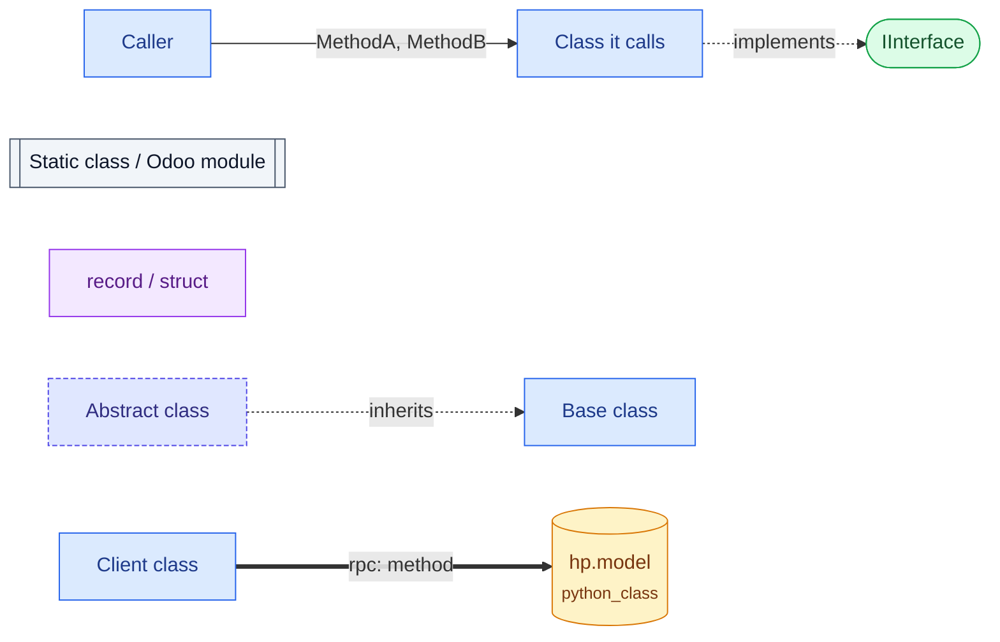
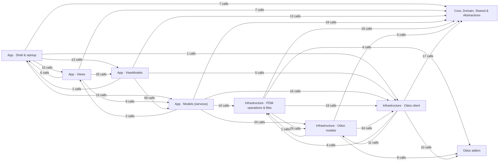
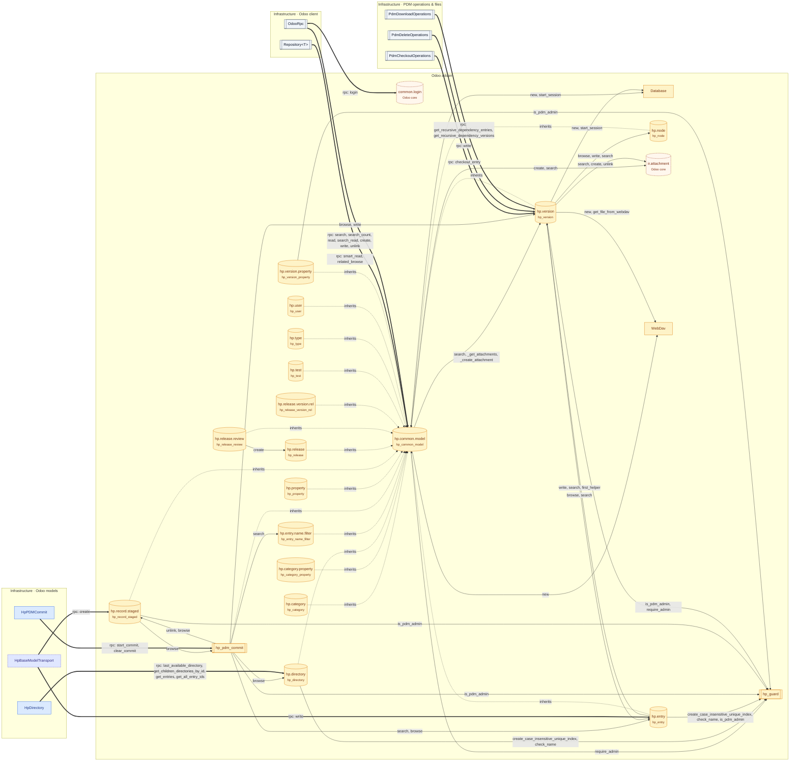

# HackPDM class graph

Every class in HackPDM, joined by the methods one calls on another. It covers the C# client (all projects except the tests) and the Odoo addon, and the RPC calls that link the two. 296 classes and models, 472 caller → callee links carrying 740 method names, and 141 inherits/implements links.

The whole graph is too large for GitHub's Mermaid renderer (it stops at 500 links), so it is drawn here area by area: each link is in the graph of the area its **calling** class belongs to, and classes from other areas show up in their own box at the edge. Together the area graphs are the whole graph. To see it all at once, open [CLASS_GRAPH.html](CLASS_GRAPH.html) in a browser (pan with drag, zoom with the wheel, search for a class); its Mermaid source is [CLASS_GRAPH.mmd](CLASS_GRAPH.mmd).

## How to read a graph



- An arrow points from the class that makes a call to the class whose method it calls. Its label lists the methods called, `new` for a constructor. `Name<T>` is a generic method called with that type, `Name(typeof)` is a call that is handed the type.
- Calls inside one class, property reads and writes, and calls into .NET or other libraries are left out. A call through an interface points at the interface; the dotted `implements` arrow leads on to the class behind it.
- Shapes and colours: blue box class, indigo dashed abstract class, grey double box static class, green rounded interface, purple record or struct, amber cylinder Odoo model, amber double box Odoo module (`hp_guard`), dashed orange Odoo core.
- Thick arrows are RPC calls from the client to the Odoo server: `rpc: write` is that method on that model. `search`, `read`, `create`, `write` and `unlink` go through `OdooRpc` for every `hp.*` model, drawn as one arrow to `hp.common.model`, which every model inherits.
- On the Odoo side, `self.env["hp.x"].method()`, calls on related records (`entry.latest_version_id.write(...)`) and `hp_guard.func()` count as calls; `sudo`, `exists`, `mapped`, `filtered` and similar record plumbing are left out.
- [CALL_GRAPHS.md](CALL_GRAPHS.md) follows single actions call by call; this file shows which classes talk to which.

## Contents

- [Areas](#areas)
- [App · Shell & startup](#app--shell--startup)
- [App · Views](#app--views)
- [App · ViewModels](#app--viewmodels)
- [App · Models (services)](#app--models-services)
- [Infrastructure · PDM operations & files](#infrastructure--pdm-operations--files)
- [Infrastructure · Odoo models](#infrastructure--odoo-models)
- [Infrastructure · Odoo client](#infrastructure--odoo-client)
- [Core, Domain, Shared & Abstractions](#core-domain-shared--abstractions)
- [Odoo addon](#odoo-addon)
- [Types with no calls in or out](#types-with-no-calls-in-or-out)

## Areas

How many method calls go from one area to another (calls within an area are left out).



## App · Shell & startup

[↑ contents](#contents)

8 classes in this area make or receive these 51 links.

```mermaid
flowchart LR
  subgraph G0["App · Shell & startup"]
    cs_HackPDM_Shell_AppComposition[["AppComposition"]]:::stat
    cs_HackPDM_Shell_AppSettingsStore[["AppSettingsStore"]]:::stat
    cs_HackPDM_HackApp["HackApp"]:::cls
    cs_HackPDM_Configuration_HackUpdater["HackUpdater"]:::cls
    cs_HackPDM_MainWindow["MainWindow"]:::cls
    cs_HackPDM_Shell_NavigationService["NavigationService"]:::cls
    cs_HackPDM_Program["Program"]:::cls
    cs_HackPDM_Shell_Testing_SmokeTestRunner[["SmokeTestRunner"]]:::stat
  end
  subgraph G1["App · Models (services)"]
    cs_HackPDM_Mvvm_Models_Hack_DirectoryTreeService["DirectoryTreeService"]:::cls
    cs_HackPDM_Mvvm_Models_Hack_EntryDetailsService["EntryDetailsService"]:::cls
    cs_HackPDM_Mvvm_Models_Hack_EntryFileService["EntryFileService"]:::cls
    cs_HackPDM_Mvvm_Models_Hack_EntryListService["EntryListService"]:::cls
    cs_HackPDM_Mvvm_Models_Odoo_EntrySearchService["EntrySearchService"]:::cls
    cs_HackPDM_Mvvm_Models_Hack_FileManagerState["FileManagerState"]:::cls
    cs_HackPDM_Mvvm_Models_Tools_JsonEditorDraft["JsonEditorDraft"]:::cls
    cs_HackPDM_Mvvm_Models_Hack_LocalFileWatcher["LocalFileWatcher"]:::cls
    cs_HackPDM_Mvvm_Models_Settings_LoginSession["LoginSession"]:::cls
    cs_HackPDM_Mvvm_Models_Hack_PdmWorkflowService["PdmWorkflowService"]:::cls
  end
  subgraph G2["App · ViewModels"]
    cs_HackPDM_Mvvm_ViewModels_Hack_HackFileManagerViewModel["HackFileManagerViewModel"]:::cls
    cs_HackPDM_Mvvm_ViewModels_Hack_HackSettingsViewModel["HackSettingsViewModel"]:::cls
    cs_HackPDM_Mvvm_ViewModels_Common_IDialogService(["IDialogService"]):::intf
    cs_HackPDM_Mvvm_ViewModels_Common_INavigationService(["INavigationService"]):::intf
    cs_HackPDM_Mvvm_ViewModels_Odoo_OdooSettingsViewModel["OdooSettingsViewModel"]:::cls
    cs_HackPDM_Mvvm_ViewModels_Settings_ProfileManagerViewModel["ProfileManagerViewModel"]:::cls
    cs_HackPDM_Mvvm_ViewModels_Odoo_SearchOdooViewModel["SearchOdooViewModel"]:::cls
    cs_HackPDM_Mvvm_ViewModels_Settings_StatusDialogViewModel["StatusDialogViewModel"]:::cls
    cs_HackPDM_Mvvm_ViewModels_Settings_StatusWindowReporter["StatusWindowReporter"]:::cls
    cs_HackPDM_Mvvm_ViewModels_Settings_ThemeEditorViewModel["ThemeEditorViewModel"]:::cls
    cs_HackPDM_Mvvm_ViewModels_Common_UiDispatcher[["UiDispatcher"]]:::stat
  end
  subgraph G3["App · Views"]
    cs_HackPDM_Mvvm_Views_Common_Settings_AppConfigStore[["AppConfigStore"]]:::stat
    cs_HackPDM_Mvvm_Views_Dialogs_DialogService["DialogService"]:::cls
    cs_HackPDM_Mvvm_Views_Common_Helpers_DispatcherQueueUiDispatcher["DispatcherQueueUiDispatcher"]:::cls
    cs_HackPDM_Mvvm_Views_Common_Controls_FilePickerService["FilePickerService"]:::cls
    cs_HackPDM_Mvvm_Views_Hack_HackFileManagerView["HackFileManagerView"]:::cls
    cs_HackPDM_Mvvm_Views_Hack_HomeView["HomeView"]:::cls
    cs_HackPDM_Mvvm_Views_Common_Theming_ThemeService["ThemeService"]:::cls
    cs_HackPDM_Mvvm_Views_Common_Controls_TreeViewExtensions[["TreeViewExtensions"]]:::stat
    cs_HackPDM_Mvvm_Views_Common_Controls_WindowConfig["WindowConfig"]:::cls
    cs_HackPDM_Mvvm_Views_Common_Controls_WindowExtensions[["WindowExtensions"]]:::stat
    cs_HackPDM_Mvvm_Views_Common_Controls_WindowHelper[["WindowHelper"]]:::stat
  end
  subgraph G4["Core, Domain, Shared & Abstractions"]
    cs_HackPDM_Core_Configuration_CoreSettings["CoreSettings"]:::cls
    cs_HackPDM_Core_Hack_HackDefaults["HackDefaults"]:::cls
    cs_HackPDM_Core_Configuration_JsonFileSettingsProvider["JsonFileSettingsProvider"]:::cls
    cs_HackPDM_Core_PwaPaths[["PwaPaths"]]:::stat
    cs_HackPDM_Core_ShellLauncher[["ShellLauncher"]]:::stat
  end
  subgraph G5["Infrastructure · Odoo client"]
    cs_HackPDM_Infrastructure_Odoo_OdooDefaults["OdooDefaults"]:::cls
  end
  cs_HackPDM_Configuration_HackUpdater -->|"OpenUrl"| cs_HackPDM_Core_ShellLauncher
  cs_HackPDM_Configuration_HackUpdater -->|"ShowMessageAsync"| cs_HackPDM_Mvvm_ViewModels_Common_IDialogService
  cs_HackPDM_HackApp -->|"new"| cs_HackPDM_MainWindow
  cs_HackPDM_HackApp -->|"SetWindowType"| cs_HackPDM_Mvvm_Views_Common_Controls_WindowExtensions
  cs_HackPDM_HackApp -->|"Save"| cs_HackPDM_Mvvm_Views_Common_Settings_AppConfigStore
  cs_HackPDM_HackApp -->|"ReadSavedMode, Attach"| cs_HackPDM_Mvvm_Views_Common_Theming_ThemeService
  cs_HackPDM_HackApp -->|"new"| cs_HackPDM_Mvvm_Views_Hack_HomeView
  cs_HackPDM_HackApp -->|"InitializeDefaults, Initialize"| cs_HackPDM_Shell_AppComposition
  cs_HackPDM_HackApp -->|"Start"| cs_HackPDM_Shell_Testing_SmokeTestRunner
  cs_HackPDM_MainWindow -->|"ResizeWindow"| cs_HackPDM_Mvvm_Views_Common_Controls_WindowHelper
  cs_HackPDM_Program -->|"new"| cs_HackPDM_HackApp
  cs_HackPDM_Shell_AppComposition -->|"new"| cs_HackPDM_Core_Configuration_CoreSettings
  cs_HackPDM_Shell_AppComposition -->|"new"| cs_HackPDM_Core_Hack_HackDefaults
  cs_HackPDM_Shell_AppComposition -->|"ToServerName"| cs_HackPDM_Core_PwaPaths
  cs_HackPDM_Shell_AppComposition -->|"new"| cs_HackPDM_Infrastructure_Odoo_OdooDefaults
  cs_HackPDM_Shell_AppComposition -->|"new"| cs_HackPDM_Mvvm_Models_Hack_DirectoryTreeService
  cs_HackPDM_Shell_AppComposition -->|"new"| cs_HackPDM_Mvvm_Models_Hack_EntryDetailsService
  cs_HackPDM_Shell_AppComposition -->|"new"| cs_HackPDM_Mvvm_Models_Hack_EntryFileService
  cs_HackPDM_Shell_AppComposition -->|"new"| cs_HackPDM_Mvvm_Models_Hack_EntryListService
  cs_HackPDM_Shell_AppComposition -->|"new, LocalFilesChanged, Reset<br/>RequestLocateAsync"| cs_HackPDM_Mvvm_Models_Hack_FileManagerState
  cs_HackPDM_Shell_AppComposition -->|"new"| cs_HackPDM_Mvvm_Models_Hack_LocalFileWatcher
  cs_HackPDM_Shell_AppComposition -->|"new"| cs_HackPDM_Mvvm_Models_Hack_PdmWorkflowService
  cs_HackPDM_Shell_AppComposition -->|"new"| cs_HackPDM_Mvvm_Models_Odoo_EntrySearchService
  cs_HackPDM_Shell_AppComposition -->|"new"| cs_HackPDM_Mvvm_Models_Settings_LoginSession
  cs_HackPDM_Shell_AppComposition -->|"new"| cs_HackPDM_Mvvm_Models_Tools_JsonEditorDraft
  cs_HackPDM_Shell_AppComposition -->|"Post"| cs_HackPDM_Mvvm_ViewModels_Common_UiDispatcher
  cs_HackPDM_Shell_AppComposition -->|"new"| cs_HackPDM_Mvvm_ViewModels_Hack_HackFileManagerViewModel
  cs_HackPDM_Shell_AppComposition -->|"new"| cs_HackPDM_Mvvm_ViewModels_Hack_HackSettingsViewModel
  cs_HackPDM_Shell_AppComposition -->|"new"| cs_HackPDM_Mvvm_ViewModels_Odoo_OdooSettingsViewModel
  cs_HackPDM_Shell_AppComposition -->|"new"| cs_HackPDM_Mvvm_ViewModels_Odoo_SearchOdooViewModel
  cs_HackPDM_Shell_AppComposition -->|"new"| cs_HackPDM_Mvvm_ViewModels_Settings_ProfileManagerViewModel
  cs_HackPDM_Shell_AppComposition -->|"new"| cs_HackPDM_Mvvm_ViewModels_Settings_StatusDialogViewModel
  cs_HackPDM_Shell_AppComposition -->|"new, Cancel"| cs_HackPDM_Mvvm_ViewModels_Settings_StatusWindowReporter
  cs_HackPDM_Shell_AppComposition -->|"new"| cs_HackPDM_Mvvm_ViewModels_Settings_ThemeEditorViewModel
  cs_HackPDM_Shell_AppComposition -->|"new"| cs_HackPDM_Mvvm_Views_Common_Controls_FilePickerService
  cs_HackPDM_Shell_AppComposition -->|"new"| cs_HackPDM_Mvvm_Views_Common_Helpers_DispatcherQueueUiDispatcher
  cs_HackPDM_Shell_AppComposition -->|"new"| cs_HackPDM_Mvvm_Views_Common_Theming_ThemeService
  cs_HackPDM_Shell_AppComposition -->|"new"| cs_HackPDM_Mvvm_Views_Dialogs_DialogService
  cs_HackPDM_Shell_AppComposition -->|"Open"| cs_HackPDM_Shell_AppSettingsStore
  cs_HackPDM_Shell_AppComposition -->|"new, NavigateTo"| cs_HackPDM_Shell_NavigationService
  cs_HackPDM_Shell_AppSettingsStore -->|"new, ImportMissing"| cs_HackPDM_Core_Configuration_JsonFileSettingsProvider
  cs_HackPDM_Shell_NavigationService -->|"Select"| cs_HackPDM_Mvvm_Views_Hack_HomeView
  cs_HackPDM_Shell_Testing_SmokeTestRunner -->|"ToAbsolute"| cs_HackPDM_Core_PwaPaths
  cs_HackPDM_Shell_Testing_SmokeTestRunner -->|"Post"| cs_HackPDM_Mvvm_ViewModels_Common_UiDispatcher
  cs_HackPDM_Shell_Testing_SmokeTestRunner -->|"AbleToLoginAsync"| cs_HackPDM_Mvvm_ViewModels_Settings_ProfileManagerViewModel
  cs_HackPDM_Shell_Testing_SmokeTestRunner -->|"EnsureVisible"| cs_HackPDM_Mvvm_Views_Common_Controls_TreeViewExtensions
  cs_HackPDM_Shell_Testing_SmokeTestRunner -->|"Preset"| cs_HackPDM_Mvvm_Views_Common_Controls_WindowConfig
  cs_HackPDM_Shell_Testing_SmokeTestRunner -->|"GetOdooDirectoryTree, GetOdooEntryList"| cs_HackPDM_Mvvm_Views_Hack_HackFileManagerView
  cs_HackPDM_Shell_Testing_SmokeTestRunner -->|"CreateProfileManager"| cs_HackPDM_Shell_AppComposition
  cs_HackPDM_Shell_Testing_SmokeTestRunner -->|"NavigateTo"| cs_HackPDM_Shell_NavigationService
  cs_HackPDM_Shell_NavigationService -.->|implements| cs_HackPDM_Mvvm_ViewModels_Common_INavigationService
  classDef cls fill:#dbeafe,stroke:#2563eb,color:#1e3a8a
  classDef abs fill:#e0e7ff,stroke:#4f46e5,color:#312e81,stroke-dasharray:4 2
  classDef stat fill:#f1f5f9,stroke:#475569,color:#0f172a
  classDef intf fill:#dcfce7,stroke:#16a34a,color:#14532d
  classDef rec fill:#f3e8ff,stroke:#9333ea,color:#581c87
  classDef odoo fill:#fef3c7,stroke:#d97706,color:#78350f
  classDef core fill:#fff7ed,stroke:#9a3412,color:#7c2d12,stroke-dasharray:4 2
```



## App · Views

[↑ contents](#contents)

48 classes in this area make or receive these 84 links.

```mermaid
flowchart LR
  subgraph G0["App · Views"]
    cs_HackPDM_Mvvm_Views_Common_Settings_AppConfigStore[["AppConfigStore"]]:::stat
    cs_HackPDM_Mvvm_Views_Settings_ApplicationSettingsView["ApplicationSettingsView"]:::cls
    cs_HackPDM_Mvvm_Views_Common_Imaging_AssetsImageProvider["AssetsImageProvider"]:::cls
    cs_HackPDM_Mvvm_Views_Common_Converters_BoolToVisibilityConverter["BoolToVisibilityConverter"]:::cls
    cs_HackPDM_Mvvm_Views_Common_Settings_ColorSettings["ColorSettings"]:::cls
    cs_HackPDM_Mvvm_Views_Settings_ConfigurationView["ConfigurationView"]:::cls
    cs_HackPDM_Mvvm_Views_Common_Settings_CustomSerializers[["CustomSerializers"]]:::stat
    cs_HackPDM_Mvvm_Views_Dialogs_DialogService["DialogService"]:::cls
    cs_HackPDM_Mvvm_Views_Hack_DirectoryTreeBuilder[["DirectoryTreeBuilder"]]:::stat
    cs_HackPDM_Mvvm_Views_Common_Helpers_DispatcherQueueUiDispatcher["DispatcherQueueUiDispatcher"]:::cls
    cs_HackPDM_Mvvm_Views_Common_Converters_EntryIcons[["EntryIcons"]]:::stat
    cs_HackPDM_Mvvm_Views_Hack_EntryListGrouping[["EntryListGrouping"]]:::stat
    cs_HackPDM_Mvvm_Views_Common_Controls_FilePickerService["FilePickerService"]:::cls
    cs_HackPDM_Mvvm_Views_Common_Converters_FileSizeConverter["FileSizeConverter"]:::cls
    cs_HackPDM_Mvvm_Views_Common_Helpers_FrameworkElementExtensions[["FrameworkElementExtensions"]]:::stat
    cs_HackPDM_Mvvm_Views_Common_Settings_GlobalSerializedData["GlobalSerializedData"]:::cls
    cs_HackPDM_Mvvm_Views_Common_Settings_GroupByField["GroupByField"]:::cls
    cs_HackPDM_Mvvm_Views_Hack_HackFileManagerView["HackFileManagerView"]:::cls
    cs_HackPDM_Mvvm_Views_Hack_HackSettingsView["HackSettingsView"]:::cls
    cs_HackPDM_Mvvm_Views_Common_Converters_HexToBrushConverter["HexToBrushConverter"]:::cls
    cs_HackPDM_Mvvm_Views_Hack_HomeView["HomeView"]:::cls
    cs_HackPDM_Mvvm_Views_Common_Controls_IPreviewImageLoader(["IPreviewImageLoader"]):::intf
    cs_HackPDM_Mvvm_Views_Tools_JsonEditorView["JsonEditorView"]:::cls
    cs_HackPDM_Mvvm_Views_Dialogs_MessageBox["MessageBox"]:::cls
    cs_HackPDM_Mvvm_Views_Settings_NotLoggedInView["NotLoggedInView"]:::cls
    cs_HackPDM_Mvvm_Views_Common_Settings_OdooEntryColumn["OdooEntryColumn"]:::cls
    cs_HackPDM_Mvvm_Views_Common_Settings_OdooEntryColumnID["OdooEntryColumnID"]:::cls
    cs_HackPDM_Mvvm_Views_Common_Settings_OdooEntryColumns["OdooEntryColumns"]:::cls
    cs_HackPDM_Mvvm_Views_Odoo_OdooFileTypeManagerView["OdooFileTypeManagerView"]:::cls
    cs_HackPDM_Mvvm_Views_Odoo_OdooSettingsView["OdooSettingsView"]:::cls
    cs_HackPDM_Mvvm_Views_Dialogs_PipWindow["PipWindow"]:::cls
    cs_HackPDM_Mvvm_Views_Common_Controls_PreviewImageLoader["PreviewImageLoader"]:::cls
    cs_HackPDM_Mvvm_Views_Settings_ProfileManagerView["ProfileManagerView"]:::cls
    cs_HackPDM_Mvvm_Views_Odoo_SearchOdooView["SearchOdooView"]:::cls
    cs_HackPDM_Mvvm_Views_Settings_StatusDialogView["StatusDialogView"]:::cls
    cs_HackPDM_Mvvm_Views_Common_Converters_StatusIconConverter["StatusIconConverter"]:::cls
    cs_HackPDM_Mvvm_Views_Settings_ThemeEditorView["ThemeEditorView"]:::cls
    cs_HackPDM_Mvvm_Views_Common_Theming_ThemeService["ThemeService"]:::cls
    cs_HackPDM_Mvvm_Views_Common_Types_TreeData["TreeData (app)"]:::cls
    cs_HackPDM_Mvvm_Views_Common_Controls_TreeViewExtensions[["TreeViewExtensions"]]:::stat
    cs_HackPDM_Mvvm_Views_Common_Converters_TypeIconConverter["TypeIconConverter"]:::cls
    cs_HackPDM_Mvvm_Views_Common_Controls_UISettings["UISettings"]:::cls
    cs_HackPDM_Mvvm_Views_Common_Settings_UIStorage[["UIStorage"]]:::stat
    cs_HackPDM_Mvvm_Views_Common_Controls_WindowConfig["WindowConfig"]:::cls
    cs_HackPDM_Mvvm_Views_Common_Controls_WindowExtensions[["WindowExtensions"]]:::stat
    cs_HackPDM_Mvvm_Views_Common_Controls_WindowHelper[["WindowHelper"]]:::stat
    cs_HackPDM_Mvvm_Views_Common_Settings_WindowSettings["WindowSettings"]:::cls
    cs_HackPDM_Mvvm_Views_Common_Controls_X11WindowSize[["X11WindowSize"]]:::stat
  end
  subgraph G1["App · Models (services)"]
    cs_HackPDM_Mvvm_Models_Settings_ArgbColor["ArgbColor"]:::rec
    cs_HackPDM_Mvvm_Models_Settings_ThemeSettings["ThemeSettings"]:::cls
  end
  subgraph G2["App · Shell & startup"]
    cs_HackPDM_Shell_AppComposition[["AppComposition"]]:::stat
    cs_HackPDM_Shell_NavigationService["NavigationService"]:::cls
  end
  subgraph G3["App · ViewModels"]
    cs_HackPDM_Mvvm_ViewModels_Hack_HackFileManagerViewModel["HackFileManagerViewModel"]:::cls
    cs_HackPDM_Mvvm_ViewModels_Common_IDialogService(["IDialogService"]):::intf
    cs_HackPDM_Mvvm_ViewModels_Common_IFilePickerService(["IFilePickerService"]):::intf
    cs_HackPDM_Mvvm_ViewModels_Common_InlineUiDispatcher["InlineUiDispatcher"]:::cls
    cs_HackPDM_Mvvm_ViewModels_Common_IThemeService(["IThemeService"]):::intf
    cs_HackPDM_Mvvm_ViewModels_Common_IUiDispatcher(["IUiDispatcher"]):::intf
    cs_HackPDM_Mvvm_ViewModels_Tools_JsonEditorViewModel["JsonEditorViewModel"]:::cls
    cs_HackPDM_Mvvm_ViewModels_Tools_JsonNodeViewModel["JsonNodeViewModel"]:::cls
    cs_HackPDM_Mvvm_ViewModels_Odoo_SearchOdooViewModel["SearchOdooViewModel"]:::cls
    cs_HackPDM_Mvvm_ViewModels_Settings_StatusDialogViewModel["StatusDialogViewModel"]:::cls
    cs_HackPDM_Mvvm_ViewModels_Settings_ThemeEditorViewModel["ThemeEditorViewModel"]:::cls
    cs_HackPDM_Mvvm_ViewModels_Common_UiDispatcher[["UiDispatcher"]]:::stat
  end
  subgraph G4["Core, Domain, Shared & Abstractions"]
    cs_HackPDM_Core_AsyncHelper["AsyncHelper"]:::cls
    cs_HackPDM_Shared_GlobalData_ByteSize[["ByteSize"]]:::stat
    cs_HackPDM_Core_Hack_DirectoryRef["DirectoryRef"]:::rec
    cs_HackPDM_Shared_GlobalData_OperatorConverter["OperatorConverter"]:::cls
    cs_HackPDM_Core_PwaPaths[["PwaPaths"]]:::stat
    cs_HackPDM_Domain_Representation_TreeData["TreeData (Domain)"]:::abs
    cs_HackPDM_Domain_Representation_Vector4_T_["Vector4#lt;T#gt;"]:::rec
  end
  cs_HackPDM_Mvvm_Views_Common_Controls_TreeViewExtensions -->|"new"| cs_HackPDM_Mvvm_Views_Common_Types_TreeData
  cs_HackPDM_Mvvm_Views_Common_Controls_UISettings -->|"new"| cs_HackPDM_Mvvm_Views_Common_Imaging_AssetsImageProvider
  cs_HackPDM_Mvvm_Views_Common_Controls_WindowConfig -->|"new"| cs_HackPDM_Mvvm_Views_Common_Settings_WindowSettings
  cs_HackPDM_Mvvm_Views_Common_Controls_WindowExtensions -->|"WindowOf"| cs_HackPDM_Mvvm_Views_Common_Controls_WindowHelper
  cs_HackPDM_Mvvm_Views_Common_Controls_WindowHelper -->|"SetWindowType"| cs_HackPDM_Mvvm_Views_Common_Controls_WindowExtensions
  cs_HackPDM_Mvvm_Views_Common_Controls_WindowHelper -->|"TryResize"| cs_HackPDM_Mvvm_Views_Common_Controls_X11WindowSize
  cs_HackPDM_Mvvm_Views_Common_Controls_WindowHelper -->|"Attach"| cs_HackPDM_Mvvm_Views_Common_Theming_ThemeService
  cs_HackPDM_Mvvm_Views_Common_Converters_FileSizeConverter -->|"Format"| cs_HackPDM_Shared_GlobalData_ByteSize
  cs_HackPDM_Mvvm_Views_Common_Converters_HexToBrushConverter -->|"TryParse"| cs_HackPDM_Mvvm_Models_Settings_ArgbColor
  cs_HackPDM_Mvvm_Views_Common_Converters_StatusIconConverter -->|"ForStatus"| cs_HackPDM_Mvvm_Views_Common_Converters_EntryIcons
  cs_HackPDM_Mvvm_Views_Common_Converters_TypeIconConverter -->|"ForType"| cs_HackPDM_Mvvm_Views_Common_Converters_EntryIcons
  cs_HackPDM_Mvvm_Views_Common_Helpers_DispatcherQueueUiDispatcher -->|"RunAsync, new"| cs_HackPDM_Mvvm_ViewModels_Common_InlineUiDispatcher
  cs_HackPDM_Mvvm_Views_Common_Settings_AppConfigStore -->|"new"| cs_HackPDM_Mvvm_Views_Common_Settings_CustomSerializers
  cs_HackPDM_Mvvm_Views_Common_Settings_AppConfigStore -->|"new"| cs_HackPDM_Mvvm_Views_Common_Settings_GlobalSerializedData
  cs_HackPDM_Mvvm_Views_Common_Settings_ColorSettings -->|"ToColor, TransformUIntToRGB"| cs_HackPDM_Mvvm_Views_Common_Settings_UIStorage
  cs_HackPDM_Mvvm_Views_Common_Settings_CustomSerializers -->|"new"| cs_HackPDM_Domain_Representation_Vector4_T_
  cs_HackPDM_Mvvm_Views_Common_Settings_GlobalSerializedData -->|"new"| cs_HackPDM_Mvvm_Models_Settings_ThemeSettings
  cs_HackPDM_Mvvm_Views_Common_Settings_GlobalSerializedData -->|"new"| cs_HackPDM_Mvvm_Views_Common_Settings_ColorSettings
  cs_HackPDM_Mvvm_Views_Common_Settings_GlobalSerializedData -->|"new"| cs_HackPDM_Mvvm_Views_Common_Settings_OdooEntryColumns
  cs_HackPDM_Mvvm_Views_Common_Settings_GlobalSerializedData -->|"new"| cs_HackPDM_Mvvm_Views_Common_Settings_WindowSettings
  cs_HackPDM_Mvvm_Views_Common_Settings_OdooEntryColumnID -->|"new"| cs_HackPDM_Mvvm_Views_Common_Settings_OdooEntryColumn
  cs_HackPDM_Mvvm_Views_Common_Settings_OdooEntryColumns -->|"new"| cs_HackPDM_Mvvm_Views_Common_Settings_GroupByField
  cs_HackPDM_Mvvm_Views_Common_Settings_OdooEntryColumns -->|"new"| cs_HackPDM_Mvvm_Views_Common_Settings_OdooEntryColumn
  cs_HackPDM_Mvvm_Views_Common_Settings_OdooEntryColumns -->|"new"| cs_HackPDM_Mvvm_Views_Common_Settings_OdooEntryColumnID
  cs_HackPDM_Mvvm_Views_Common_Settings_UIStorage -->|"Load"| cs_HackPDM_Mvvm_Views_Common_Settings_AppConfigStore
  cs_HackPDM_Mvvm_Views_Common_Settings_WindowSettings -->|"new"| cs_HackPDM_Mvvm_Views_Common_Controls_WindowConfig
  cs_HackPDM_Mvvm_Views_Common_Theming_ThemeService -->|"ToString, TryParse, new"| cs_HackPDM_Mvvm_Models_Settings_ArgbColor
  cs_HackPDM_Mvvm_Views_Common_Theming_ThemeService -->|"new, OverridesFor"| cs_HackPDM_Mvvm_Models_Settings_ThemeSettings
  cs_HackPDM_Mvvm_Views_Common_Theming_ThemeService -->|"Load, Save"| cs_HackPDM_Mvvm_Views_Common_Settings_AppConfigStore
  cs_HackPDM_Mvvm_Views_Common_Types_TreeData -->|"ToAbsolute"| cs_HackPDM_Core_PwaPaths
  cs_HackPDM_Mvvm_Views_Dialogs_DialogService -->|"CreateWindowAndPage"| cs_HackPDM_Mvvm_Views_Common_Controls_WindowHelper
  cs_HackPDM_Mvvm_Views_Dialogs_DialogService -->|"ShowAsync"| cs_HackPDM_Mvvm_Views_Dialogs_MessageBox
  cs_HackPDM_Mvvm_Views_Dialogs_DialogService -->|"CreateWindowAndPage#lt;StatusDialogView#gt;"| cs_HackPDM_Mvvm_Views_Settings_StatusDialogView
  cs_HackPDM_Mvvm_Views_Dialogs_MessageBox -->|"RunAsync"| cs_HackPDM_Mvvm_ViewModels_Common_IUiDispatcher
  cs_HackPDM_Mvvm_Views_Dialogs_MessageBox -->|"CreateWindow"| cs_HackPDM_Mvvm_Views_Common_Controls_WindowHelper
  cs_HackPDM_Mvvm_Views_Dialogs_MessageBox -->|"SetGrid"| cs_HackPDM_Mvvm_Views_Common_Helpers_FrameworkElementExtensions
  cs_HackPDM_Mvvm_Views_Hack_DirectoryTreeBuilder -->|"Asset"| cs_HackPDM_Mvvm_Views_Common_Converters_EntryIcons
  cs_HackPDM_Mvvm_Views_Hack_HackFileManagerView -->|"WaitUntil"| cs_HackPDM_Core_AsyncHelper
  cs_HackPDM_Mvvm_Views_Hack_HackFileManagerView -->|"new"| cs_HackPDM_Core_Hack_DirectoryRef
  cs_HackPDM_Mvvm_Views_Hack_HackFileManagerView -->|"Segments"| cs_HackPDM_Core_PwaPaths
  cs_HackPDM_Mvvm_Views_Hack_HackFileManagerView -->|"Post"| cs_HackPDM_Mvvm_ViewModels_Common_UiDispatcher
  cs_HackPDM_Mvvm_Views_Hack_HackFileManagerView -->|"Dispose, Initialize, SetExpanded<br/>Activate, LoadDirectoryTreeAsync, LoadEntriesAsync<br/>TakeSelectionToRestore, ShowEntryDetailsAsync, SortEntries<br/>PreviewVersionAsync, RefreshFromServer"| cs_HackPDM_Mvvm_ViewModels_Hack_HackFileManagerViewModel
  cs_HackPDM_Mvvm_Views_Hack_HackFileManagerView -->|"FromBytesAsync, FromFileIconAsync"| cs_HackPDM_Mvvm_Views_Common_Controls_IPreviewImageLoader
  cs_HackPDM_Mvvm_Views_Hack_HackFileManagerView -->|"new"| cs_HackPDM_Mvvm_Views_Common_Controls_PreviewImageLoader
  cs_HackPDM_Mvvm_Views_Hack_HackFileManagerView -->|"FindTreeNode, EnsureVisible, UpdateBreadCrumbCollection"| cs_HackPDM_Mvvm_Views_Common_Controls_TreeViewExtensions
  cs_HackPDM_Mvvm_Views_Hack_HackFileManagerView -->|"CreateWindowAndPage, CreateWindowPage"| cs_HackPDM_Mvvm_Views_Common_Controls_WindowHelper
  cs_HackPDM_Mvvm_Views_Hack_HackFileManagerView -->|"new"| cs_HackPDM_Mvvm_Views_Common_Converters_FileSizeConverter
  cs_HackPDM_Mvvm_Views_Hack_HackFileManagerView -->|"new"| cs_HackPDM_Mvvm_Views_Common_Converters_StatusIconConverter
  cs_HackPDM_Mvvm_Views_Hack_HackFileManagerView -->|"new"| cs_HackPDM_Mvvm_Views_Common_Converters_TypeIconConverter
  cs_HackPDM_Mvvm_Views_Hack_HackFileManagerView -->|"new"| cs_HackPDM_Mvvm_Views_Common_Settings_OdooEntryColumns
  cs_HackPDM_Mvvm_Views_Hack_HackFileManagerView -->|"new, HostComponent, ReleaseComponent"| cs_HackPDM_Mvvm_Views_Dialogs_PipWindow
  cs_HackPDM_Mvvm_Views_Hack_HackFileManagerView -->|"Build"| cs_HackPDM_Mvvm_Views_Hack_DirectoryTreeBuilder
  cs_HackPDM_Mvvm_Views_Hack_HackFileManagerView -->|"Apply"| cs_HackPDM_Mvvm_Views_Hack_EntryListGrouping
  cs_HackPDM_Mvvm_Views_Hack_HackFileManagerView -->|"CreateWindowPage#lt;OdooFileTypeManagerView#gt;"| cs_HackPDM_Mvvm_Views_Odoo_OdooFileTypeManagerView
  cs_HackPDM_Mvvm_Views_Hack_HackFileManagerView -->|"CreateWindowAndPage#lt;SearchOdooView#gt;, StoreWindowInstance"| cs_HackPDM_Mvvm_Views_Odoo_SearchOdooView
  cs_HackPDM_Mvvm_Views_Hack_HackFileManagerView -->|"CreateFileManager"| cs_HackPDM_Shell_AppComposition
  cs_HackPDM_Mvvm_Views_Hack_HackSettingsView -->|"CreateHackSettings"| cs_HackPDM_Shell_AppComposition
  cs_HackPDM_Mvvm_Views_Hack_HomeView -->|"Preset"| cs_HackPDM_Mvvm_Views_Common_Controls_WindowConfig
  cs_HackPDM_Mvvm_Views_Hack_HomeView -->|"SetWindowConfig"| cs_HackPDM_Mvvm_Views_Common_Controls_WindowHelper
  cs_HackPDM_Mvvm_Views_Hack_HomeView -->|"Navigate(typeof)"| cs_HackPDM_Mvvm_Views_Settings_ConfigurationView
  cs_HackPDM_Mvvm_Views_Hack_HomeView -->|"Navigate(typeof)"| cs_HackPDM_Mvvm_Views_Settings_NotLoggedInView
  cs_HackPDM_Mvvm_Views_Hack_HomeView -->|"Attach"| cs_HackPDM_Shell_NavigationService
  cs_HackPDM_Mvvm_Views_Odoo_OdooSettingsView -->|"CreateOdooSettings"| cs_HackPDM_Shell_AppComposition
  cs_HackPDM_Mvvm_Views_Odoo_SearchOdooView -->|"LoadLookups"| cs_HackPDM_Mvvm_ViewModels_Odoo_SearchOdooViewModel
  cs_HackPDM_Mvvm_Views_Odoo_SearchOdooView -->|"new"| cs_HackPDM_Shared_GlobalData_OperatorConverter
  cs_HackPDM_Mvvm_Views_Settings_ConfigurationView -->|"Navigate(typeof)"| cs_HackPDM_Mvvm_Views_Hack_HackSettingsView
  cs_HackPDM_Mvvm_Views_Settings_ConfigurationView -->|"Navigate(typeof)"| cs_HackPDM_Mvvm_Views_Odoo_OdooSettingsView
  cs_HackPDM_Mvvm_Views_Settings_ProfileManagerView -->|"CreateProfileManager"| cs_HackPDM_Shell_AppComposition
  cs_HackPDM_Mvvm_Views_Settings_StatusDialogView -->|"ConfirmCloseAsync"| cs_HackPDM_Mvvm_ViewModels_Settings_StatusDialogViewModel
  cs_HackPDM_Mvvm_Views_Settings_StatusDialogView -->|"CreateWindowPage"| cs_HackPDM_Mvvm_Views_Common_Controls_WindowHelper
  cs_HackPDM_Mvvm_Views_Settings_StatusDialogView -->|"CreateWindowPage#lt;ApplicationSettingsView#gt;"| cs_HackPDM_Mvvm_Views_Settings_ApplicationSettingsView
  cs_HackPDM_Mvvm_Views_Settings_ThemeEditorView -->|"TryParse, new"| cs_HackPDM_Mvvm_Models_Settings_ArgbColor
  cs_HackPDM_Mvvm_Views_Settings_ThemeEditorView -->|"SetSelectedColor"| cs_HackPDM_Mvvm_ViewModels_Settings_ThemeEditorViewModel
  cs_HackPDM_Mvvm_Views_Settings_ThemeEditorView -->|"new"| cs_HackPDM_Mvvm_Views_Common_Converters_BoolToVisibilityConverter
  cs_HackPDM_Mvvm_Views_Settings_ThemeEditorView -->|"new"| cs_HackPDM_Mvvm_Views_Common_Converters_HexToBrushConverter
  cs_HackPDM_Mvvm_Views_Settings_ThemeEditorView -->|"CreateThemeEditor"| cs_HackPDM_Shell_AppComposition
  cs_HackPDM_Mvvm_Views_Tools_JsonEditorView -->|"new, Keep, ToJson<br/>Save, Remove, LoadText"| cs_HackPDM_Mvvm_ViewModels_Tools_JsonEditorViewModel
  cs_HackPDM_Mvvm_Views_Tools_JsonEditorView -->|"AddChildProperty"| cs_HackPDM_Mvvm_ViewModels_Tools_JsonNodeViewModel
  cs_HackPDM_Mvvm_Views_Common_Controls_FilePickerService -.->|implements| cs_HackPDM_Mvvm_ViewModels_Common_IFilePickerService
  cs_HackPDM_Mvvm_Views_Common_Controls_PreviewImageLoader -.->|implements| cs_HackPDM_Mvvm_Views_Common_Controls_IPreviewImageLoader
  cs_HackPDM_Mvvm_Views_Common_Helpers_DispatcherQueueUiDispatcher -.->|implements| cs_HackPDM_Mvvm_ViewModels_Common_IUiDispatcher
  cs_HackPDM_Mvvm_Views_Common_Theming_ThemeService -.->|implements| cs_HackPDM_Mvvm_ViewModels_Common_IThemeService
  cs_HackPDM_Mvvm_Views_Common_Types_TreeData -.->|inherits| cs_HackPDM_Domain_Representation_TreeData
  cs_HackPDM_Mvvm_Views_Dialogs_DialogService -.->|implements| cs_HackPDM_Mvvm_ViewModels_Common_IDialogService
  classDef cls fill:#dbeafe,stroke:#2563eb,color:#1e3a8a
  classDef abs fill:#e0e7ff,stroke:#4f46e5,color:#312e81,stroke-dasharray:4 2
  classDef stat fill:#f1f5f9,stroke:#475569,color:#0f172a
  classDef intf fill:#dcfce7,stroke:#16a34a,color:#14532d
  classDef rec fill:#f3e8ff,stroke:#9333ea,color:#581c87
  classDef odoo fill:#fef3c7,stroke:#d97706,color:#78350f
  classDef core fill:#fff7ed,stroke:#9a3412,color:#7c2d12,stroke-dasharray:4 2
```

## App · ViewModels

[↑ contents](#contents)

19 classes in this area make or receive these 61 links.

```mermaid
flowchart LR
  subgraph G0["App · ViewModels"]
    cs_HackPDM_Mvvm_ViewModels_Hack_HackFileManagerViewModel["HackFileManagerViewModel"]:::cls
    cs_HackPDM_Mvvm_ViewModels_Hack_HackSettingsViewModel["HackSettingsViewModel"]:::cls
    cs_HackPDM_Mvvm_ViewModels_Common_IDialogService(["IDialogService"]):::intf
    cs_HackPDM_Mvvm_ViewModels_Common_IFilePickerService(["IFilePickerService"]):::intf
    cs_HackPDM_Mvvm_ViewModels_Common_INavigationService(["INavigationService"]):::intf
    cs_HackPDM_Mvvm_ViewModels_Common_InlineUiDispatcher["InlineUiDispatcher"]:::cls
    cs_HackPDM_Mvvm_ViewModels_Common_IThemeService(["IThemeService"]):::intf
    cs_HackPDM_Mvvm_ViewModels_Common_IUiDispatcher(["IUiDispatcher"]):::intf
    cs_HackPDM_Mvvm_ViewModels_Tools_JsonEditorViewModel["JsonEditorViewModel"]:::cls
    cs_HackPDM_Mvvm_ViewModels_Tools_JsonNodeViewModel["JsonNodeViewModel"]:::cls
    cs_HackPDM_Mvvm_ViewModels_Odoo_OdooSettingsViewModel["OdooSettingsViewModel"]:::cls
    cs_HackPDM_Mvvm_ViewModels_Common_OperationViewModel["OperationViewModel"]:::abs
    cs_HackPDM_Mvvm_ViewModels_Settings_ProfileManagerViewModel["ProfileManagerViewModel"]:::cls
    cs_HackPDM_Mvvm_ViewModels_Odoo_SearchOdooViewModel["SearchOdooViewModel"]:::cls
    cs_HackPDM_Mvvm_ViewModels_Settings_StatusDialogViewModel["StatusDialogViewModel"]:::cls
    cs_HackPDM_Mvvm_ViewModels_Settings_StatusWindowReporter["StatusWindowReporter"]:::cls
    cs_HackPDM_Mvvm_ViewModels_Settings_ThemeColorItem["ThemeColorItem"]:::cls
    cs_HackPDM_Mvvm_ViewModels_Settings_ThemeEditorViewModel["ThemeEditorViewModel"]:::cls
    cs_HackPDM_Mvvm_ViewModels_Common_UiDispatcher[["UiDispatcher"]]:::stat
  end
  subgraph G1["App · Models (services)"]
    cs_HackPDM_Mvvm_Models_Tools_AppConfigJsonService[["AppConfigJsonService"]]:::stat
    cs_HackPDM_Mvvm_Models_Settings_ArgbColor["ArgbColor"]:::rec
    cs_HackPDM_Mvvm_Models_Hack_EntryListResult["EntryListResult"]:::rec
    cs_HackPDM_Mvvm_Models_Hack_EntryRowKeys[["EntryRowKeys"]]:::stat
    cs_HackPDM_Mvvm_Models_Odoo_EntrySearchQuery["EntrySearchQuery"]:::rec
    cs_HackPDM_Mvvm_Models_Hack_FileManagerState["FileManagerState"]:::cls
    cs_HackPDM_Mvvm_Models_Hack_IDirectoryTreeService(["IDirectoryTreeService"]):::intf
    cs_HackPDM_Mvvm_Models_Hack_IEntryDetailsService(["IEntryDetailsService"]):::intf
    cs_HackPDM_Mvvm_Models_Hack_IEntryFileService(["IEntryFileService"]):::intf
    cs_HackPDM_Mvvm_Models_Hack_IEntryListService(["IEntryListService"]):::intf
    cs_HackPDM_Mvvm_Models_Odoo_IEntrySearchService(["IEntrySearchService"]):::intf
    cs_HackPDM_Mvvm_Models_Hack_ILocalFileWatcher(["ILocalFileWatcher"]):::intf
    cs_HackPDM_Mvvm_Models_Common_IOperationReporter(["IOperationReporter"]):::intf
    cs_HackPDM_Mvvm_Models_Hack_IPdmWorkflowService(["IPdmWorkflowService"]):::intf
    cs_HackPDM_Mvvm_Models_Settings_LoginSession["LoginSession"]:::cls
    cs_HackPDM_Mvvm_Models_Settings_ProfileStore[["ProfileStore"]]:::stat
    cs_HackPDM_Mvvm_Models_Common_RangeObservableCollection_T_["RangeObservableCollection#lt;T#gt;"]:::cls
    cs_HackPDM_Mvvm_Models_Settings_StatusLogSession["StatusLogSession"]:::cls
  end
  subgraph G2["App · Shell & startup"]
    cs_HackPDM_Configuration_HackUpdater["HackUpdater"]:::cls
  end
  subgraph G3["Core, Domain, Shared & Abstractions"]
    cs_HackPDM_Core_AsyncHelper["AsyncHelper"]:::cls
    cs_HackPDM_Domain_Representation_BasicStatusMessage["BasicStatusMessage"]:::cls
    cs_HackPDM_Core_Hack_EntryPreview["EntryPreview"]:::rec
    cs_HackPDM_Core_General_ExtensionMethods[["ExtensionMethods"]]:::stat
    cs_HackPDM_Core_Hack_FileStatusPolicy[["FileStatusPolicy"]]:::stat
    cs_HackPDM_Domain_OdooModels_IOdooDefaultBase(["IOdooDefaultBase"]):::intf
    cs_HackPDM_Abstractions_ISettingsProvider(["ISettingsProvider"]):::intf
    cs_HackPDM_Abstractions_Structures_ObservableRingBuffer_T_["ObservableRingBuffer#lt;T#gt;"]:::cls
    cs_HackPDM_Domain_Representation_OperatorsRow["OperatorsRow"]:::cls
    cs_HackPDM_Core_PwaPaths[["PwaPaths"]]:::stat
    cs_HackPDM_Domain_Representation_SearchPropertiesRow["SearchPropertiesRow"]:::cls
  end
  subgraph G4["Infrastructure · Odoo client"]
    cs_HackPDM_Infrastructure_Odoo_OdooConnection[["OdooConnection"]]:::stat
    cs_HackPDM_Infrastructure_Odoo_OdooDefaults["OdooDefaults"]:::cls
    cs_HackPDM_Infrastructure_Odoo_TryHelper[["TryHelper"]]:::stat
  end
  cs_HackPDM_Mvvm_ViewModels_Common_OperationViewModel -->|"ShowWindow"| cs_HackPDM_Mvvm_Models_Common_IOperationReporter
  cs_HackPDM_Mvvm_ViewModels_Common_OperationViewModel -->|"ShowMessageAsync"| cs_HackPDM_Mvvm_ViewModels_Common_IDialogService
  cs_HackPDM_Mvvm_ViewModels_Common_UiDispatcher -->|"new"| cs_HackPDM_Mvvm_ViewModels_Common_InlineUiDispatcher
  cs_HackPDM_Mvvm_ViewModels_Common_UiDispatcher -->|"Post"| cs_HackPDM_Mvvm_ViewModels_Common_IUiDispatcher
  cs_HackPDM_Mvvm_ViewModels_Hack_HackFileManagerViewModel -->|"WaitUntil"| cs_HackPDM_Core_AsyncHelper
  cs_HackPDM_Mvvm_ViewModels_Hack_HackFileManagerViewModel -->|"Sort"| cs_HackPDM_Core_General_ExtensionMethods
  cs_HackPDM_Mvvm_ViewModels_Hack_HackFileManagerViewModel -->|"new"| cs_HackPDM_Core_Hack_EntryPreview
  cs_HackPDM_Mvvm_ViewModels_Hack_HackFileManagerViewModel -->|"CanUploadIcon"| cs_HackPDM_Core_Hack_FileStatusPolicy
  cs_HackPDM_Mvvm_ViewModels_Hack_HackFileManagerViewModel -->|"ToServerName"| cs_HackPDM_Core_PwaPaths
  cs_HackPDM_Mvvm_ViewModels_Hack_HackFileManagerViewModel -->|"Log"| cs_HackPDM_Mvvm_Models_Common_IOperationReporter
  cs_HackPDM_Mvvm_ViewModels_Hack_HackFileManagerViewModel -->|"ReplaceAll, new"| cs_HackPDM_Mvvm_Models_Common_RangeObservableCollection_T_
  cs_HackPDM_Mvvm_ViewModels_Hack_HackFileManagerViewModel -->|"new"| cs_HackPDM_Mvvm_Models_Hack_EntryListResult
  cs_HackPDM_Mvvm_ViewModels_Hack_HackFileManagerViewModel -->|"TryGetGroupKey, TryGetSortKey"| cs_HackPDM_Mvvm_Models_Hack_EntryRowKeys
  cs_HackPDM_Mvvm_ViewModels_Hack_HackFileManagerViewModel -->|"TakePendingLocate, MarkStale, RememberEntries<br/>TreeRefreshed, TryGetEntries"| cs_HackPDM_Mvvm_Models_Hack_FileManagerState
  cs_HackPDM_Mvvm_ViewModels_Hack_HackFileManagerViewModel -->|"LoadAsync"| cs_HackPDM_Mvvm_Models_Hack_IDirectoryTreeService
  cs_HackPDM_Mvvm_ViewModels_Hack_HackFileManagerViewModel -->|"GetHistoryAsync, GetParentsAsync, GetChildrenAsync<br/>GetPropertiesAsync, GetVersionInfoAsync, GetPreviewImageAsync<br/>GetLocalPreviewImageAsync"| cs_HackPDM_Mvvm_Models_Hack_IEntryDetailsService
  cs_HackPDM_Mvvm_ViewModels_Hack_HackFileManagerViewModel -->|"ResolveLocalDirectory, OpenFolder, CountFiles<br/>DeleteDirectory, OpenEntriesAsync, OpenContainingFolders<br/>FindLocalFiles, DeleteFiles, GetVersionAsync<br/>HasConflictingLocalCopy, DownloadVersionAsync, OpenFile<br/>PlanMove, ExecuteMoveAsync"| cs_HackPDM_Mvvm_Models_Hack_IEntryFileService
  cs_HackPDM_Mvvm_ViewModels_Hack_HackFileManagerViewModel -->|"RefreshRowAsync, LoadAsync"| cs_HackPDM_Mvvm_Models_Hack_IEntryListService
  cs_HackPDM_Mvvm_ViewModels_Hack_HackFileManagerViewModel -->|"Watch"| cs_HackPDM_Mvvm_Models_Hack_ILocalFileWatcher
  cs_HackPDM_Mvvm_ViewModels_Hack_HackFileManagerViewModel -->|"PreloadMetadata, GetDirectoryEntryIdsAsync, GetLatestAsync<br/>CheckoutLatestAsync, UnCheckoutAsync, LogicalDeleteAsync<br/>RestoreDeletedInDirectoryAsync, CollectFolderCommitFilesAsync, CommitAsync<br/>CollectCommitFilesAsync, PermanentDeleteAsync, PlanVersionDownloadAsync<br/>DownloadVersionsAsync"| cs_HackPDM_Mvvm_Models_Hack_IPdmWorkflowService
  cs_HackPDM_Mvvm_ViewModels_Hack_HackFileManagerViewModel -->|"ShowMessageAsync, ConfirmAsync"| cs_HackPDM_Mvvm_ViewModels_Common_IDialogService
  cs_HackPDM_Mvvm_ViewModels_Hack_HackFileManagerViewModel -->|"RemoteIds, RunOperationAsync, RunOnIdsAsync"| cs_HackPDM_Mvvm_ViewModels_Common_OperationViewModel
  cs_HackPDM_Mvvm_ViewModels_Hack_HackFileManagerViewModel -->|"Post"| cs_HackPDM_Mvvm_ViewModels_Common_UiDispatcher
  cs_HackPDM_Mvvm_ViewModels_Hack_HackSettingsViewModel -->|"ShowMessageAsync"| cs_HackPDM_Mvvm_ViewModels_Common_IDialogService
  cs_HackPDM_Mvvm_ViewModels_Odoo_OdooSettingsViewModel -->|"ShowMessageAsync"| cs_HackPDM_Mvvm_ViewModels_Common_IDialogService
  cs_HackPDM_Mvvm_ViewModels_Odoo_SearchOdooViewModel -->|"new"| cs_HackPDM_Domain_Representation_OperatorsRow
  cs_HackPDM_Mvvm_ViewModels_Odoo_SearchOdooViewModel -->|"new"| cs_HackPDM_Domain_Representation_SearchPropertiesRow
  cs_HackPDM_Mvvm_ViewModels_Odoo_SearchOdooViewModel -->|"ReplaceAll"| cs_HackPDM_Mvvm_Models_Common_RangeObservableCollection_T_
  cs_HackPDM_Mvvm_ViewModels_Odoo_SearchOdooViewModel -->|"OpenLatestRemoteAsync, OpenFolder"| cs_HackPDM_Mvvm_Models_Hack_IEntryFileService
  cs_HackPDM_Mvvm_ViewModels_Odoo_SearchOdooViewModel -->|"new"| cs_HackPDM_Mvvm_Models_Odoo_EntrySearchQuery
  cs_HackPDM_Mvvm_ViewModels_Odoo_SearchOdooViewModel -->|"GetSearchableProperties, SearchAsync, TreeSegmentsBelowRoot"| cs_HackPDM_Mvvm_Models_Odoo_IEntrySearchService
  cs_HackPDM_Mvvm_ViewModels_Odoo_SearchOdooViewModel -->|"ShowMessageAsync"| cs_HackPDM_Mvvm_ViewModels_Common_IDialogService
  cs_HackPDM_Mvvm_ViewModels_Odoo_SearchOdooViewModel -->|"RemoteIds, RunOnIdsAsync"| cs_HackPDM_Mvvm_ViewModels_Common_OperationViewModel
  cs_HackPDM_Mvvm_ViewModels_Settings_ProfileManagerViewModel -->|"EnsureUpdated"| cs_HackPDM_Configuration_HackUpdater
  cs_HackPDM_Mvvm_ViewModels_Settings_ProfileManagerViewModel -->|"InitializeAsync"| cs_HackPDM_Domain_OdooModels_IOdooDefaultBase
  cs_HackPDM_Mvvm_ViewModels_Settings_ProfileManagerViewModel -->|"new"| cs_HackPDM_Domain_Representation_BasicStatusMessage
  cs_HackPDM_Mvvm_ViewModels_Settings_ProfileManagerViewModel -->|"CorrectOdooAddress, CorrectOdooPort, CorrectUserId"| cs_HackPDM_Infrastructure_Odoo_OdooConnection
  cs_HackPDM_Mvvm_ViewModels_Settings_ProfileManagerViewModel -->|"SaveCredentials"| cs_HackPDM_Infrastructure_Odoo_OdooDefaults
  cs_HackPDM_Mvvm_ViewModels_Settings_ProfileManagerViewModel -->|"LoggedInAs"| cs_HackPDM_Mvvm_Models_Settings_LoginSession
  cs_HackPDM_Mvvm_ViewModels_Settings_ProfileManagerViewModel -->|"ReadAsync, Apply, Current<br/>WriteAsync"| cs_HackPDM_Mvvm_Models_Settings_ProfileStore
  cs_HackPDM_Mvvm_ViewModels_Settings_ProfileManagerViewModel -->|"ShowMessageAsync"| cs_HackPDM_Mvvm_ViewModels_Common_IDialogService
  cs_HackPDM_Mvvm_ViewModels_Settings_ProfileManagerViewModel -->|"PickOpenFileAsync, PickSaveFileAsync"| cs_HackPDM_Mvvm_ViewModels_Common_IFilePickerService
  cs_HackPDM_Mvvm_ViewModels_Settings_ProfileManagerViewModel -->|"NavigateTo"| cs_HackPDM_Mvvm_ViewModels_Common_INavigationService
  cs_HackPDM_Mvvm_ViewModels_Settings_StatusDialogViewModel -->|"Set, Get"| cs_HackPDM_Abstractions_ISettingsProvider
  cs_HackPDM_Mvvm_ViewModels_Settings_StatusDialogViewModel -->|"new, Add"| cs_HackPDM_Abstractions_Structures_ObservableRingBuffer_T_
  cs_HackPDM_Mvvm_ViewModels_Settings_StatusDialogViewModel -->|"new"| cs_HackPDM_Mvvm_Models_Settings_StatusLogSession
  cs_HackPDM_Mvvm_ViewModels_Settings_StatusDialogViewModel -->|"ShowMessageAsync"| cs_HackPDM_Mvvm_ViewModels_Common_IDialogService
  cs_HackPDM_Mvvm_ViewModels_Settings_StatusDialogViewModel -->|"Post"| cs_HackPDM_Mvvm_ViewModels_Common_UiDispatcher
  cs_HackPDM_Mvvm_ViewModels_Settings_StatusWindowReporter -->|"Log"| cs_HackPDM_Mvvm_Models_Settings_StatusLogSession
  cs_HackPDM_Mvvm_ViewModels_Settings_StatusWindowReporter -->|"ShowStatusWindow, ShowMessageAsync"| cs_HackPDM_Mvvm_ViewModels_Common_IDialogService
  cs_HackPDM_Mvvm_ViewModels_Settings_StatusWindowReporter -->|"ResetProgress, Advance, SetProcessed<br/>CompleteProgress"| cs_HackPDM_Mvvm_ViewModels_Settings_StatusDialogViewModel
  cs_HackPDM_Mvvm_ViewModels_Settings_ThemeEditorViewModel -->|"ToString, TryParse"| cs_HackPDM_Mvvm_Models_Settings_ArgbColor
  cs_HackPDM_Mvvm_ViewModels_Settings_ThemeEditorViewModel -->|"SetMode, SetColor, ResetColor<br/>ResetAll, Save, Revert<br/>GetColor, IsOverridden"| cs_HackPDM_Mvvm_ViewModels_Common_IThemeService
  cs_HackPDM_Mvvm_ViewModels_Settings_ThemeEditorViewModel -->|"new"| cs_HackPDM_Mvvm_ViewModels_Settings_ThemeColorItem
  cs_HackPDM_Mvvm_ViewModels_Tools_JsonEditorViewModel -->|"Load, Format, Save"| cs_HackPDM_Mvvm_Models_Tools_AppConfigJsonService
  cs_HackPDM_Mvvm_ViewModels_Tools_JsonEditorViewModel -->|"ToJsonNode, DeleteSelf, new"| cs_HackPDM_Mvvm_ViewModels_Tools_JsonNodeViewModel
  cs_HackPDM_Mvvm_ViewModels_Tools_JsonNodeViewModel -->|"TryGet"| cs_HackPDM_Infrastructure_Odoo_TryHelper
  cs_HackPDM_Mvvm_ViewModels_Common_InlineUiDispatcher -.->|implements| cs_HackPDM_Mvvm_ViewModels_Common_IUiDispatcher
  cs_HackPDM_Mvvm_ViewModels_Hack_HackFileManagerViewModel -.->|inherits| cs_HackPDM_Mvvm_ViewModels_Common_OperationViewModel
  cs_HackPDM_Mvvm_ViewModels_Odoo_SearchOdooViewModel -.->|inherits| cs_HackPDM_Mvvm_ViewModels_Common_OperationViewModel
  cs_HackPDM_Mvvm_ViewModels_Settings_StatusWindowReporter -.->|implements| cs_HackPDM_Mvvm_Models_Common_IOperationReporter
  classDef cls fill:#dbeafe,stroke:#2563eb,color:#1e3a8a
  classDef abs fill:#e0e7ff,stroke:#4f46e5,color:#312e81,stroke-dasharray:4 2
  classDef stat fill:#f1f5f9,stroke:#475569,color:#0f172a
  classDef intf fill:#dcfce7,stroke:#16a34a,color:#14532d
  classDef rec fill:#f3e8ff,stroke:#9333ea,color:#581c87
  classDef odoo fill:#fef3c7,stroke:#d97706,color:#78350f
  classDef core fill:#fff7ed,stroke:#9a3412,color:#7c2d12,stroke-dasharray:4 2
```



## App · Models (services)

[↑ contents](#contents)

29 classes in this area make or receive these 76 links.

```mermaid
flowchart LR
  subgraph G0["App · Models (services)"]
    cs_HackPDM_Mvvm_Models_Tools_AppConfigJsonService[["AppConfigJsonService"]]:::stat
    cs_HackPDM_Mvvm_Models_Hack_DirectoryTreeService["DirectoryTreeService"]:::cls
    cs_HackPDM_Mvvm_Models_Hack_EntryDetailsService["EntryDetailsService"]:::cls
    cs_HackPDM_Mvvm_Models_Hack_EntryFileService["EntryFileService"]:::cls
    cs_HackPDM_Mvvm_Models_Hack_EntryListResult["EntryListResult"]:::rec
    cs_HackPDM_Mvvm_Models_Hack_EntryListService["EntryListService"]:::cls
    cs_HackPDM_Mvvm_Models_Hack_EntryRow["EntryRow (app)"]:::cls
    cs_HackPDM_Mvvm_Models_Odoo_EntrySearchService["EntrySearchService"]:::cls
    cs_HackPDM_Mvvm_Models_Hack_IDirectoryTreeService(["IDirectoryTreeService"]):::intf
    cs_HackPDM_Mvvm_Models_Hack_IEntryDetailsService(["IEntryDetailsService"]):::intf
    cs_HackPDM_Mvvm_Models_Hack_IEntryFileService(["IEntryFileService"]):::intf
    cs_HackPDM_Mvvm_Models_Hack_IEntryListService(["IEntryListService"]):::intf
    cs_HackPDM_Mvvm_Models_Odoo_IEntrySearchService(["IEntrySearchService"]):::intf
    cs_HackPDM_Mvvm_Models_Hack_ILocalFileWatcher(["ILocalFileWatcher"]):::intf
    cs_HackPDM_Mvvm_Models_Common_IOperationReporter(["IOperationReporter"]):::intf
    cs_HackPDM_Mvvm_Models_Hack_IPdmWorkflowService(["IPdmWorkflowService"]):::intf
    cs_HackPDM_Mvvm_Models_Hack_LocalChangeBatcher["LocalChangeBatcher"]:::cls
    cs_HackPDM_Mvvm_Models_Hack_LocalFileChange["LocalFileChange"]:::rec
    cs_HackPDM_Mvvm_Models_Hack_LocalFileWatcher["LocalFileWatcher"]:::cls
    cs_HackPDM_Mvvm_Models_Common_ObservableCollectionExtensions[["ObservableCollectionExtensions"]]:::stat
    cs_HackPDM_Mvvm_Models_Hack_PdmWorkflowService["PdmWorkflowService"]:::cls
    cs_HackPDM_Mvvm_Models_Settings_ProfileStore[["ProfileStore"]]:::stat
    cs_HackPDM_Mvvm_Models_Common_RangeObservableCollection_T_["RangeObservableCollection#lt;T#gt;"]:::cls
    cs_HackPDM_Mvvm_Models_Settings_SavedProfileData["SavedProfileData"]:::cls
    cs_HackPDM_Mvvm_Models_Settings_StatusLogSession["StatusLogSession"]:::cls
    cs_HackPDM_Mvvm_Models_Settings_ThemeColorCatalog[["ThemeColorCatalog"]]:::stat
    cs_HackPDM_Mvvm_Models_Settings_ThemeColorKey["ThemeColorKey"]:::rec
    cs_HackPDM_Mvvm_Models_Hack_VersionDownloadPlan["VersionDownloadPlan"]:::rec
    cs_HackPDM_Mvvm_Models_Hack_VersionMovePlan["VersionMovePlan"]:::rec
  end
  subgraph G1["App · Views"]
    cs_HackPDM_Mvvm_Views_Common_Settings_AppConfigStore[["AppConfigStore"]]:::stat
  end
  subgraph G2["Core, Domain, Shared & Abstractions"]
    cs_HackPDM_Core_AsyncHelper["AsyncHelper"]:::cls
    cs_HackPDM_Domain_Representation_BasicStatusMessage["BasicStatusMessage"]:::cls
    cs_HackPDM_Core_Checksums[["Checksums"]]:::stat
    cs_HackPDM_Domain_Representation_ChildrenRow["ChildrenRow"]:::cls
    cs_HackPDM_Core_Hack_DirectoryNode["DirectoryNode"]:::cls
    cs_HackPDM_Core_Hack_DirectoryTreeMerger[["DirectoryTreeMerger"]]:::stat
    cs_HackPDM_Domain_Representation_EntryRow["EntryRow (Domain)"]:::cls
    cs_HackPDM_Core_Hack_EntryStatusResolver[["EntryStatusResolver"]]:::stat
    cs_HackPDM_Core_General_ExtensionMethods[["ExtensionMethods"]]:::stat
    cs_HackPDM_Core_FileOperations[["FileOperations"]]:::stat
    cs_HackPDM_Core_Hack_FileStatusPolicy[["FileStatusPolicy"]]:::stat
    cs_HackPDM_Core_Hack_HackFile["HackFile"]:::cls
    cs_HackPDM_Domain_Representation_HistoryRow["HistoryRow"]:::cls
    cs_HackPDM_Domain_Representation_ParentRow["ParentRow"]:::cls
    cs_HackPDM_Domain_Representation_PropertiesRow["PropertiesRow"]:::cls
    cs_HackPDM_Core_PwaPaths[["PwaPaths"]]:::stat
    cs_HackPDM_Domain_Representation_SearchPropertiesRow["SearchPropertiesRow"]:::cls
    cs_HackPDM_Domain_Representation_SearchRow["SearchRow"]:::cls
    cs_HackPDM_Core_ShellLauncher[["ShellLauncher"]]:::stat
    cs_HackPDM_Domain_Representation_VersionRow["VersionRow"]:::cls
  end
  subgraph G3["Infrastructure · Odoo client"]
    cs_HackPDM_Infrastructure_Odoo_OdooDomain["OdooDomain"]:::cls
    cs_HackPDM_Infrastructure_Odoo_OdooRpc[["OdooRpc"]]:::stat
    cs_HackPDM_Infrastructure_Odoo_OdooValues[["OdooValues"]]:::stat
    cs_HackPDM_Infrastructure_Odoo_Result_T_["Result#lt;T#gt;"]:::rec
    cs_HackPDM_Infrastructure_Odoo_VersionFileService[["VersionFileService"]]:::stat
  end
  subgraph G4["Infrastructure · Odoo models"]
    cs_HackPDM_Infrastructure_Odoo_Models_HpBaseModelTransport_T_["HpBaseModelTransport#lt;T#gt;"]:::abs
    cs_HackPDM_Infrastructure_Odoo_Models_HpDirectory["HpDirectory"]:::cls
    cs_HackPDM_Infrastructure_Odoo_Models_HpPDMCommit["HpPDMCommit"]:::cls
    cs_HackPDM_Infrastructure_Odoo_Models_HpVersion["HpVersion"]:::cls
    cs_HackPDM_Infrastructure_Odoo_Models_HpVersionProperty["HpVersionProperty"]:::cls
    cs_HackPDM_Infrastructure_Odoo_Models_RecordIds[["RecordIds"]]:::stat
  end
  subgraph G5["Infrastructure · PDM operations & files"]
    cs_HackPDM_Infrastructure_Hack_DependencyScanner[["DependencyScanner"]]:::stat
    cs_HackPDM_Infrastructure_SldWrks_ISwDocumentReader(["ISwDocumentReader"]):::intf
    cs_HackPDM_Infrastructure_Operations_PdmCheckoutOperations[["PdmCheckoutOperations"]]:::stat
    cs_HackPDM_Infrastructure_Operations_PdmCommitOperations[["PdmCommitOperations"]]:::stat
    cs_HackPDM_Infrastructure_Operations_PdmDeleteOperations[["PdmDeleteOperations"]]:::stat
    cs_HackPDM_Infrastructure_Operations_PdmDownloadOperations[["PdmDownloadOperations"]]:::stat
    cs_HackPDM_Infrastructure_SldWrks_SwDocumentTypes[["SwDocumentTypes"]]:::stat
  end
  cs_HackPDM_Mvvm_Models_Common_ObservableCollectionExtensions -->|"ReplaceAll"| cs_HackPDM_Mvvm_Models_Common_RangeObservableCollection_T_
  cs_HackPDM_Mvvm_Models_Hack_DirectoryTreeService -->|"SortRecursive, new"| cs_HackPDM_Core_Hack_DirectoryNode
  cs_HackPDM_Mvvm_Models_Hack_DirectoryTreeService -->|"AddLocalDirectories"| cs_HackPDM_Core_Hack_DirectoryTreeMerger
  cs_HackPDM_Mvvm_Models_Hack_DirectoryTreeService -->|"ToAbsolute, ToServerName"| cs_HackPDM_Core_PwaPaths
  cs_HackPDM_Mvvm_Models_Hack_DirectoryTreeService -->|"GetSubdirectoriesAsync"| cs_HackPDM_Infrastructure_Odoo_Models_HpDirectory
  cs_HackPDM_Mvvm_Models_Hack_EntryDetailsService -->|"new"| cs_HackPDM_Domain_Representation_ChildrenRow
  cs_HackPDM_Mvvm_Models_Hack_EntryDetailsService -->|"new"| cs_HackPDM_Domain_Representation_HistoryRow
  cs_HackPDM_Mvvm_Models_Hack_EntryDetailsService -->|"new"| cs_HackPDM_Domain_Representation_ParentRow
  cs_HackPDM_Mvvm_Models_Hack_EntryDetailsService -->|"new"| cs_HackPDM_Domain_Representation_PropertiesRow
  cs_HackPDM_Mvvm_Models_Hack_EntryDetailsService -->|"new"| cs_HackPDM_Domain_Representation_VersionRow
  cs_HackPDM_Mvvm_Models_Hack_EntryDetailsService -->|"GetRelatedRecordByIdsAsync, GetRecordByIdAsync, GetRecordsByIdsAsync"| cs_HackPDM_Infrastructure_Odoo_Models_HpBaseModelTransport_T_
  cs_HackPDM_Mvvm_Models_Hack_EntryDetailsService -->|"GetRelatedRecordByIdsAsync#lt;HpVersion#gt;, GetAllVersionPropertiesAsync"| cs_HackPDM_Infrastructure_Odoo_Models_HpVersion
  cs_HackPDM_Mvvm_Models_Hack_EntryDetailsService -->|"GetValueType"| cs_HackPDM_Infrastructure_Odoo_Models_HpVersionProperty
  cs_HackPDM_Mvvm_Models_Hack_EntryDetailsService -->|"Ids"| cs_HackPDM_Infrastructure_Odoo_Models_RecordIds
  cs_HackPDM_Mvvm_Models_Hack_EntryDetailsService -->|"Many2OneId, Many2OneName"| cs_HackPDM_Infrastructure_Odoo_OdooValues
  cs_HackPDM_Mvvm_Models_Hack_EntryDetailsService -->|"GetPreviewImage"| cs_HackPDM_Infrastructure_Odoo_VersionFileService
  cs_HackPDM_Mvvm_Models_Hack_EntryDetailsService -->|"GetPreviewPng"| cs_HackPDM_Infrastructure_SldWrks_ISwDocumentReader
  cs_HackPDM_Mvvm_Models_Hack_EntryDetailsService -->|"IsSolidWorks"| cs_HackPDM_Infrastructure_SldWrks_SwDocumentTypes
  cs_HackPDM_Mvvm_Models_Hack_EntryFileService -->|"Matches"| cs_HackPDM_Core_Checksums
  cs_HackPDM_Mvvm_Models_Hack_EntryFileService -->|"MoveFile"| cs_HackPDM_Core_General_ExtensionMethods
  cs_HackPDM_Mvvm_Models_Hack_EntryFileService -->|"ForLatestLocal, ForLatestRemote, ForOpen"| cs_HackPDM_Core_Hack_FileStatusPolicy
  cs_HackPDM_Mvvm_Models_Hack_EntryFileService -->|"ToAbsolute, ToRelative"| cs_HackPDM_Core_PwaPaths
  cs_HackPDM_Mvvm_Models_Hack_EntryFileService -->|"OpenFolder, OpenFile"| cs_HackPDM_Core_ShellLauncher
  cs_HackPDM_Mvvm_Models_Hack_EntryFileService -->|"GetRelatedRecordByIdsAsync, GetRecordByIdAsync"| cs_HackPDM_Infrastructure_Odoo_Models_HpBaseModelTransport_T_
  cs_HackPDM_Mvvm_Models_Hack_EntryFileService -->|"GetRelatedRecordByIdsAsync#lt;HpVersion#gt;"| cs_HackPDM_Infrastructure_Odoo_Models_HpVersion
  cs_HackPDM_Mvvm_Models_Hack_EntryFileService -->|"Many2OneName"| cs_HackPDM_Infrastructure_Odoo_OdooValues
  cs_HackPDM_Mvvm_Models_Hack_EntryFileService -->|"DownloadFileAsync"| cs_HackPDM_Infrastructure_Odoo_VersionFileService
  cs_HackPDM_Mvvm_Models_Hack_EntryFileService -->|"new"| cs_HackPDM_Mvvm_Models_Hack_VersionMovePlan
  cs_HackPDM_Mvvm_Models_Hack_EntryListService -->|"FilesInDirectory"| cs_HackPDM_Core_FileOperations
  cs_HackPDM_Mvvm_Models_Hack_EntryListService -->|"ResolveRemote, ResolveLocal"| cs_HackPDM_Core_Hack_EntryStatusResolver
  cs_HackPDM_Mvvm_Models_Hack_EntryListService -->|"GetFromPath"| cs_HackPDM_Core_Hack_HackFile
  cs_HackPDM_Mvvm_Models_Hack_EntryListService -->|"ToAbsolute"| cs_HackPDM_Core_PwaPaths
  cs_HackPDM_Mvvm_Models_Hack_EntryListService -->|"GetEntriesAsync"| cs_HackPDM_Infrastructure_Odoo_Models_HpDirectory
  cs_HackPDM_Mvvm_Models_Hack_EntryListService -->|"new"| cs_HackPDM_Mvvm_Models_Hack_EntryListResult
  cs_HackPDM_Mvvm_Models_Hack_EntryListService -->|"new"| cs_HackPDM_Mvvm_Models_Hack_EntryRow
  cs_HackPDM_Mvvm_Models_Hack_EntryRow -->|"ToAbsolute"| cs_HackPDM_Core_PwaPaths
  cs_HackPDM_Mvvm_Models_Hack_LocalChangeBatcher -->|"new"| cs_HackPDM_Mvvm_Models_Hack_LocalFileChange
  cs_HackPDM_Mvvm_Models_Hack_LocalFileWatcher -->|"new, Add, TakeDue"| cs_HackPDM_Mvvm_Models_Hack_LocalChangeBatcher
  cs_HackPDM_Mvvm_Models_Hack_PdmWorkflowService -->|"AsyncRunner"| cs_HackPDM_Core_AsyncHelper
  cs_HackPDM_Mvvm_Models_Hack_PdmWorkflowService -->|"AddAll"| cs_HackPDM_Core_General_ExtensionMethods
  cs_HackPDM_Mvvm_Models_Hack_PdmWorkflowService -->|"AddAll#lt;HackFile#gt;, GetFromPath"| cs_HackPDM_Core_Hack_HackFile
  cs_HackPDM_Mvvm_Models_Hack_PdmWorkflowService -->|"GetHackFileWithDependencies, GetHackFolderWithDependenciesAsync"| cs_HackPDM_Infrastructure_Hack_DependencyScanner
  cs_HackPDM_Mvvm_Models_Hack_PdmWorkflowService -->|"GetRecordsByIdsAsync, CreateCommitAsync, GetRecordByIdAsync"| cs_HackPDM_Infrastructure_Odoo_Models_HpBaseModelTransport_T_
  cs_HackPDM_Mvvm_Models_Hack_PdmWorkflowService -->|"GetDirectoryEntryIDsAsync"| cs_HackPDM_Infrastructure_Odoo_Models_HpDirectory
  cs_HackPDM_Mvvm_Models_Hack_PdmWorkflowService -->|"new, ServerCommit"| cs_HackPDM_Infrastructure_Odoo_Models_HpPDMCommit
  cs_HackPDM_Mvvm_Models_Hack_PdmWorkflowService -->|"Ids"| cs_HackPDM_Infrastructure_Odoo_Models_RecordIds
  cs_HackPDM_Mvvm_Models_Hack_PdmWorkflowService -->|"Where, And"| cs_HackPDM_Infrastructure_Odoo_OdooDomain
  cs_HackPDM_Mvvm_Models_Hack_PdmWorkflowService -->|"ValueOr"| cs_HackPDM_Infrastructure_Odoo_Result_T_
  cs_HackPDM_Mvvm_Models_Hack_PdmWorkflowService -->|"DownloadAllAsync"| cs_HackPDM_Infrastructure_Odoo_VersionFileService
  cs_HackPDM_Mvvm_Models_Hack_PdmWorkflowService -->|"CheckOutEntriesAsync, UnCheckOutEntriesAsync"| cs_HackPDM_Infrastructure_Operations_PdmCheckoutOperations
  cs_HackPDM_Mvvm_Models_Hack_PdmWorkflowService -->|"FilterCommitHackFilesAsync, CommitRecordAsync"| cs_HackPDM_Infrastructure_Operations_PdmCommitOperations
  cs_HackPDM_Mvvm_Models_Hack_PdmWorkflowService -->|"SetDeletedAsync, PermanentDeleteEntry"| cs_HackPDM_Infrastructure_Operations_PdmDeleteOperations
  cs_HackPDM_Mvvm_Models_Hack_PdmWorkflowService -->|"GetAllEntriesAndDependenciesListAsync, GetLatestVersionsAsync, BatchBySize<br/>ProcessDownloadsAsync, GetVersionListAsync"| cs_HackPDM_Infrastructure_Operations_PdmDownloadOperations
  cs_HackPDM_Mvvm_Models_Hack_PdmWorkflowService -->|"IsSolidWorksExtension"| cs_HackPDM_Infrastructure_SldWrks_SwDocumentTypes
  cs_HackPDM_Mvvm_Models_Hack_PdmWorkflowService -->|"Log, BeginOperation, SetTotal<br/>Complete, NotifyAsync, Advance<br/>SetProcessed"| cs_HackPDM_Mvvm_Models_Common_IOperationReporter
  cs_HackPDM_Mvvm_Models_Hack_PdmWorkflowService -->|"new"| cs_HackPDM_Mvvm_Models_Hack_VersionDownloadPlan
  cs_HackPDM_Mvvm_Models_Odoo_EntrySearchService -->|"LocalSegments, ToServerDirectory"| cs_HackPDM_Core_PwaPaths
  cs_HackPDM_Mvvm_Models_Odoo_EntrySearchService -->|"new"| cs_HackPDM_Domain_Representation_SearchPropertiesRow
  cs_HackPDM_Mvvm_Models_Odoo_EntrySearchService -->|"new"| cs_HackPDM_Domain_Representation_SearchRow
  cs_HackPDM_Mvvm_Models_Odoo_EntrySearchService -->|"GetHpModel"| cs_HackPDM_Infrastructure_Odoo_Models_HpBaseModelTransport_T_
  cs_HackPDM_Mvvm_Models_Odoo_EntrySearchService -->|"And, Where"| cs_HackPDM_Infrastructure_Odoo_OdooDomain
  cs_HackPDM_Mvvm_Models_Odoo_EntrySearchService -->|"SearchReadAsync"| cs_HackPDM_Infrastructure_Odoo_OdooRpc
  cs_HackPDM_Mvvm_Models_Odoo_EntrySearchService -->|"RefId, Int, Text"| cs_HackPDM_Infrastructure_Odoo_OdooValues
  cs_HackPDM_Mvvm_Models_Odoo_EntrySearchService -->|"ValueOr"| cs_HackPDM_Infrastructure_Odoo_Result_T_
  cs_HackPDM_Mvvm_Models_Settings_ProfileStore -->|"new"| cs_HackPDM_Mvvm_Models_Settings_SavedProfileData
  cs_HackPDM_Mvvm_Models_Settings_StatusLogSession -->|"new"| cs_HackPDM_Domain_Representation_BasicStatusMessage
  cs_HackPDM_Mvvm_Models_Settings_ThemeColorCatalog -->|"new"| cs_HackPDM_Mvvm_Models_Settings_ThemeColorKey
  cs_HackPDM_Mvvm_Models_Tools_AppConfigJsonService -->|"Save, Parse"| cs_HackPDM_Mvvm_Views_Common_Settings_AppConfigStore
  cs_HackPDM_Mvvm_Models_Hack_DirectoryTreeService -.->|implements| cs_HackPDM_Mvvm_Models_Hack_IDirectoryTreeService
  cs_HackPDM_Mvvm_Models_Hack_EntryDetailsService -.->|implements| cs_HackPDM_Mvvm_Models_Hack_IEntryDetailsService
  cs_HackPDM_Mvvm_Models_Hack_EntryFileService -.->|implements| cs_HackPDM_Mvvm_Models_Hack_IEntryFileService
  cs_HackPDM_Mvvm_Models_Hack_EntryListService -.->|implements| cs_HackPDM_Mvvm_Models_Hack_IEntryListService
  cs_HackPDM_Mvvm_Models_Hack_EntryRow -.->|inherits| cs_HackPDM_Domain_Representation_EntryRow
  cs_HackPDM_Mvvm_Models_Hack_LocalFileWatcher -.->|implements| cs_HackPDM_Mvvm_Models_Hack_ILocalFileWatcher
  cs_HackPDM_Mvvm_Models_Hack_PdmWorkflowService -.->|implements| cs_HackPDM_Mvvm_Models_Hack_IPdmWorkflowService
  cs_HackPDM_Mvvm_Models_Odoo_EntrySearchService -.->|implements| cs_HackPDM_Mvvm_Models_Odoo_IEntrySearchService
  classDef cls fill:#dbeafe,stroke:#2563eb,color:#1e3a8a
  classDef abs fill:#e0e7ff,stroke:#4f46e5,color:#312e81,stroke-dasharray:4 2
  classDef stat fill:#f1f5f9,stroke:#475569,color:#0f172a
  classDef intf fill:#dcfce7,stroke:#16a34a,color:#14532d
  classDef rec fill:#f3e8ff,stroke:#9333ea,color:#581c87
  classDef odoo fill:#fef3c7,stroke:#d97706,color:#78350f
  classDef core fill:#fff7ed,stroke:#9a3412,color:#7c2d12,stroke-dasharray:4 2
```



## Infrastructure · PDM operations & files

[↑ contents](#contents)

26 classes in this area make or receive these 84 links.

```mermaid
flowchart LR
  subgraph G0["Infrastructure · PDM operations & files"]
    cs_HackPDM_Infrastructure_Operations_CommitStaging[["CommitStaging"]]:::stat
    cs_HackPDM_Infrastructure_SldWrks_Format_ConfigHeaderReader[["ConfigHeaderReader"]]:::stat
    cs_HackPDM_Infrastructure_SldWrks_Format_Crc32[["Crc32"]]:::stat
    cs_HackPDM_Infrastructure_Credentials_CredentialLog[["CredentialLog"]]:::stat
    cs_HackPDM_Infrastructure_Credentials_CredentialSecret[["CredentialSecret"]]:::stat
    cs_HackPDM_Infrastructure_Hack_DependencyScanner[["DependencyScanner"]]:::stat
    cs_HackPDM_Core_Hack_HackResultTree["HackResultTree"]:::cls
    cs_HackPDM_Infrastructure_Credentials_ICredentialStore(["ICredentialStore"]):::intf
    cs_HackPDM_Infrastructure_SldWrks_ISwDocumentReader(["ISwDocumentReader"]):::intf
    cs_HackPDM_Infrastructure_Credentials_MacKeychainStore["MacKeychainStore"]:::cls
    cs_HackPDM_Infrastructure_SldWrks_Format_OlePropertySet[["OlePropertySet"]]:::stat
    cs_HackPDM_Infrastructure_Operations_PdmCheckoutOperations[["PdmCheckoutOperations"]]:::stat
    cs_HackPDM_Infrastructure_Operations_PdmCommitOperations[["PdmCommitOperations"]]:::stat
    cs_HackPDM_Infrastructure_Operations_PdmDeleteOperations[["PdmDeleteOperations"]]:::stat
    cs_HackPDM_Infrastructure_Operations_PdmDownloadOperations[["PdmDownloadOperations"]]:::stat
    cs_HackPDM_Core_Hack_ResultHackFile["ResultHackFile"]:::rec
    cs_HackPDM_Infrastructure_Credentials_SecretServiceStore["SecretServiceStore"]:::cls
    cs_HackPDM_Infrastructure_SldWrks_SolidWorksUtil["SolidWorksUtil"]:::cls
    cs_HackPDM_Infrastructure_Credentials_StoredCredential["StoredCredential"]:::rec
    cs_HackPDM_Infrastructure_SldWrks_SwDependencies[["SwDependencies"]]:::stat
    cs_HackPDM_Infrastructure_SldWrks_SwDocMgr["SwDocMgr"]:::cls
    cs_HackPDM_Infrastructure_SldWrks_SwDocumentTypes[["SwDocumentTypes"]]:::stat
    cs_HackPDM_Infrastructure_SldWrks_SwFileReader["SwFileReader"]:::cls
    cs_HackPDM_Infrastructure_SldWrks_SwReferenceResolver["SwReferenceResolver"]:::cls
    cs_HackPDM_Infrastructure_SldWrks_Format_SwStreamStore["SwStreamStore"]:::cls
    cs_HackPDM_Infrastructure_Credentials_WindowsCredentialStore["WindowsCredentialStore"]:::cls
  end
  subgraph G1["Core, Domain, Shared & Abstractions"]
    cs_HackPDM_Shared_GlobalData_ByteSize[["ByteSize"]]:::stat
    cs_HackPDM_Core_Checksums[["Checksums"]]:::stat
    cs_HackPDM_Core_General_ExtensionMethods[["ExtensionMethods"]]:::stat
    cs_HackPDM_Core_Hack_HackFile["HackFile"]:::cls
    cs_HackPDM_Core_LocalFileWriter[["LocalFileWriter"]]:::stat
    cs_HackPDM_Core_PwaPaths[["PwaPaths"]]:::stat
  end
  subgraph G2["Infrastructure · Odoo client"]
    cs_HackPDM_Infrastructure_Odoo_FieldSelection["FieldSelection"]:::rec
    cs_HackPDM_Infrastructure_Odoo_OdooDomain["OdooDomain"]:::cls
    cs_HackPDM_Infrastructure_Odoo_OdooRpc[["OdooRpc"]]:::stat
    cs_HackPDM_Infrastructure_Odoo_Repository_T_[["Repository#lt;T#gt;"]]:::stat
    cs_HackPDM_Infrastructure_Odoo_Result_T_["Result#lt;T#gt;"]:::rec
    cs_HackPDM_Infrastructure_Odoo_VersionFileService[["VersionFileService"]]:::stat
  end
  subgraph G3["Infrastructure · Odoo models"]
    cs_HackPDM_Infrastructure_Odoo_Models_HpBaseModelTransport_T_["HpBaseModelTransport#lt;T#gt;"]:::abs
    cs_HackPDM_Infrastructure_Odoo_Models_HpDirectory["HpDirectory"]:::cls
    cs_HackPDM_Infrastructure_Odoo_Models_HpEntry["HpEntry"]:::cls
    cs_HackPDM_Infrastructure_Odoo_Models_HpPDMCommit["HpPDMCommit"]:::cls
    cs_HackPDM_Infrastructure_Odoo_Models_HpRecordStaged["HpRecordStaged"]:::cls
    cs_HackPDM_Infrastructure_Odoo_Models_HpVersion["HpVersion"]:::cls
    cs_HackPDM_Infrastructure_Odoo_Models_HpVersionProperty["HpVersionProperty"]:::cls
    cs_HackPDM_Infrastructure_Odoo_Models_Many2One["Many2One"]:::cls
    cs_HackPDM_Infrastructure_Odoo_Models_RecordIds[["RecordIds"]]:::stat
  end
  subgraph G4["Odoo addon"]
    od_hp_version[("hp.version<br/><small>hp_version</small>")]:::odoo
  end
  cs_HackPDM_Core_Hack_HackResultTree -->|"GetFromPath"| cs_HackPDM_Core_Hack_HackFile
  cs_HackPDM_Core_Hack_HackResultTree -->|"new, MarkUnreadable"| cs_HackPDM_Core_Hack_ResultHackFile
  cs_HackPDM_Core_Hack_HackResultTree -->|"Of"| cs_HackPDM_Infrastructure_SldWrks_SwDependencies
  cs_HackPDM_Core_Hack_HackResultTree -->|"IsSolidWorksExtension"| cs_HackPDM_Infrastructure_SldWrks_SwDocumentTypes
  cs_HackPDM_Core_Hack_HackResultTree -->|"new, FileName"| cs_HackPDM_Infrastructure_SldWrks_SwReferenceResolver
  cs_HackPDM_Core_Hack_ResultHackFile -->|"IsInside"| cs_HackPDM_Core_PwaPaths
  cs_HackPDM_Infrastructure_Credentials_CredentialSecret -->|"new"| cs_HackPDM_Infrastructure_Credentials_StoredCredential
  cs_HackPDM_Infrastructure_Credentials_MacKeychainStore -->|"Warn"| cs_HackPDM_Infrastructure_Credentials_CredentialLog
  cs_HackPDM_Infrastructure_Credentials_MacKeychainStore -->|"Decode, Encode"| cs_HackPDM_Infrastructure_Credentials_CredentialSecret
  cs_HackPDM_Infrastructure_Credentials_SecretServiceStore -->|"Warn"| cs_HackPDM_Infrastructure_Credentials_CredentialLog
  cs_HackPDM_Infrastructure_Credentials_SecretServiceStore -->|"Decode, Encode"| cs_HackPDM_Infrastructure_Credentials_CredentialSecret
  cs_HackPDM_Infrastructure_Credentials_WindowsCredentialStore -->|"Warn"| cs_HackPDM_Infrastructure_Credentials_CredentialLog
  cs_HackPDM_Infrastructure_Credentials_WindowsCredentialStore -->|"new"| cs_HackPDM_Infrastructure_Credentials_StoredCredential
  cs_HackPDM_Infrastructure_Hack_DependencyScanner -->|"AddAll"| cs_HackPDM_Core_General_ExtensionMethods
  cs_HackPDM_Infrastructure_Hack_DependencyScanner -->|"new, GetFromPath, AddAll#lt;HackFile#gt;"| cs_HackPDM_Core_Hack_HackFile
  cs_HackPDM_Infrastructure_Hack_DependencyScanner -->|"new, ProcessDependencies, GetAllNodes"| cs_HackPDM_Core_Hack_HackResultTree
  cs_HackPDM_Infrastructure_Hack_DependencyScanner -->|"IsFilteredName"| cs_HackPDM_Infrastructure_Operations_PdmCommitOperations
  cs_HackPDM_Infrastructure_Hack_DependencyScanner -->|"IsSolidWorks"| cs_HackPDM_Infrastructure_SldWrks_SwDocumentTypes
  cs_HackPDM_Infrastructure_Operations_CommitStaging -->|"ToAbsolute, ToServerName"| cs_HackPDM_Core_PwaPaths
  cs_HackPDM_Infrastructure_Operations_CommitStaging -->|"GetRecordsBySearchAsync, StageRecAsync, GetHpModel<br/>MultiCreateAsync, MultiStageAsync"| cs_HackPDM_Infrastructure_Odoo_Models_HpBaseModelTransport_T_
  cs_HackPDM_Infrastructure_Operations_CommitStaging -->|"new"| cs_HackPDM_Infrastructure_Odoo_Models_HpEntry
  cs_HackPDM_Infrastructure_Operations_CommitStaging -->|"new"| cs_HackPDM_Infrastructure_Odoo_Models_HpRecordStaged
  cs_HackPDM_Infrastructure_Operations_CommitStaging -->|"new"| cs_HackPDM_Infrastructure_Odoo_Models_HpVersion
  cs_HackPDM_Infrastructure_Operations_CommitStaging -->|"FromSwProperty"| cs_HackPDM_Infrastructure_Odoo_Models_HpVersionProperty
  cs_HackPDM_Infrastructure_Operations_CommitStaging -->|"new"| cs_HackPDM_Infrastructure_Odoo_Models_Many2One
  cs_HackPDM_Infrastructure_Operations_CommitStaging -->|"And, Where"| cs_HackPDM_Infrastructure_Odoo_OdooDomain
  cs_HackPDM_Infrastructure_Operations_CommitStaging -->|"GetPreviewPng, GetProperties"| cs_HackPDM_Infrastructure_SldWrks_ISwDocumentReader
  cs_HackPDM_Infrastructure_Operations_CommitStaging -->|"Of"| cs_HackPDM_Infrastructure_SldWrks_SwDependencies
  cs_HackPDM_Infrastructure_Operations_CommitStaging -->|"IsSolidWorks, IsSolidWorksExtension"| cs_HackPDM_Infrastructure_SldWrks_SwDocumentTypes
  cs_HackPDM_Infrastructure_Operations_CommitStaging -->|"new"| cs_HackPDM_Infrastructure_SldWrks_SwReferenceResolver
  cs_HackPDM_Infrastructure_Operations_PdmCheckoutOperations -->|"ToAbsolute"| cs_HackPDM_Core_PwaPaths
  cs_HackPDM_Infrastructure_Operations_PdmCheckoutOperations -->|"GetHpModel, WriteChangedValuesAsync"| cs_HackPDM_Infrastructure_Odoo_Models_HpBaseModelTransport_T_
  cs_HackPDM_Infrastructure_Operations_PdmCheckoutOperations -->|"CanCheckOut, CanUnCheckOut"| cs_HackPDM_Infrastructure_Odoo_Models_HpEntry
  cs_HackPDM_Infrastructure_Operations_PdmCheckoutOperations -->|"ExecuteAsync"| cs_HackPDM_Infrastructure_Odoo_OdooRpc
  cs_HackPDM_Infrastructure_Operations_PdmCheckoutOperations -->|"ValueOr"| cs_HackPDM_Infrastructure_Odoo_Result_T_
  cs_HackPDM_Infrastructure_Operations_PdmCommitOperations -->|"GetChecksum"| cs_HackPDM_Core_Hack_HackFile
  cs_HackPDM_Infrastructure_Operations_PdmCommitOperations -->|"LocalSegments, ToServerName, ToServerDirectory"| cs_HackPDM_Core_PwaPaths
  cs_HackPDM_Infrastructure_Operations_PdmCommitOperations -->|"GetHpModel, GetRecordsBySearchAsync, GetRecordsByIdsAsync"| cs_HackPDM_Infrastructure_Odoo_Models_HpBaseModelTransport_T_
  cs_HackPDM_Infrastructure_Operations_PdmCommitOperations -->|"CreateNew"| cs_HackPDM_Infrastructure_Odoo_Models_HpDirectory
  cs_HackPDM_Infrastructure_Operations_PdmCommitOperations -->|"new"| cs_HackPDM_Infrastructure_Odoo_Models_HpEntry
  cs_HackPDM_Infrastructure_Operations_PdmCommitOperations -->|"ServerClear"| cs_HackPDM_Infrastructure_Odoo_Models_HpPDMCommit
  cs_HackPDM_Infrastructure_Operations_PdmCommitOperations -->|"And, Where"| cs_HackPDM_Infrastructure_Odoo_OdooDomain
  cs_HackPDM_Infrastructure_Operations_PdmCommitOperations -->|"NewEntry, FindRemoteEntryAsync, StageVersionAsync<br/>StageEntryAsync, StageRelationshipsAsync, StagePropertiesAsync"| cs_HackPDM_Infrastructure_Operations_CommitStaging
  cs_HackPDM_Infrastructure_Operations_PdmCommitOperations -->|"GetDependencies"| cs_HackPDM_Infrastructure_SldWrks_ISwDocumentReader
  cs_HackPDM_Infrastructure_Operations_PdmCommitOperations -->|"IsSolidWorksExtension"| cs_HackPDM_Infrastructure_SldWrks_SwDocumentTypes
  cs_HackPDM_Infrastructure_Operations_PdmDeleteOperations -->|"GetHpModel, GetRelatedRecordByIdsAsync, WriteChangedValuesAsync"| cs_HackPDM_Infrastructure_Odoo_Models_HpBaseModelTransport_T_
  cs_HackPDM_Infrastructure_Operations_PdmDeleteOperations -->|"GetRelatedRecordByIdsAsync#lt;HpVersion#gt;"| cs_HackPDM_Infrastructure_Odoo_Models_HpVersion
  cs_HackPDM_Infrastructure_Operations_PdmDeleteOperations -->|"Ids"| cs_HackPDM_Infrastructure_Odoo_Models_RecordIds
  cs_HackPDM_Infrastructure_Operations_PdmDeleteOperations -->|"Where, And"| cs_HackPDM_Infrastructure_Odoo_OdooDomain
  cs_HackPDM_Infrastructure_Operations_PdmDeleteOperations -->|"SearchAsync, UnlinkAsync, WriteAsync"| cs_HackPDM_Infrastructure_Odoo_OdooRpc
  cs_HackPDM_Infrastructure_Operations_PdmDeleteOperations -->|"ValueOr"| cs_HackPDM_Infrastructure_Odoo_Result_T_
  cs_HackPDM_Infrastructure_Operations_PdmDownloadOperations -->|"MatchesLocalCopy, OfFile"| cs_HackPDM_Core_Checksums
  cs_HackPDM_Infrastructure_Operations_PdmDownloadOperations -->|"WriteAsync"| cs_HackPDM_Core_LocalFileWriter
  cs_HackPDM_Infrastructure_Operations_PdmDownloadOperations -->|"ToAbsolute"| cs_HackPDM_Core_PwaPaths
  cs_HackPDM_Infrastructure_Operations_PdmDownloadOperations -->|"Only"| cs_HackPDM_Infrastructure_Odoo_FieldSelection
  cs_HackPDM_Infrastructure_Operations_PdmDownloadOperations -->|"GetHpModel, GetRelatedRecordByIdsAsync"| cs_HackPDM_Infrastructure_Odoo_Models_HpBaseModelTransport_T_
  cs_HackPDM_Infrastructure_Operations_PdmDownloadOperations -->|"GetRelatedRecordByIdsAsync#lt;HpVersion#gt;"| cs_HackPDM_Infrastructure_Odoo_Models_HpVersion
  cs_HackPDM_Infrastructure_Operations_PdmDownloadOperations -->|"Ids"| cs_HackPDM_Infrastructure_Odoo_Models_RecordIds
  cs_HackPDM_Infrastructure_Operations_PdmDownloadOperations -->|"Where"| cs_HackPDM_Infrastructure_Odoo_OdooDomain
  cs_HackPDM_Infrastructure_Operations_PdmDownloadOperations -->|"ExecuteAsync"| cs_HackPDM_Infrastructure_Odoo_OdooRpc
  cs_HackPDM_Infrastructure_Operations_PdmDownloadOperations -->|"SearchReadAsync, ReadAsync"| cs_HackPDM_Infrastructure_Odoo_Repository_T_
  cs_HackPDM_Infrastructure_Operations_PdmDownloadOperations -->|"ValueOr"| cs_HackPDM_Infrastructure_Odoo_Result_T_
  cs_HackPDM_Infrastructure_Operations_PdmDownloadOperations -->|"ToHackFile"| cs_HackPDM_Infrastructure_Odoo_VersionFileService
  cs_HackPDM_Infrastructure_Operations_PdmDownloadOperations -->|"Format"| cs_HackPDM_Shared_GlobalData_ByteSize
  cs_HackPDM_Infrastructure_SldWrks_Format_ConfigHeaderReader -->|"Get"| cs_HackPDM_Infrastructure_SldWrks_Format_SwStreamStore
  cs_HackPDM_Infrastructure_SldWrks_Format_SwStreamStore -->|"Compute"| cs_HackPDM_Infrastructure_SldWrks_Format_Crc32
  cs_HackPDM_Infrastructure_SldWrks_SolidWorksUtil -->|"new, GetApplication"| cs_HackPDM_Infrastructure_SldWrks_SwDocMgr
  cs_HackPDM_Infrastructure_SldWrks_SolidWorksUtil -->|"new"| cs_HackPDM_Infrastructure_SldWrks_SwFileReader
  cs_HackPDM_Infrastructure_SldWrks_SwDependencies -->|"GetDependencies"| cs_HackPDM_Infrastructure_SldWrks_ISwDocumentReader
  cs_HackPDM_Infrastructure_SldWrks_SwDependencies -->|"Resolve"| cs_HackPDM_Infrastructure_SldWrks_SwReferenceResolver
  cs_HackPDM_Infrastructure_SldWrks_SwDocMgr -->|"Of"| cs_HackPDM_Infrastructure_SldWrks_SwDocumentTypes
  cs_HackPDM_Infrastructure_SldWrks_SwDocMgr -->|"GetPreviewPng, new"| cs_HackPDM_Infrastructure_SldWrks_SwFileReader
  cs_HackPDM_Infrastructure_SldWrks_SwFileReader -->|"ReadNames"| cs_HackPDM_Infrastructure_SldWrks_Format_ConfigHeaderReader
  cs_HackPDM_Infrastructure_SldWrks_SwFileReader -->|"ReadUserDefined"| cs_HackPDM_Infrastructure_SldWrks_Format_OlePropertySet
  cs_HackPDM_Infrastructure_SldWrks_SwFileReader -->|"Open, GetText, Get"| cs_HackPDM_Infrastructure_SldWrks_Format_SwStreamStore
  cs_HackPDM_Infrastructure_SldWrks_SwFileReader -->|"IsSolidWorks"| cs_HackPDM_Infrastructure_SldWrks_SwDocumentTypes
  cs_HackPDM_Infrastructure_Credentials_MacKeychainStore -.->|implements| cs_HackPDM_Infrastructure_Credentials_ICredentialStore
  cs_HackPDM_Infrastructure_Credentials_SecretServiceStore -.->|implements| cs_HackPDM_Infrastructure_Credentials_ICredentialStore
  cs_HackPDM_Infrastructure_Credentials_WindowsCredentialStore -.->|implements| cs_HackPDM_Infrastructure_Credentials_ICredentialStore
  cs_HackPDM_Infrastructure_SldWrks_SwDocMgr -.->|implements| cs_HackPDM_Infrastructure_SldWrks_ISwDocumentReader
  cs_HackPDM_Infrastructure_SldWrks_SwFileReader -.->|implements| cs_HackPDM_Infrastructure_SldWrks_ISwDocumentReader
  cs_HackPDM_Infrastructure_Operations_PdmCheckoutOperations ==>|"rpc: checkout_entry"| od_hp_version
  cs_HackPDM_Infrastructure_Operations_PdmDeleteOperations ==>|"rpc: write"| od_hp_version
  cs_HackPDM_Infrastructure_Operations_PdmDownloadOperations ==>|"rpc: get_recursive_dependency_entries, get_recursive_dependency_versions"| od_hp_version
  classDef cls fill:#dbeafe,stroke:#2563eb,color:#1e3a8a
  classDef abs fill:#e0e7ff,stroke:#4f46e5,color:#312e81,stroke-dasharray:4 2
  classDef stat fill:#f1f5f9,stroke:#475569,color:#0f172a
  classDef intf fill:#dcfce7,stroke:#16a34a,color:#14532d
  classDef rec fill:#f3e8ff,stroke:#9333ea,color:#581c87
  classDef odoo fill:#fef3c7,stroke:#d97706,color:#78350f
  classDef core fill:#fff7ed,stroke:#9a3412,color:#7c2d12,stroke-dasharray:4 2
```



## Infrastructure · Odoo models

[↑ contents](#contents)

27 classes in this area make or receive these 86 links.

```mermaid
flowchart LR
  subgraph G0["Infrastructure · Odoo models"]
    cs_HackPDM_Infrastructure_Odoo_Models_HpBaseModelTransport["HpBaseModelTransport"]:::abs
    cs_HackPDM_Infrastructure_Odoo_Models_HpBaseModelTransport_T_["HpBaseModelTransport#lt;T#gt;"]:::abs
    cs_HackPDM_Infrastructure_Odoo_Models_HpCategory["HpCategory"]:::cls
    cs_HackPDM_Infrastructure_Odoo_Models_HpCategoryProperty["HpCategoryProperty"]:::cls
    cs_HackPDM_Infrastructure_Odoo_Models_HpDirectory["HpDirectory"]:::cls
    cs_HackPDM_Infrastructure_Odoo_Models_HpEntry["HpEntry"]:::cls
    cs_HackPDM_Infrastructure_Odoo_Models_HpEntryNameFilter["HpEntryNameFilter"]:::cls
    cs_HackPDM_Infrastructure_Odoo_Models_HpModel["HpModel"]:::cls
    cs_HackPDM_Infrastructure_Odoo_Models_HpNode["HpNode"]:::cls
    cs_HackPDM_Infrastructure_Odoo_Models_HpPDMCommit["HpPDMCommit"]:::cls
    cs_HackPDM_Infrastructure_Odoo_Models_HpProperty["HpProperty"]:::cls
    cs_HackPDM_Infrastructure_Odoo_Models_HpRecordStaged["HpRecordStaged"]:::cls
    cs_HackPDM_Infrastructure_Odoo_Models_HpRelease["HpRelease"]:::cls
    cs_HackPDM_Infrastructure_Odoo_Models_HpReleaseReview["HpReleaseReview"]:::cls
    cs_HackPDM_Infrastructure_Odoo_Models_HpReleaseVersionRel["HpReleaseVersionRel"]:::cls
    cs_HackPDM_Infrastructure_Odoo_Models_HpSetting["HpSetting"]:::cls
    cs_HackPDM_Infrastructure_Odoo_Models_HpTest["HpTest"]:::cls
    cs_HackPDM_Infrastructure_Odoo_Models_HpType["HpType"]:::cls
    cs_HackPDM_Infrastructure_Odoo_Models_HpUser["HpUser"]:::cls
    cs_HackPDM_Infrastructure_Odoo_Models_HpVersion["HpVersion"]:::cls
    cs_HackPDM_Infrastructure_Odoo_Models_HpVersionProperty["HpVersionProperty"]:::cls
    cs_HackPDM_Infrastructure_Odoo_Models_HpVersionRelationship["HpVersionRelationship"]:::cls
    cs_HackPDM_Infrastructure_Odoo_Models_IrAttachment["IrAttachment"]:::cls
    cs_HackPDM_Infrastructure_Odoo_Models_Many2Many["Many2Many"]:::cls
    cs_HackPDM_Infrastructure_Odoo_Models_Many2One["Many2One"]:::cls
    cs_HackPDM_Infrastructure_Odoo_Models_MultiRecord["MultiRecord"]:::abs
    cs_HackPDM_Infrastructure_Odoo_Models_One2Many["One2Many"]:::cls
  end
  subgraph G1["Core, Domain, Shared & Abstractions"]
    cs_HackPDM_Core_Hack_HackFile["HackFile"]:::cls
    cs_HackPDM_Domain_OdooModels_Models_HpBaseModel["HpBaseModel"]:::abs
    cs_HackPDM_Domain_OdooModels_Models_IHpCategoryModel(["IHpCategoryModel"]):::intf
    cs_HackPDM_Domain_OdooModels_Models_IHpCategoryPropertyModel(["IHpCategoryPropertyModel"]):::intf
    cs_HackPDM_Domain_OdooModels_Models_IHpDirectoryModel(["IHpDirectoryModel"]):::intf
    cs_HackPDM_Domain_OdooModels_Models_IHpEntryModel(["IHpEntryModel"]):::intf
    cs_HackPDM_Domain_OdooModels_Models_IHpEntryNameFilterModel(["IHpEntryNameFilterModel"]):::intf
    cs_HackPDM_Domain_OdooModels_Models_IHpNodeModel(["IHpNodeModel"]):::intf
    cs_HackPDM_Domain_OdooModels_Models_IHpOdooRecord(["IHpOdooRecord"]):::intf
    cs_HackPDM_Domain_OdooModels_Models_IHpPDMCommitModel(["IHpPDMCommitModel"]):::intf
    cs_HackPDM_Domain_OdooModels_Models_IHpPropertyModel(["IHpPropertyModel"]):::intf
    cs_HackPDM_Domain_OdooModels_Models_IHpRecordStagedModel(["IHpRecordStagedModel"]):::intf
    cs_HackPDM_Domain_OdooModels_Models_IHpReleaseModel(["IHpReleaseModel"]):::intf
    cs_HackPDM_Domain_OdooModels_Models_IHpReleaseReviewModel(["IHpReleaseReviewModel"]):::intf
    cs_HackPDM_Domain_OdooModels_Models_IHpReleaseVersionRelModel(["IHpReleaseVersionRelModel"]):::intf
    cs_HackPDM_Domain_OdooModels_Models_IHpSettingModel(["IHpSettingModel"]):::intf
    cs_HackPDM_Domain_OdooModels_Models_IHpTestModel(["IHpTestModel"]):::intf
    cs_HackPDM_Domain_OdooModels_Models_IHpTypeModel(["IHpTypeModel"]):::intf
    cs_HackPDM_Domain_OdooModels_Models_IHpUserModel(["IHpUserModel"]):::intf
    cs_HackPDM_Domain_OdooModels_Models_IHpVersionModel(["IHpVersionModel"]):::intf
    cs_HackPDM_Domain_OdooModels_Models_IHpVersionPropertyModel(["IHpVersionPropertyModel"]):::intf
    cs_HackPDM_Domain_OdooModels_Models_IHpVersionRelationshipModel(["IHpVersionRelationshipModel"]):::intf
    cs_HackPDM_Domain_OdooModels_Models_IIrAttachment(["IIrAttachment"]):::intf
    cs_HackPDM_Domain_OdooModels_Models_IMany2Many(["IMany2Many"]):::intf
    cs_HackPDM_Domain_OdooModels_Models_IMany2One(["IMany2One"]):::intf
    cs_HackPDM_Domain_OdooModels_Models_IMultiRecord(["IMultiRecord"]):::intf
    cs_HackPDM_Domain_OdooModels_Models_IOne2Many(["IOne2Many"]):::intf
    cs_HackPDM_Core_PwaPaths[["PwaPaths"]]:::stat
  end
  subgraph G2["Infrastructure · Odoo client"]
    cs_HackPDM_Infrastructure_Odoo_FieldSelection["FieldSelection"]:::rec
    cs_HackPDM_Infrastructure_Odoo_LastAvailableDirectory["LastAvailableDirectory"]:::rec
    cs_HackPDM_Infrastructure_Odoo_OdooDomain["OdooDomain"]:::cls
    cs_HackPDM_Infrastructure_Odoo_OdooRow["OdooRow"]:::cls
    cs_HackPDM_Infrastructure_Odoo_OdooRpc[["OdooRpc"]]:::stat
    cs_HackPDM_Infrastructure_Odoo_OdooValues[["OdooValues"]]:::stat
    cs_HackPDM_Infrastructure_Odoo_RemoteEntryDto["RemoteEntryDto"]:::rec
    cs_HackPDM_Infrastructure_Odoo_Repository_T_[["Repository#lt;T#gt;"]]:::stat
    cs_HackPDM_Infrastructure_Odoo_Result_T_["Result#lt;T#gt;"]:::rec
    cs_HackPDM_Infrastructure_Odoo_SubdirectoryDto["SubdirectoryDto"]:::rec
  end
  subgraph G3["Infrastructure · PDM operations & files"]
    cs_HackPDM_Infrastructure_Operations_PdmCommitOperations[["PdmCommitOperations"]]:::stat
  end
  subgraph G4["Odoo addon"]
    od_hp_directory[("hp.directory<br/><small>hp_directory</small>")]:::odoo
    od_hp_entry[("hp.entry<br/><small>hp_entry</small>")]:::odoo
    od_hp_record_staged[("hp.record.staged<br/><small>hp_record_staged</small>")]:::odoo
    od_hp_pdm_commit[["hp_pdm_commit"]]:::odoo
  end
  cs_HackPDM_Infrastructure_Odoo_Models_HpBaseModelTransport_T_ -->|"new"| cs_HackPDM_Infrastructure_Odoo_FieldSelection
  cs_HackPDM_Infrastructure_Odoo_Models_HpBaseModelTransport_T_ -->|"new"| cs_HackPDM_Infrastructure_Odoo_Models_HpRecordStaged
  cs_HackPDM_Infrastructure_Odoo_Models_HpBaseModelTransport_T_ -->|"And"| cs_HackPDM_Infrastructure_Odoo_OdooDomain
  cs_HackPDM_Infrastructure_Odoo_Models_HpBaseModelTransport_T_ -->|"CreateCommitAsync, CreateAsync, WriteAsync<br/>CreateManyAsync"| cs_HackPDM_Infrastructure_Odoo_OdooRpc
  cs_HackPDM_Infrastructure_Odoo_Models_HpBaseModelTransport_T_ -->|"SearchReadAsync, SmartReadAsync, ReadAsync<br/>RelatedAsync"| cs_HackPDM_Infrastructure_Odoo_Repository_T_
  cs_HackPDM_Infrastructure_Odoo_Models_HpBaseModelTransport_T_ -->|"Unwrap, ValueOr"| cs_HackPDM_Infrastructure_Odoo_Result_T_
  cs_HackPDM_Infrastructure_Odoo_Models_HpDirectory -->|"Map#lt;LastAvailableDirectory#gt;, new"| cs_HackPDM_Infrastructure_Odoo_LastAvailableDirectory
  cs_HackPDM_Infrastructure_Odoo_Models_HpDirectory -->|"GetHpModel, GetRecordByIdAsync, CreateAsync"| cs_HackPDM_Infrastructure_Odoo_Models_HpBaseModelTransport_T_
  cs_HackPDM_Infrastructure_Odoo_Models_HpDirectory -->|"ExecuteAsync#lt;OdooRow#gt;"| cs_HackPDM_Infrastructure_Odoo_OdooRow
  cs_HackPDM_Infrastructure_Odoo_Models_HpDirectory -->|"ExecuteAsync"| cs_HackPDM_Infrastructure_Odoo_OdooRpc
  cs_HackPDM_Infrastructure_Odoo_Models_HpDirectory -->|"Int"| cs_HackPDM_Infrastructure_Odoo_OdooValues
  cs_HackPDM_Infrastructure_Odoo_Models_HpDirectory -->|"ListFrom"| cs_HackPDM_Infrastructure_Odoo_RemoteEntryDto
  cs_HackPDM_Infrastructure_Odoo_Models_HpDirectory -->|"Map, Unwrap, Fail"| cs_HackPDM_Infrastructure_Odoo_Result_T_
  cs_HackPDM_Infrastructure_Odoo_Models_HpDirectory -->|"Map#lt;SubdirectoryDto#gt;, FromRow"| cs_HackPDM_Infrastructure_Odoo_SubdirectoryDto
  cs_HackPDM_Infrastructure_Odoo_Models_HpEntry -->|"new"| cs_HackPDM_Core_Hack_HackFile
  cs_HackPDM_Infrastructure_Odoo_Models_HpEntry -->|"ToAbsolute"| cs_HackPDM_Core_PwaPaths
  cs_HackPDM_Infrastructure_Odoo_Models_HpEntry -->|"Many2OneName"| cs_HackPDM_Infrastructure_Odoo_OdooValues
  cs_HackPDM_Infrastructure_Odoo_Models_HpEntry -->|"ServerWindowsName"| cs_HackPDM_Infrastructure_Operations_PdmCommitOperations
  cs_HackPDM_Infrastructure_Odoo_Models_HpPDMCommit -->|"GetHpModel"| cs_HackPDM_Infrastructure_Odoo_Models_HpBaseModelTransport_T_
  cs_HackPDM_Infrastructure_Odoo_Models_HpPDMCommit -->|"ExecuteAsync"| cs_HackPDM_Infrastructure_Odoo_OdooRpc
  cs_HackPDM_Infrastructure_Odoo_Models_HpPDMCommit -->|"Bool, Text"| cs_HackPDM_Infrastructure_Odoo_OdooValues
  cs_HackPDM_Infrastructure_Odoo_Models_HpPDMCommit -->|"ValueOr"| cs_HackPDM_Infrastructure_Odoo_Result_T_
  cs_HackPDM_Infrastructure_Odoo_Models_HpVersion -->|"FolderOf, ToRelative"| cs_HackPDM_Core_PwaPaths
  cs_HackPDM_Infrastructure_Odoo_Models_HpVersion -->|"CompleteConstruction"| cs_HackPDM_Domain_OdooModels_Models_HpBaseModel
  cs_HackPDM_Infrastructure_Odoo_Models_HpVersion -->|"GetHpModel, GetRecordsByIdsAsync"| cs_HackPDM_Infrastructure_Odoo_Models_HpBaseModelTransport_T_
  cs_HackPDM_Infrastructure_Odoo_Models_HpVersion -->|"ReadAsync"| cs_HackPDM_Infrastructure_Odoo_OdooRpc
  cs_HackPDM_Infrastructure_Odoo_Models_HpVersion -->|"Many2OneName, RefIds"| cs_HackPDM_Infrastructure_Odoo_OdooValues
  cs_HackPDM_Infrastructure_Odoo_Models_HpVersion -->|"ValueOr"| cs_HackPDM_Infrastructure_Odoo_Result_T_
  cs_HackPDM_Infrastructure_Odoo_Models_IrAttachment -->|"GetHpModel"| cs_HackPDM_Infrastructure_Odoo_Models_HpBaseModelTransport_T_
  cs_HackPDM_Infrastructure_Odoo_Models_IrAttachment -->|"ReadAsync"| cs_HackPDM_Infrastructure_Odoo_OdooRpc
  cs_HackPDM_Infrastructure_Odoo_Models_IrAttachment -->|"Text"| cs_HackPDM_Infrastructure_Odoo_OdooValues
  cs_HackPDM_Infrastructure_Odoo_Models_MultiRecord -->|"new"| cs_HackPDM_Infrastructure_Odoo_Models_HpModel
  cs_HackPDM_Infrastructure_Odoo_Models_HpBaseModelTransport -.->|inherits| cs_HackPDM_Domain_OdooModels_Models_HpBaseModel
  cs_HackPDM_Infrastructure_Odoo_Models_HpBaseModelTransport_T_ -.->|inherits| cs_HackPDM_Infrastructure_Odoo_Models_HpBaseModelTransport
  cs_HackPDM_Infrastructure_Odoo_Models_HpCategory -.->|inherits| cs_HackPDM_Infrastructure_Odoo_Models_HpBaseModelTransport_T_
  cs_HackPDM_Infrastructure_Odoo_Models_HpCategory -.->|implements| cs_HackPDM_Domain_OdooModels_Models_IHpCategoryModel
  cs_HackPDM_Infrastructure_Odoo_Models_HpCategoryProperty -.->|inherits| cs_HackPDM_Infrastructure_Odoo_Models_HpBaseModelTransport_T_
  cs_HackPDM_Infrastructure_Odoo_Models_HpCategoryProperty -.->|implements| cs_HackPDM_Domain_OdooModels_Models_IHpCategoryPropertyModel
  cs_HackPDM_Infrastructure_Odoo_Models_HpDirectory -.->|inherits| cs_HackPDM_Infrastructure_Odoo_Models_HpBaseModelTransport_T_
  cs_HackPDM_Infrastructure_Odoo_Models_HpDirectory -.->|implements| cs_HackPDM_Domain_OdooModels_Models_IHpDirectoryModel
  cs_HackPDM_Infrastructure_Odoo_Models_HpEntry -.->|inherits| cs_HackPDM_Infrastructure_Odoo_Models_HpBaseModelTransport_T_
  cs_HackPDM_Infrastructure_Odoo_Models_HpEntry -.->|implements| cs_HackPDM_Domain_OdooModels_Models_IHpEntryModel
  cs_HackPDM_Infrastructure_Odoo_Models_HpEntryNameFilter -.->|inherits| cs_HackPDM_Infrastructure_Odoo_Models_HpBaseModelTransport_T_
  cs_HackPDM_Infrastructure_Odoo_Models_HpEntryNameFilter -.->|implements| cs_HackPDM_Domain_OdooModels_Models_IHpEntryNameFilterModel
  cs_HackPDM_Infrastructure_Odoo_Models_HpModel -.->|implements| cs_HackPDM_Domain_OdooModels_Models_IHpOdooRecord
  cs_HackPDM_Infrastructure_Odoo_Models_HpNode -.->|inherits| cs_HackPDM_Infrastructure_Odoo_Models_HpBaseModelTransport_T_
  cs_HackPDM_Infrastructure_Odoo_Models_HpNode -.->|implements| cs_HackPDM_Domain_OdooModels_Models_IHpNodeModel
  cs_HackPDM_Infrastructure_Odoo_Models_HpPDMCommit -.->|inherits| cs_HackPDM_Infrastructure_Odoo_Models_HpBaseModelTransport_T_
  cs_HackPDM_Infrastructure_Odoo_Models_HpPDMCommit -.->|implements| cs_HackPDM_Domain_OdooModels_Models_IHpPDMCommitModel
  cs_HackPDM_Infrastructure_Odoo_Models_HpProperty -.->|inherits| cs_HackPDM_Infrastructure_Odoo_Models_HpBaseModelTransport_T_
  cs_HackPDM_Infrastructure_Odoo_Models_HpProperty -.->|implements| cs_HackPDM_Domain_OdooModels_Models_IHpPropertyModel
  cs_HackPDM_Infrastructure_Odoo_Models_HpRecordStaged -.->|inherits| cs_HackPDM_Infrastructure_Odoo_Models_HpBaseModelTransport_T_
  cs_HackPDM_Infrastructure_Odoo_Models_HpRecordStaged -.->|implements| cs_HackPDM_Domain_OdooModels_Models_IHpRecordStagedModel
  cs_HackPDM_Infrastructure_Odoo_Models_HpRelease -.->|inherits| cs_HackPDM_Infrastructure_Odoo_Models_HpBaseModelTransport_T_
  cs_HackPDM_Infrastructure_Odoo_Models_HpRelease -.->|implements| cs_HackPDM_Domain_OdooModels_Models_IHpReleaseModel
  cs_HackPDM_Infrastructure_Odoo_Models_HpReleaseReview -.->|inherits| cs_HackPDM_Infrastructure_Odoo_Models_HpBaseModelTransport_T_
  cs_HackPDM_Infrastructure_Odoo_Models_HpReleaseReview -.->|implements| cs_HackPDM_Domain_OdooModels_Models_IHpReleaseReviewModel
  cs_HackPDM_Infrastructure_Odoo_Models_HpReleaseVersionRel -.->|inherits| cs_HackPDM_Infrastructure_Odoo_Models_HpBaseModelTransport_T_
  cs_HackPDM_Infrastructure_Odoo_Models_HpReleaseVersionRel -.->|implements| cs_HackPDM_Domain_OdooModels_Models_IHpReleaseVersionRelModel
  cs_HackPDM_Infrastructure_Odoo_Models_HpSetting -.->|inherits| cs_HackPDM_Infrastructure_Odoo_Models_HpBaseModelTransport_T_
  cs_HackPDM_Infrastructure_Odoo_Models_HpSetting -.->|implements| cs_HackPDM_Domain_OdooModels_Models_IHpSettingModel
  cs_HackPDM_Infrastructure_Odoo_Models_HpTest -.->|inherits| cs_HackPDM_Infrastructure_Odoo_Models_HpBaseModelTransport_T_
  cs_HackPDM_Infrastructure_Odoo_Models_HpTest -.->|implements| cs_HackPDM_Domain_OdooModels_Models_IHpTestModel
  cs_HackPDM_Infrastructure_Odoo_Models_HpType -.->|inherits| cs_HackPDM_Infrastructure_Odoo_Models_HpBaseModelTransport_T_
  cs_HackPDM_Infrastructure_Odoo_Models_HpType -.->|implements| cs_HackPDM_Domain_OdooModels_Models_IHpTypeModel
  cs_HackPDM_Infrastructure_Odoo_Models_HpUser -.->|inherits| cs_HackPDM_Infrastructure_Odoo_Models_HpBaseModelTransport_T_
  cs_HackPDM_Infrastructure_Odoo_Models_HpUser -.->|implements| cs_HackPDM_Domain_OdooModels_Models_IHpUserModel
  cs_HackPDM_Infrastructure_Odoo_Models_HpVersion -.->|inherits| cs_HackPDM_Infrastructure_Odoo_Models_HpBaseModelTransport_T_
  cs_HackPDM_Infrastructure_Odoo_Models_HpVersion -.->|implements| cs_HackPDM_Domain_OdooModels_Models_IHpVersionModel
  cs_HackPDM_Infrastructure_Odoo_Models_HpVersionProperty -.->|inherits| cs_HackPDM_Infrastructure_Odoo_Models_HpBaseModelTransport_T_
  cs_HackPDM_Infrastructure_Odoo_Models_HpVersionProperty -.->|implements| cs_HackPDM_Domain_OdooModels_Models_IHpVersionPropertyModel
  cs_HackPDM_Infrastructure_Odoo_Models_HpVersionRelationship -.->|inherits| cs_HackPDM_Infrastructure_Odoo_Models_HpBaseModelTransport_T_
  cs_HackPDM_Infrastructure_Odoo_Models_HpVersionRelationship -.->|implements| cs_HackPDM_Domain_OdooModels_Models_IHpVersionRelationshipModel
  cs_HackPDM_Infrastructure_Odoo_Models_IrAttachment -.->|inherits| cs_HackPDM_Infrastructure_Odoo_Models_HpBaseModelTransport_T_
  cs_HackPDM_Infrastructure_Odoo_Models_IrAttachment -.->|implements| cs_HackPDM_Domain_OdooModels_Models_IIrAttachment
  cs_HackPDM_Infrastructure_Odoo_Models_Many2Many -.->|inherits| cs_HackPDM_Infrastructure_Odoo_Models_MultiRecord
  cs_HackPDM_Infrastructure_Odoo_Models_Many2Many -.->|implements| cs_HackPDM_Domain_OdooModels_Models_IMany2Many
  cs_HackPDM_Infrastructure_Odoo_Models_Many2One -.->|inherits| cs_HackPDM_Infrastructure_Odoo_Models_HpModel
  cs_HackPDM_Infrastructure_Odoo_Models_Many2One -.->|implements| cs_HackPDM_Domain_OdooModels_Models_IMany2One
  cs_HackPDM_Infrastructure_Odoo_Models_MultiRecord -.->|implements| cs_HackPDM_Domain_OdooModels_Models_IMultiRecord
  cs_HackPDM_Infrastructure_Odoo_Models_One2Many -.->|inherits| cs_HackPDM_Infrastructure_Odoo_Models_MultiRecord
  cs_HackPDM_Infrastructure_Odoo_Models_One2Many -.->|implements| cs_HackPDM_Domain_OdooModels_Models_IOne2Many
  cs_HackPDM_Infrastructure_Odoo_Models_HpPDMCommit ==>|"rpc: start_commit, clear_commit"| od_hp_pdm_commit
  cs_HackPDM_Infrastructure_Odoo_Models_HpBaseModelTransport ==>|"rpc: create"| od_hp_record_staged
  cs_HackPDM_Infrastructure_Odoo_Models_HpBaseModelTransport ==>|"rpc: write"| od_hp_entry
  cs_HackPDM_Infrastructure_Odoo_Models_HpDirectory ==>|"rpc: last_available_directory, get_children_directories_by_id, get_entries, get_all_entry_ids"| od_hp_directory
  classDef cls fill:#dbeafe,stroke:#2563eb,color:#1e3a8a
  classDef abs fill:#e0e7ff,stroke:#4f46e5,color:#312e81,stroke-dasharray:4 2
  classDef stat fill:#f1f5f9,stroke:#475569,color:#0f172a
  classDef intf fill:#dcfce7,stroke:#16a34a,color:#14532d
  classDef rec fill:#f3e8ff,stroke:#9333ea,color:#581c87
  classDef odoo fill:#fef3c7,stroke:#d97706,color:#78350f
  classDef core fill:#fff7ed,stroke:#9a3412,color:#7c2d12,stroke-dasharray:4 2
```

## Infrastructure · Odoo client

[↑ contents](#contents)

22 classes in this area make or receive these 59 links.

```mermaid
flowchart LR
  subgraph G0["Infrastructure · Odoo client"]
    cs_HackPDM_Infrastructure_Odoo_CrossPlatformCredentialManager[["CrossPlatformCredentialManager"]]:::stat
    cs_HackPDM_Infrastructure_Odoo_DomainTerm["DomainTerm"]:::rec
    cs_HackPDM_Infrastructure_Odoo_FieldSelection["FieldSelection"]:::rec
    cs_HackPDM_Infrastructure_RPC_JsonRpcError["JsonRpcError"]:::cls
    cs_HackPDM_Infrastructure_RPC_JsonRpcParams["JsonRpcParams"]:::cls
    cs_HackPDM_Infrastructure_RPC_JsonRpcRequest["JsonRpcRequest"]:::cls
    cs_HackPDM_Infrastructure_Odoo_OdooConnectionSettings["OdooConnectionSettings"]:::cls
    cs_HackPDM_Infrastructure_Odoo_OdooDefaults["OdooDefaults"]:::cls
    cs_HackPDM_Infrastructure_Odoo_OdooDomain["OdooDomain"]:::cls
    cs_HackPDM_Infrastructure_Odoo_OdooException["OdooException"]:::cls
    cs_HackPDM_Infrastructure_Odoo_OdooLookupCache["OdooLookupCache"]:::rec
    cs_HackPDM_Infrastructure_Odoo_OdooRow["OdooRow"]:::cls
    cs_HackPDM_Infrastructure_Odoo_OdooRpc[["OdooRpc"]]:::stat
    cs_HackPDM_Infrastructure_Odoo_OdooTransport[["OdooTransport"]]:::stat
    cs_HackPDM_Infrastructure_Odoo_OdooValueConverter[["OdooValueConverter"]]:::stat
    cs_HackPDM_Infrastructure_Odoo_OdooValues[["OdooValues"]]:::stat
    cs_HackPDM_Infrastructure_Odoo_RemoteEntryDto["RemoteEntryDto"]:::rec
    cs_HackPDM_Infrastructure_Odoo_Repository_T_[["Repository#lt;T#gt;"]]:::stat
    cs_HackPDM_Infrastructure_Odoo_Result_T_["Result#lt;T#gt;"]:::rec
    cs_HackPDM_Infrastructure_Odoo_SubdirectoryDto["SubdirectoryDto"]:::rec
    cs_HackPDM_Infrastructure_Odoo_TryHelper[["TryHelper"]]:::stat
    cs_HackPDM_Infrastructure_Odoo_VersionFileService[["VersionFileService"]]:::stat
  end
  subgraph G1["Core, Domain, Shared & Abstractions"]
    cs_HackPDM_Core_FileOperations[["FileOperations"]]:::stat
    cs_HackPDM_Core_Hack_HackFile["HackFile"]:::cls
    cs_HackPDM_Domain_OdooModels_Models_HpBaseModel["HpBaseModel"]:::abs
    cs_HackPDM_Domain_OdooModels_Models_IHpCategoryModel(["IHpCategoryModel"]):::intf
    cs_HackPDM_Domain_OdooModels_Models_IHpEntryNameFilterModel(["IHpEntryNameFilterModel"]):::intf
    cs_HackPDM_Domain_OdooModels_Models_IHpPropertyModel(["IHpPropertyModel"]):::intf
    cs_HackPDM_Domain_OdooModels_Models_IHpTypeModel(["IHpTypeModel"]):::intf
    cs_HackPDM_Domain_OdooModels_Models_IHpUserModel(["IHpUserModel"]):::intf
    cs_HackPDM_Domain_OdooModels_IOdooDefaults(["IOdooDefaults"]):::intf
    cs_HackPDM_Abstractions_ISettingsProvider(["ISettingsProvider"]):::intf
    cs_HackPDM_Core_LocalFileWriter[["LocalFileWriter"]]:::stat
    cs_HackPDM_Shared_GlobalData_OpExtension[["OpExtension"]]:::stat
    cs_HackPDM_Core_PwaPaths[["PwaPaths"]]:::stat
  end
  subgraph G2["Infrastructure · Odoo models"]
    cs_HackPDM_Infrastructure_Odoo_Models_HpBaseModelTransport_T_["HpBaseModelTransport#lt;T#gt;"]:::abs
    cs_HackPDM_Infrastructure_Odoo_Models_HpNode["HpNode"]:::cls
    cs_HackPDM_Infrastructure_Odoo_Models_Many2Many["Many2Many"]:::cls
    cs_HackPDM_Infrastructure_Odoo_Models_Many2One["Many2One"]:::cls
    cs_HackPDM_Infrastructure_Odoo_Models_One2Many["One2Many"]:::cls
  end
  subgraph G3["Infrastructure · PDM operations & files"]
    cs_HackPDM_Infrastructure_Credentials_ICredentialStore(["ICredentialStore"]):::intf
    cs_HackPDM_Infrastructure_Credentials_MacKeychainStore["MacKeychainStore"]:::cls
    cs_HackPDM_Infrastructure_Credentials_SecretServiceStore["SecretServiceStore"]:::cls
    cs_HackPDM_Infrastructure_Credentials_WindowsCredentialStore["WindowsCredentialStore"]:::cls
  end
  subgraph G4["Odoo addon"]
    od_odoo_common[("common.login<br/><small>Odoo core</small>")]:::core
    od_hp_common_model[("hp.common.model<br/><small>hp_common_model</small>")]:::odoo
  end
  cs_HackPDM_Infrastructure_Odoo_CrossPlatformCredentialManager -->|"Read, Write, Delete"| cs_HackPDM_Infrastructure_Credentials_ICredentialStore
  cs_HackPDM_Infrastructure_Odoo_CrossPlatformCredentialManager -->|"new"| cs_HackPDM_Infrastructure_Credentials_MacKeychainStore
  cs_HackPDM_Infrastructure_Odoo_CrossPlatformCredentialManager -->|"new"| cs_HackPDM_Infrastructure_Credentials_SecretServiceStore
  cs_HackPDM_Infrastructure_Odoo_CrossPlatformCredentialManager -->|"new"| cs_HackPDM_Infrastructure_Credentials_WindowsCredentialStore
  cs_HackPDM_Infrastructure_Odoo_DomainTerm -->|"ToRpc"| cs_HackPDM_Infrastructure_Odoo_OdooValues
  cs_HackPDM_Infrastructure_Odoo_DomainTerm -->|"OperatorConversion"| cs_HackPDM_Shared_GlobalData_OpExtension
  cs_HackPDM_Infrastructure_Odoo_FieldSelection -->|"GetFields"| cs_HackPDM_Infrastructure_Odoo_Models_HpBaseModelTransport_T_
  cs_HackPDM_Infrastructure_Odoo_OdooConnectionSettings -->|"Get, Set"| cs_HackPDM_Abstractions_ISettingsProvider
  cs_HackPDM_Infrastructure_Odoo_OdooConnectionSettings -->|"ReadCredential, WriteCredential"| cs_HackPDM_Infrastructure_Odoo_CrossPlatformCredentialManager
  cs_HackPDM_Infrastructure_Odoo_OdooDefaults -->|"new, SaveCredentials, TrySetWindowsOdooUserPass"| cs_HackPDM_Infrastructure_Odoo_OdooConnectionSettings
  cs_HackPDM_Infrastructure_Odoo_OdooDefaults -->|"LoadAsync"| cs_HackPDM_Infrastructure_Odoo_OdooLookupCache
  cs_HackPDM_Infrastructure_Odoo_OdooDefaults -->|"LoginAsync"| cs_HackPDM_Infrastructure_Odoo_OdooRpc
  cs_HackPDM_Infrastructure_Odoo_OdooDefaults -->|"ValueOr"| cs_HackPDM_Infrastructure_Odoo_Result_T_
  cs_HackPDM_Infrastructure_Odoo_OdooDomain -->|"new, ToRpc"| cs_HackPDM_Infrastructure_Odoo_DomainTerm
  cs_HackPDM_Infrastructure_Odoo_OdooDomain -->|"OperatorConversion"| cs_HackPDM_Shared_GlobalData_OpExtension
  cs_HackPDM_Infrastructure_Odoo_OdooLookupCache -->|"MapBy#lt;IHpCategoryModel#gt;"| cs_HackPDM_Domain_OdooModels_Models_IHpCategoryModel
  cs_HackPDM_Infrastructure_Odoo_OdooLookupCache -->|"MapBy#lt;IHpEntryNameFilterModel#gt;"| cs_HackPDM_Domain_OdooModels_Models_IHpEntryNameFilterModel
  cs_HackPDM_Infrastructure_Odoo_OdooLookupCache -->|"MapBy#lt;IHpPropertyModel#gt;"| cs_HackPDM_Domain_OdooModels_Models_IHpPropertyModel
  cs_HackPDM_Infrastructure_Odoo_OdooLookupCache -->|"MapBy#lt;IHpTypeModel#gt;"| cs_HackPDM_Domain_OdooModels_Models_IHpTypeModel
  cs_HackPDM_Infrastructure_Odoo_OdooLookupCache -->|"MapBy#lt;IHpUserModel#gt;"| cs_HackPDM_Domain_OdooModels_Models_IHpUserModel
  cs_HackPDM_Infrastructure_Odoo_OdooLookupCache -->|"GetAllRecordsAsync, GetRecordByIdAsync, CreateAsync"| cs_HackPDM_Infrastructure_Odoo_Models_HpBaseModelTransport_T_
  cs_HackPDM_Infrastructure_Odoo_OdooLookupCache -->|"new"| cs_HackPDM_Infrastructure_Odoo_Models_HpNode
  cs_HackPDM_Infrastructure_Odoo_OdooLookupCache -->|"TryAsync"| cs_HackPDM_Infrastructure_Odoo_TryHelper
  cs_HackPDM_Infrastructure_Odoo_OdooRow -->|"Int"| cs_HackPDM_Infrastructure_Odoo_OdooValues
  cs_HackPDM_Infrastructure_Odoo_OdooRpc -->|"SendJsonAsync"| cs_HackPDM_Infrastructure_Odoo_OdooTransport
  cs_HackPDM_Infrastructure_Odoo_OdooRpc -->|"ToRpc, Ids, FromJson"| cs_HackPDM_Infrastructure_Odoo_OdooValues
  cs_HackPDM_Infrastructure_Odoo_OdooRpc -->|"Fail, Success"| cs_HackPDM_Infrastructure_Odoo_Result_T_
  cs_HackPDM_Infrastructure_Odoo_OdooRpc -->|"Describe"| cs_HackPDM_Infrastructure_RPC_JsonRpcError
  cs_HackPDM_Infrastructure_Odoo_OdooRpc -->|"new"| cs_HackPDM_Infrastructure_RPC_JsonRpcParams
  cs_HackPDM_Infrastructure_Odoo_OdooRpc -->|"new"| cs_HackPDM_Infrastructure_RPC_JsonRpcRequest
  cs_HackPDM_Infrastructure_Odoo_OdooValueConverter -->|"new"| cs_HackPDM_Infrastructure_Odoo_Models_Many2Many
  cs_HackPDM_Infrastructure_Odoo_OdooValueConverter -->|"new"| cs_HackPDM_Infrastructure_Odoo_Models_Many2One
  cs_HackPDM_Infrastructure_Odoo_OdooValueConverter -->|"new"| cs_HackPDM_Infrastructure_Odoo_Models_One2Many
  cs_HackPDM_Infrastructure_Odoo_OdooValueConverter -->|"Ids, AsInt"| cs_HackPDM_Infrastructure_Odoo_OdooValues
  cs_HackPDM_Infrastructure_Odoo_OdooValues -->|"ToRpc"| cs_HackPDM_Infrastructure_Odoo_DomainTerm
  cs_HackPDM_Infrastructure_Odoo_OdooValues -->|"ToRpc"| cs_HackPDM_Infrastructure_Odoo_OdooDomain
  cs_HackPDM_Infrastructure_Odoo_RemoteEntryDto -->|"Int, Text, Bool"| cs_HackPDM_Infrastructure_Odoo_OdooValues
  cs_HackPDM_Infrastructure_Odoo_Repository_T_ -->|"CompleteConstruction"| cs_HackPDM_Domain_OdooModels_Models_HpBaseModel
  cs_HackPDM_Infrastructure_Odoo_Repository_T_ -->|"For"| cs_HackPDM_Infrastructure_Odoo_FieldSelection
  cs_HackPDM_Infrastructure_Odoo_Repository_T_ -->|"GetHpModel"| cs_HackPDM_Infrastructure_Odoo_Models_HpBaseModelTransport_T_
  cs_HackPDM_Infrastructure_Odoo_Repository_T_ -->|"ReadAsync, SearchReadAsync, ExecuteAsync"| cs_HackPDM_Infrastructure_Odoo_OdooRpc
  cs_HackPDM_Infrastructure_Odoo_Repository_T_ -->|"AsInt"| cs_HackPDM_Infrastructure_Odoo_OdooValues
  cs_HackPDM_Infrastructure_Odoo_Repository_T_ -->|"Success, Fail"| cs_HackPDM_Infrastructure_Odoo_Result_T_
  cs_HackPDM_Infrastructure_Odoo_Result_T_ -->|"new"| cs_HackPDM_Infrastructure_Odoo_OdooException
  cs_HackPDM_Infrastructure_Odoo_SubdirectoryDto -->|"Int, Text, Object"| cs_HackPDM_Infrastructure_Odoo_OdooValues
  cs_HackPDM_Infrastructure_Odoo_SubdirectoryDto -->|"ListFrom"| cs_HackPDM_Infrastructure_Odoo_RemoteEntryDto
  cs_HackPDM_Infrastructure_Odoo_VersionFileService -->|"ConvertFromBase64"| cs_HackPDM_Core_FileOperations
  cs_HackPDM_Infrastructure_Odoo_VersionFileService -->|"new, SetModifiedDate"| cs_HackPDM_Core_Hack_HackFile
  cs_HackPDM_Infrastructure_Odoo_VersionFileService -->|"Write"| cs_HackPDM_Core_LocalFileWriter
  cs_HackPDM_Infrastructure_Odoo_VersionFileService -->|"Segments, ToServerDirectory, ToAbsolute"| cs_HackPDM_Core_PwaPaths
  cs_HackPDM_Infrastructure_Odoo_VersionFileService -->|"GetRecordsBySearchAsync, GetHpModel"| cs_HackPDM_Infrastructure_Odoo_Models_HpBaseModelTransport_T_
  cs_HackPDM_Infrastructure_Odoo_VersionFileService -->|"And, Where"| cs_HackPDM_Infrastructure_Odoo_OdooDomain
  cs_HackPDM_Infrastructure_Odoo_VersionFileService -->|"ReadAsync"| cs_HackPDM_Infrastructure_Odoo_OdooRpc
  cs_HackPDM_Infrastructure_Odoo_VersionFileService -->|"Text"| cs_HackPDM_Infrastructure_Odoo_OdooValues
  cs_HackPDM_Infrastructure_RPC_JsonRpcRequest -->|"new"| cs_HackPDM_Infrastructure_RPC_JsonRpcParams
  cs_HackPDM_Infrastructure_Odoo_OdooDefaults -.->|implements| cs_HackPDM_Domain_OdooModels_IOdooDefaults
  cs_HackPDM_Infrastructure_Odoo_Repository_T_ ==>|"rpc: smart_read, related_browse"| od_hp_common_model
  cs_HackPDM_Infrastructure_Odoo_OdooRpc ==>|"rpc: search, search_count, read, search_read, create, write, unlink"| od_hp_common_model
  cs_HackPDM_Infrastructure_Odoo_OdooRpc ==>|"rpc: login"| od_odoo_common
  classDef cls fill:#dbeafe,stroke:#2563eb,color:#1e3a8a
  classDef abs fill:#e0e7ff,stroke:#4f46e5,color:#312e81,stroke-dasharray:4 2
  classDef stat fill:#f1f5f9,stroke:#475569,color:#0f172a
  classDef intf fill:#dcfce7,stroke:#16a34a,color:#14532d
  classDef rec fill:#f3e8ff,stroke:#9333ea,color:#581c87
  classDef odoo fill:#fef3c7,stroke:#d97706,color:#78350f
  classDef core fill:#fff7ed,stroke:#9a3412,color:#7c2d12,stroke-dasharray:4 2
```



## Core, Domain, Shared & Abstractions

[↑ contents](#contents)

75 classes in this area make or receive these 71 links.

```mermaid
flowchart LR
  subgraph G0["Core, Domain, Shared & Abstractions"]
    cs_HackPDM_Core_AsyncHelper["AsyncHelper"]:::cls
    cs_HackPDM_Shared_GlobalData_ByteSize[["ByteSize"]]:::stat
    cs_HackPDM_Core_Checksums[["Checksums"]]:::stat
    cs_HackPDM_Domain_Representation_ChildrenRow["ChildrenRow"]:::cls
    cs_HackPDM_Core_Configuration_CoreSettings["CoreSettings"]:::cls
    cs_HackPDM_Domain_Representation_DataGridData["DataGridData"]:::cls
    cs_HackPDM_Core_Hack_DirectoryNode["DirectoryNode"]:::cls
    cs_HackPDM_Core_Hack_DirectoryTreeMerger[["DirectoryTreeMerger"]]:::stat
    cs_HackPDM_Domain_Representation_EntryRow["EntryRow (Domain)"]:::cls
    cs_HackPDM_SchemaGenerator_GeneratedTypes_EquatableArray_T_["EquatableArray#lt;T#gt;"]:::rec
    cs_HackPDM_Abstractions_Structures_Except["Except"]:::cls
    cs_HackPDM_Abstractions_Structures_Except_T1_T2_T3_T4_["Except#lt;T1,T2,T3,T4#gt;"]:::cls
    cs_HackPDM_Abstractions_Structures_Except_T1_T2_T3_["Except#lt;T1,T2,T3#gt;"]:::cls
    cs_HackPDM_Abstractions_Structures_Except_T1_T2_["Except#lt;T1,T2#gt;"]:::cls
    cs_HackPDM_Abstractions_Structures_Except_T_["Except#lt;T#gt;"]:::cls
    cs_HackPDM_Core_General_ExtensionConvertMethods[["ExtensionConvertMethods"]]:::stat
    cs_HackPDM_Core_General_ExtensionMethods[["ExtensionMethods"]]:::stat
    cs_HackPDM_Core_FileOperations[["FileOperations"]]:::stat
    cs_HackPDM_Domain_Representation_FileTypeEntryFilterRow["FileTypeEntryFilterRow"]:::cls
    cs_HackPDM_Domain_Representation_FileTypeLocDatRow["FileTypeLocDatRow"]:::cls
    cs_HackPDM_Domain_Representation_FileTypeLocRow["FileTypeLocRow"]:::cls
    cs_HackPDM_Domain_Representation_FileTypeRow["FileTypeRow"]:::cls
    cs_HackPDM_Core_Hack_HackBaseFile["HackBaseFile"]:::abs
    cs_HackPDM_Core_Hack_HackDefaults["HackDefaults"]:::cls
    cs_HackPDM_Core_Hack_HackFile["HackFile"]:::cls
    cs_HackPDM_Domain_Representation_HistoryRow["HistoryRow"]:::cls
    cs_HackPDM_Abstractions_IHackDefaultBase(["IHackDefaultBase"]):::intf
    cs_HackPDM_Domain_Hack_IHackDefaults(["IHackDefaults"]):::intf
    cs_HackPDM_Domain_OdooModels_Models_IHpCategoryModel(["IHpCategoryModel"]):::intf
    cs_HackPDM_Domain_OdooModels_Models_IHpCategoryPropertyModel(["IHpCategoryPropertyModel"]):::intf
    cs_HackPDM_Domain_OdooModels_Models_IHpDirectoryModel(["IHpDirectoryModel"]):::intf
    cs_HackPDM_Domain_OdooModels_Models_IHpEntryModel(["IHpEntryModel"]):::intf
    cs_HackPDM_Domain_OdooModels_Models_IHpEntryNameFilterModel(["IHpEntryNameFilterModel"]):::intf
    cs_HackPDM_Domain_OdooModels_Models_IHpNodeModel(["IHpNodeModel"]):::intf
    cs_HackPDM_Domain_OdooModels_Models_IHpOdooRecord(["IHpOdooRecord"]):::intf
    cs_HackPDM_Domain_OdooModels_Models_IHpPDMCommitModel(["IHpPDMCommitModel"]):::intf
    cs_HackPDM_Domain_OdooModels_Models_IHpPropertyModel(["IHpPropertyModel"]):::intf
    cs_HackPDM_Domain_OdooModels_Models_IHpRecordStagedModel(["IHpRecordStagedModel"]):::intf
    cs_HackPDM_Domain_OdooModels_Models_IHpReleaseModel(["IHpReleaseModel"]):::intf
    cs_HackPDM_Domain_OdooModels_Models_IHpReleaseReviewModel(["IHpReleaseReviewModel"]):::intf
    cs_HackPDM_Domain_OdooModels_Models_IHpReleaseVersionRelModel(["IHpReleaseVersionRelModel"]):::intf
    cs_HackPDM_Domain_OdooModels_Models_IHpSettingModel(["IHpSettingModel"]):::intf
    cs_HackPDM_Domain_OdooModels_Models_IHpTestModel(["IHpTestModel"]):::intf
    cs_HackPDM_Domain_OdooModels_Models_IHpTypeModel(["IHpTypeModel"]):::intf
    cs_HackPDM_Domain_OdooModels_Models_IHpUserModel(["IHpUserModel"]):::intf
    cs_HackPDM_Domain_OdooModels_Models_IHpVersionModel(["IHpVersionModel"]):::intf
    cs_HackPDM_Domain_OdooModels_Models_IHpVersionPropertyModel(["IHpVersionPropertyModel"]):::intf
    cs_HackPDM_Domain_OdooModels_Models_IHpVersionRelationshipModel(["IHpVersionRelationshipModel"]):::intf
    cs_HackPDM_Domain_OdooModels_Models_IIrAttachment(["IIrAttachment"]):::intf
    cs_HackPDM_Domain_OdooModels_Models_IMany2Many(["IMany2Many"]):::intf
    cs_HackPDM_Domain_OdooModels_Models_IMany2One(["IMany2One"]):::intf
    cs_HackPDM_Domain_OdooModels_Models_IMultiRecord(["IMultiRecord"]):::intf
    cs_HackPDM_Domain_OdooModels_IOdooDefaultBase(["IOdooDefaultBase"]):::intf
    cs_HackPDM_Domain_OdooModels_IOdooDefaults(["IOdooDefaults"]):::intf
    cs_HackPDM_Domain_OdooModels_Models_IOne2Many(["IOne2Many"]):::intf
    cs_HackPDM_Abstractions_ISettingsProvider(["ISettingsProvider"]):::intf
    cs_HackPDM_Domain_Representation_IVectorize2_T_(["IVectorize2#lt;T#gt;"]):::intf
    cs_HackPDM_Domain_Representation_IVectorize3_T_(["IVectorize3#lt;T#gt;"]):::intf
    cs_HackPDM_Domain_Representation_IVectorize4_T_(["IVectorize4#lt;T#gt;"]):::intf
    cs_HackPDM_Core_Configuration_JsonFileSettingsProvider["JsonFileSettingsProvider"]:::cls
    cs_HackPDM_Core_LocalFileWriter[["LocalFileWriter"]]:::stat
    cs_HackPDM_Core_General_MathUtility["MathUtility"]:::cls
    cs_HackPDM_SchemaGenerator_GeneratedTypes_OdooModelGen["OdooModelGen"]:::rec
    cs_HackPDM_SchemaGenerator_GeneratedTypes_OdooPropertyGen["OdooPropertyGen"]:::rec
    cs_HackPDM_SchemaGenerator_OdooSchemaGenerator["OdooSchemaGenerator"]:::cls
    cs_HackPDM_Shared_GlobalData_OperatorConverter["OperatorConverter"]:::cls
    cs_HackPDM_Domain_Representation_OperatorsRow["OperatorsRow"]:::cls
    cs_HackPDM_Shared_GlobalData_OpExtension[["OpExtension"]]:::stat
    cs_HackPDM_Domain_Representation_ParentRow["ParentRow"]:::cls
    cs_HackPDM_Domain_Representation_PropertiesRow["PropertiesRow"]:::cls
    cs_HackPDM_Core_PwaPaths[["PwaPaths"]]:::stat
    cs_HackPDM_Domain_Representation_SearchPropertiesRow["SearchPropertiesRow"]:::cls
    cs_HackPDM_Domain_Representation_SearchRow["SearchRow"]:::cls
    cs_HackPDM_Domain_Representation_Vector4_T_["Vector4#lt;T#gt;"]:::rec
    cs_HackPDM_Domain_Representation_VersionRow["VersionRow"]:::cls
  end
  cs_HackPDM_Abstractions_Structures_Except -->|"new"| cs_HackPDM_Abstractions_Structures_Except_T_
  cs_HackPDM_Abstractions_Structures_Except -->|"new"| cs_HackPDM_Abstractions_Structures_Except_T1_T2_T3_T4_
  cs_HackPDM_Abstractions_Structures_Except -->|"new"| cs_HackPDM_Abstractions_Structures_Except_T1_T2_T3_
  cs_HackPDM_Abstractions_Structures_Except -->|"new"| cs_HackPDM_Abstractions_Structures_Except_T1_T2_
  cs_HackPDM_Core_AsyncHelper -->|"MinDownTo"| cs_HackPDM_Core_General_MathUtility
  cs_HackPDM_Core_Checksums -->|"ToAbsolute"| cs_HackPDM_Core_PwaPaths
  cs_HackPDM_Core_Configuration_CoreSettings -->|"Get, Set, Contains<br/>Remove"| cs_HackPDM_Abstractions_ISettingsProvider
  cs_HackPDM_Core_FileOperations -->|"SkipSelect"| cs_HackPDM_Core_General_ExtensionMethods
  cs_HackPDM_Core_FileOperations -->|"SkipSelect#lt;HackFile#gt;, new, GetFromPath"| cs_HackPDM_Core_Hack_HackFile
  cs_HackPDM_Core_FileOperations -->|"ToServerDirectory"| cs_HackPDM_Core_PwaPaths
  cs_HackPDM_Core_General_ExtensionConvertMethods -->|"new"| cs_HackPDM_Core_Hack_HackFile
  cs_HackPDM_Core_Hack_DirectoryTreeMerger -->|"FindChild, new"| cs_HackPDM_Core_Hack_DirectoryNode
  cs_HackPDM_Core_Hack_HackDefaults -->|"Get, Set"| cs_HackPDM_Abstractions_ISettingsProvider
  cs_HackPDM_Core_Hack_HackFile -->|"OfFile"| cs_HackPDM_Core_Checksums
  cs_HackPDM_Core_Hack_HackFile -->|"ToAbsolute, LocalSegments"| cs_HackPDM_Core_PwaPaths
  cs_HackPDM_Core_LocalFileWriter -->|"ApplyModifiedDateToLocal, ApplyNonOwnerReadOnly"| cs_HackPDM_Core_Hack_HackFile
  cs_HackPDM_Domain_Representation_OperatorsRow -->|"OperatorToString"| cs_HackPDM_Shared_GlobalData_OperatorConverter
  cs_HackPDM_SchemaGenerator_OdooSchemaGenerator -->|"new"| cs_HackPDM_SchemaGenerator_GeneratedTypes_EquatableArray_T_
  cs_HackPDM_SchemaGenerator_OdooSchemaGenerator -->|"new"| cs_HackPDM_SchemaGenerator_GeneratedTypes_OdooModelGen
  cs_HackPDM_SchemaGenerator_OdooSchemaGenerator -->|"new"| cs_HackPDM_SchemaGenerator_GeneratedTypes_OdooPropertyGen
  cs_HackPDM_Shared_GlobalData_OperatorConverter -->|"Format"| cs_HackPDM_Shared_GlobalData_ByteSize
  cs_HackPDM_Shared_GlobalData_OperatorConverter -->|"OperatorConversion"| cs_HackPDM_Shared_GlobalData_OpExtension
  cs_HackPDM_Abstractions_Structures_Except_T_ -.->|inherits| cs_HackPDM_Abstractions_Structures_Except
  cs_HackPDM_Abstractions_Structures_Except_T1_T2_T3_T4_ -.->|inherits| cs_HackPDM_Abstractions_Structures_Except_T1_T2_T3_
  cs_HackPDM_Abstractions_Structures_Except_T1_T2_T3_ -.->|inherits| cs_HackPDM_Abstractions_Structures_Except_T1_T2_
  cs_HackPDM_Abstractions_Structures_Except_T1_T2_ -.->|inherits| cs_HackPDM_Abstractions_Structures_Except_T_
  cs_HackPDM_Core_Configuration_CoreSettings -.->|implements| cs_HackPDM_Abstractions_ISettingsProvider
  cs_HackPDM_Core_Configuration_JsonFileSettingsProvider -.->|implements| cs_HackPDM_Abstractions_ISettingsProvider
  cs_HackPDM_Core_Hack_HackDefaults -.->|implements| cs_HackPDM_Domain_Hack_IHackDefaults
  cs_HackPDM_Core_Hack_HackFile -.->|inherits| cs_HackPDM_Core_Hack_HackBaseFile
  cs_HackPDM_Domain_Hack_IHackDefaults -.->|implements| cs_HackPDM_Abstractions_IHackDefaultBase
  cs_HackPDM_Domain_OdooModels_IOdooDefaults -.->|implements| cs_HackPDM_Domain_OdooModels_IOdooDefaultBase
  cs_HackPDM_Domain_OdooModels_Models_IHpCategoryModel -.->|implements| cs_HackPDM_Domain_OdooModels_Models_IHpOdooRecord
  cs_HackPDM_Domain_OdooModels_Models_IHpCategoryPropertyModel -.->|implements| cs_HackPDM_Domain_OdooModels_Models_IHpOdooRecord
  cs_HackPDM_Domain_OdooModels_Models_IHpDirectoryModel -.->|implements| cs_HackPDM_Domain_OdooModels_Models_IHpOdooRecord
  cs_HackPDM_Domain_OdooModels_Models_IHpEntryModel -.->|implements| cs_HackPDM_Domain_OdooModels_Models_IHpOdooRecord
  cs_HackPDM_Domain_OdooModels_Models_IHpEntryNameFilterModel -.->|implements| cs_HackPDM_Domain_OdooModels_Models_IHpOdooRecord
  cs_HackPDM_Domain_OdooModels_Models_IHpNodeModel -.->|implements| cs_HackPDM_Domain_OdooModels_Models_IHpOdooRecord
  cs_HackPDM_Domain_OdooModels_Models_IHpPDMCommitModel -.->|implements| cs_HackPDM_Domain_OdooModels_Models_IHpOdooRecord
  cs_HackPDM_Domain_OdooModels_Models_IHpPropertyModel -.->|implements| cs_HackPDM_Domain_OdooModels_Models_IHpOdooRecord
  cs_HackPDM_Domain_OdooModels_Models_IHpRecordStagedModel -.->|implements| cs_HackPDM_Domain_OdooModels_Models_IHpOdooRecord
  cs_HackPDM_Domain_OdooModels_Models_IHpReleaseModel -.->|implements| cs_HackPDM_Domain_OdooModels_Models_IHpOdooRecord
  cs_HackPDM_Domain_OdooModels_Models_IHpReleaseReviewModel -.->|implements| cs_HackPDM_Domain_OdooModels_Models_IHpOdooRecord
  cs_HackPDM_Domain_OdooModels_Models_IHpReleaseVersionRelModel -.->|implements| cs_HackPDM_Domain_OdooModels_Models_IHpOdooRecord
  cs_HackPDM_Domain_OdooModels_Models_IHpSettingModel -.->|implements| cs_HackPDM_Domain_OdooModels_Models_IHpOdooRecord
  cs_HackPDM_Domain_OdooModels_Models_IHpTestModel -.->|implements| cs_HackPDM_Domain_OdooModels_Models_IHpOdooRecord
  cs_HackPDM_Domain_OdooModels_Models_IHpTypeModel -.->|implements| cs_HackPDM_Domain_OdooModels_Models_IHpOdooRecord
  cs_HackPDM_Domain_OdooModels_Models_IHpUserModel -.->|implements| cs_HackPDM_Domain_OdooModels_Models_IHpOdooRecord
  cs_HackPDM_Domain_OdooModels_Models_IHpVersionModel -.->|implements| cs_HackPDM_Domain_OdooModels_Models_IHpOdooRecord
  cs_HackPDM_Domain_OdooModels_Models_IHpVersionPropertyModel -.->|implements| cs_HackPDM_Domain_OdooModels_Models_IHpOdooRecord
  cs_HackPDM_Domain_OdooModels_Models_IHpVersionRelationshipModel -.->|implements| cs_HackPDM_Domain_OdooModels_Models_IHpOdooRecord
  cs_HackPDM_Domain_OdooModels_Models_IIrAttachment -.->|implements| cs_HackPDM_Domain_OdooModels_Models_IHpOdooRecord
  cs_HackPDM_Domain_OdooModels_Models_IMany2Many -.->|implements| cs_HackPDM_Domain_OdooModels_Models_IMultiRecord
  cs_HackPDM_Domain_OdooModels_Models_IMany2One -.->|implements| cs_HackPDM_Domain_OdooModels_Models_IHpOdooRecord
  cs_HackPDM_Domain_OdooModels_Models_IOne2Many -.->|implements| cs_HackPDM_Domain_OdooModels_Models_IMultiRecord
  cs_HackPDM_Domain_Representation_ChildrenRow -.->|inherits| cs_HackPDM_Domain_Representation_DataGridData
  cs_HackPDM_Domain_Representation_EntryRow -.->|inherits| cs_HackPDM_Domain_Representation_DataGridData
  cs_HackPDM_Domain_Representation_FileTypeEntryFilterRow -.->|inherits| cs_HackPDM_Domain_Representation_DataGridData
  cs_HackPDM_Domain_Representation_FileTypeLocDatRow -.->|inherits| cs_HackPDM_Domain_Representation_DataGridData
  cs_HackPDM_Domain_Representation_FileTypeLocRow -.->|inherits| cs_HackPDM_Domain_Representation_DataGridData
  cs_HackPDM_Domain_Representation_FileTypeRow -.->|inherits| cs_HackPDM_Domain_Representation_DataGridData
  cs_HackPDM_Domain_Representation_HistoryRow -.->|inherits| cs_HackPDM_Domain_Representation_DataGridData
  cs_HackPDM_Domain_Representation_IVectorize3_T_ -.->|implements| cs_HackPDM_Domain_Representation_IVectorize2_T_
  cs_HackPDM_Domain_Representation_IVectorize4_T_ -.->|implements| cs_HackPDM_Domain_Representation_IVectorize3_T_
  cs_HackPDM_Domain_Representation_OperatorsRow -.->|inherits| cs_HackPDM_Domain_Representation_DataGridData
  cs_HackPDM_Domain_Representation_ParentRow -.->|inherits| cs_HackPDM_Domain_Representation_DataGridData
  cs_HackPDM_Domain_Representation_PropertiesRow -.->|inherits| cs_HackPDM_Domain_Representation_DataGridData
  cs_HackPDM_Domain_Representation_SearchPropertiesRow -.->|inherits| cs_HackPDM_Domain_Representation_DataGridData
  cs_HackPDM_Domain_Representation_SearchRow -.->|inherits| cs_HackPDM_Domain_Representation_DataGridData
  cs_HackPDM_Domain_Representation_Vector4_T_ -.->|implements| cs_HackPDM_Domain_Representation_IVectorize4_T_
  cs_HackPDM_Domain_Representation_VersionRow -.->|inherits| cs_HackPDM_Domain_Representation_DataGridData
  classDef cls fill:#dbeafe,stroke:#2563eb,color:#1e3a8a
  classDef abs fill:#e0e7ff,stroke:#4f46e5,color:#312e81,stroke-dasharray:4 2
  classDef stat fill:#f1f5f9,stroke:#475569,color:#0f172a
  classDef intf fill:#dcfce7,stroke:#16a34a,color:#14532d
  classDef rec fill:#f3e8ff,stroke:#9333ea,color:#581c87
  classDef odoo fill:#fef3c7,stroke:#d97706,color:#78350f
  classDef core fill:#fff7ed,stroke:#9a3412,color:#7c2d12,stroke-dasharray:4 2
```



## Odoo addon

[↑ contents](#contents)

23 classes in this area make or receive these 51 links.



## Types with no calls in or out

[↑ contents](#contents)

These types are only used as values, constants or attributes: no method on them is called from another class, and they call none. Enums are listed together.

| Kind | Types |
|---|---|
| class | BiMap&lt;TKey,TValue&gt;, ConcurrentSet&lt;T&gt;, ExplorerItem, JsonRpcData, JsonRpcResponse, OdooModelAttribute, OdooPropAttribute, Settings |
| enum | AppThemeMode, ChangeType, ChecksumType, ColorNames, ColumnGroup, DialogResult, DomainOperators, EntryOpenMode, EntryOpenTarget, EntryReprType, EntryReturnType, FileManagerRefresh, FileStatus, FlowDirection, HackResult, HackTestDepth, HashedValueStoring, JsonNodeType, LocalChangeKind, MessageBoxButtons, MessageBoxIcon, MessageBoxModal, MessageBoxRepresentation, MessageBoxTypeFallback, NavigatePageMenu, OdooFieldType, Operators, PropertyType, RelationType, SortPredefined, StatusMessage, TaskProgress |
| odoo model | hp.settings |
| static class | AppDataPaths, Assets, CallbackDelegations, IsExternalInit, OdooDefaultsConstants, OdooFieldSelector, StorageBox, UnsafeExtensions, VisualTreeExtensions |
| struct | ContentDialogInfo |
